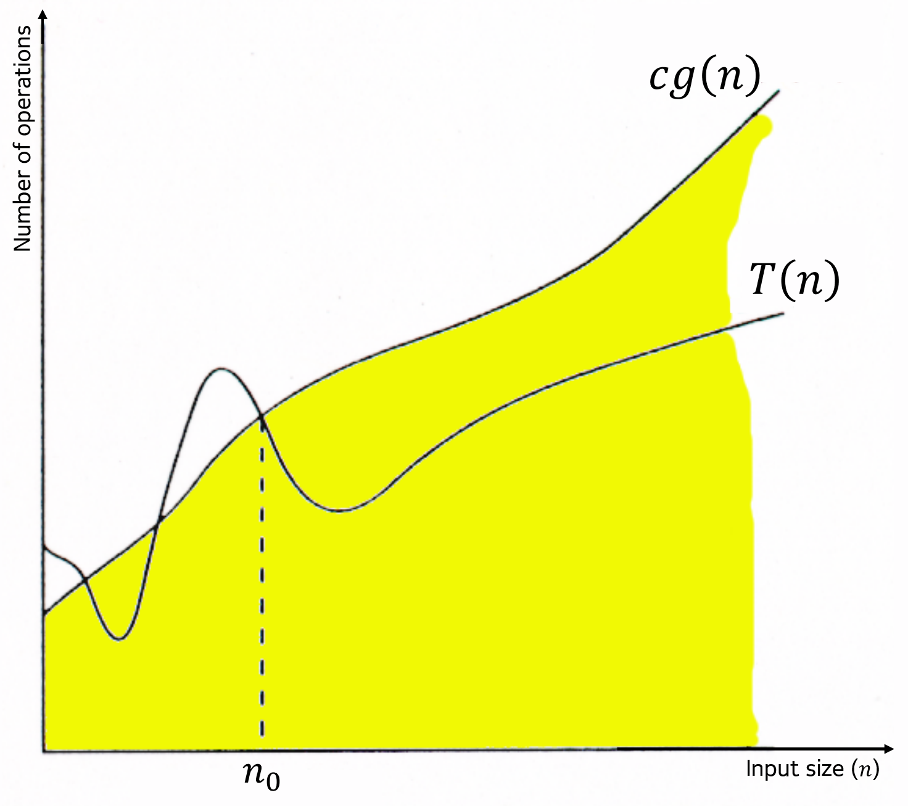
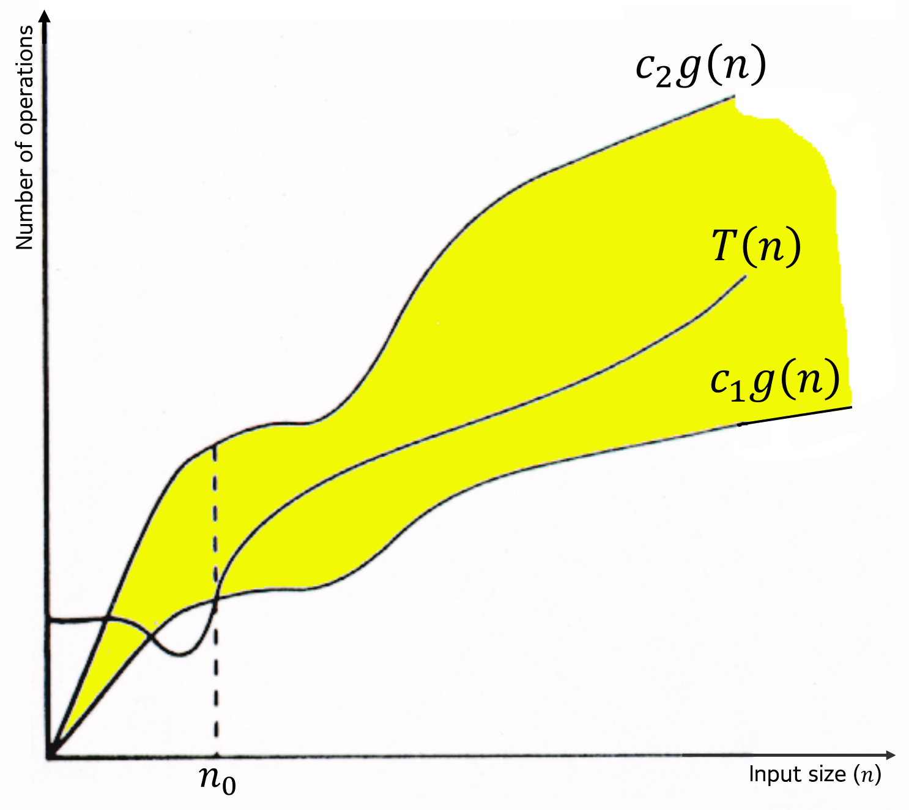
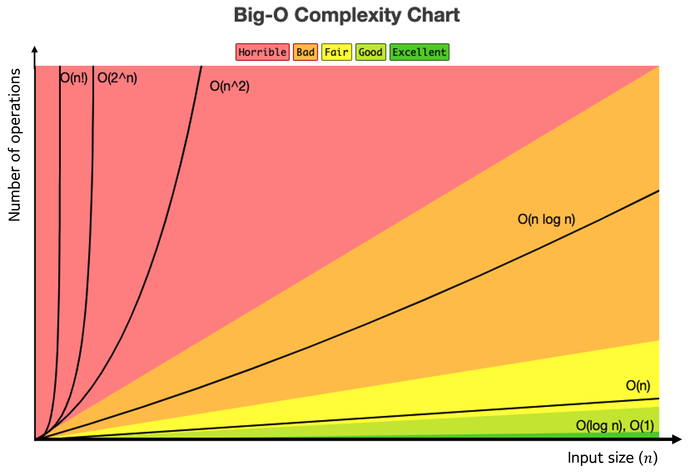

# Time Complexity
- ### Number of operations：$T\left(n\right) \approx c\times g\left(n\right)$
    - $n = \text{Input size}$
    - $c = \text{Constant}$
    - $g\left(n\right) = \text{the dominant term of }T(n)\text{ ignoring coefficients}$
- ### Time Complexity：$f\left(n\right)$
    |Time Complexity|Notation|Definition ($\text{for }n\ge n_0$)||
    |:---:|:---:|:---:|:---:|
    |Worst-case (Upper Bound)|Big O Notation $T\left(n\right)=O\left(g\left(n\right)\right)$| $T\left(n\right) \le c\times g\left(n\right)$|
    |Best-case (Lower Bound)|Big Ω Notation $T\left(n\right)=Ω\left(g\left(n\right)\right)$| $T\left(n\right) \ge c\times g\left(n\right)$|
    |Average-case|Big Θ Notation $T\left(n\right)=Θ\left(g\left(n\right)\right)$| $c_1\times g\left(n\right) \le T\left(n\right) \le c_2\times g\left(n\right)$|
    - #### Strict Bounds
        |Time Complexity|Notation|Definition ($\text{for }n\ge n_0$)||
        |:---:|:---:|:---:|:---:|
        |Worst-case Time Complexity (Strict Upper Bound)|Little o Notation $T\left(n\right)=o\left(g\left(n\right)\right)$|$T\left(n\right) < c\times g\left(n\right)$|
        |Best-case Time Complexity (Strict Lower Bound)|Little ω Notation $T\left(n\right)=ω\left(g\left(n\right)\right)$|$T\left(n\right) > c\times g\left(n\right)$|
- #### Example
    - number of operations：$T\left(n\right)=2n^2+n+1$
    - Time Complexity (Worst-case) = $O\left(n^2\right)$
- ### Common Time Complexities
    

    |Time Complexity|$O\left(g\left(n\right)\right)$ ($a>1,~b>1$)|Name|Example|
    |:---:|:---:|:---:|:---:|
    |Faster|$O\left(1\right)$|Constant time||
    |$\downarrow$|$O\left(\log_a{n}\right)$|Logarithmic time|[Binary search](./sorting-and-search-algorithm/search-algorithm/types-of-searching/ordered-search.md#binary-search)|
    |$\downarrow$|$O\left(\left(\log_a{n}\right)^b\right)$|Polylogarithmic time|||
    |$\downarrow$|$O\left(n\right)$|Linear time|[Linear search](./sorting-and-search-algorithm/search-algorithm/types-of-searching/unordered-search.md#linear-search-sequential-search)|
    |$\downarrow$|$O\left(n\log_a{n}\right)$|Linearithmic time|[Merge sort](./sorting-and-search-algorithm/sorting-algorithm/types-of-sorting/comparison-sort.md#merge-sort)|
    |$\downarrow$|$O\left(n^2\right)$|Quadratic time|[Bubble sort](./sorting-and-search-algorithm/sorting-algorithm/types-of-sorting/comparison-sort.md#bubble-sort), [Insertion sort](./sorting-and-search-algorithm/sorting-algorithm/types-of-sorting/comparison-sort.md#insertion-sort), [Selection sort](./sorting-and-search-algorithm/sorting-algorithm/types-of-sorting/comparison-sort.md#selection-sort)|
    |$\downarrow$|$O\left(n^a\right)$|Polynomial time (P)|[Matrix multiplication](matrix-multiplication.md#matrix-multiplication)|
    |$\downarrow$|$O\left(a^n\right)$|Exponential time||
    |Slower|$O\left(n!\right)$|Factorial time||

# Space Complexity

# Computational Complexity Theory

- ### Nondeterministic Polynomial Time (NP)
- ### Polynomial Time (P)
    - $\text{P} \subseteq \text{NP}$
- ### NP-Hard
- ### NP-Complete
    - $\text{NP-Complete}=\text{NP}\cap \text{NP-Hard}$

# Master Theorem
- ### Master Theorem：$T\left(n\right)=aT\left(\frac{n}{b}\right)+f\left(n\right)$

# Amortized Analysis
