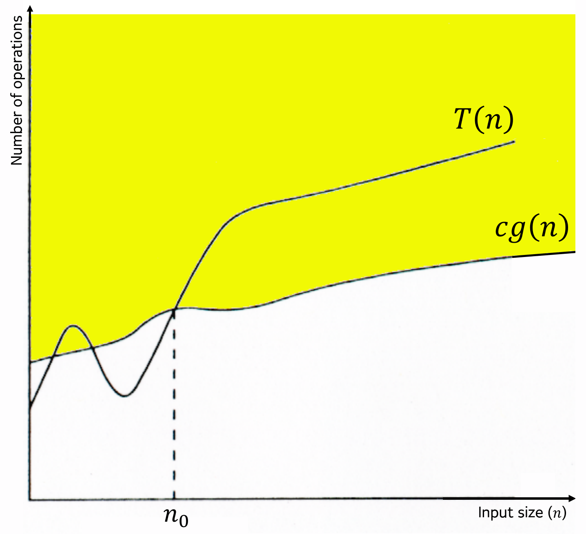

# Time Complexity
- ### Number of operations：$T\left(n\right)$
    - $n = \text{Input size}$
    - $c = \text{Constant}$
- ### Asymptotic Notation
    <table border="1">
        <thead>
            <tr>
                <th align="center">Time Complexity</th>
                <th align="center">Asymptotic Notation</th>
                <th align="center">Definition ($\text{for }n\ge n_0$)</th>
                <th align="center">Limit</th>
            </tr>
        </thead>
        <tr>
            <th align="center">Worst-case (Upper Bound)</th>
            <td align="center">Big O Notation $T\left(n\right)=O\Bigl(g\left(n\right)\Bigr)$</td>
            <td align="center"> $T\left(n\right) \le c\times g\left(n\right)$</td>
            <td align="center" rowspan="3"> $\lim\limits_{n\to\infty}{\frac{T\left(n\right)}{g\left(n\right)}}=c_l$   $T\left(n\right) \approx c_l\times g\left(n\right)$   $c_l=\text{the Leading Coefficient of }T\left(n\right)$   $g\left(n\right) = \text{the Dominant Term of }T\left(n\right)\text{ ignoring coefficients} \left(c_l\right)$ </td>
        </tr>
        <tr>
            <th align="center">Best-case (Lower Bound)</th>
            <td align="center">Big Ω Notation $T\left(n\right)=Ω\Bigl(g\left(n\right)\Bigr)$</td>
            <td align="center"> $T\left(n\right) \ge c\times g\left(n\right)$</td>
        </tr>
        <tr>
            <th align="center">Average-case (Tight Bound)</th>
            <td align="center">Big Θ Notation $T\left(n\right)=Θ\Bigl(g\left(n\right)\Bigr)$</td>
            <td align="center"> $c_1\times g\left(n\right) \le T\left(n\right) \le c_2\times g\left(n\right)$</td>
        </tr>
    </table>

    - #### Strict Bounds
        |Time Complexity|Asymptotic Notation|Definition ($\text{for }n\ge n_0$)|Limit|
        |:---:|:---:|:---:|:---:|
        |**Worst-case (Strict Upper Bound)**|Little o Notation $T\left(n\right)=o\Bigl(g\left(n\right)\Bigr)$|$T\left(n\right) < c\times g\left(n\right)$|$\lim\limits_{n\to\infty}{\frac{T\left(n\right)}{g\left(n\right)}}=0$|
        |**Best-case (Strict Lower Bound)**|Little ω Notation $T\left(n\right)=ω\Bigl(g\left(n\right)\Bigr)$|$T\left(n\right) > c\times g\left(n\right)$|$\lim\limits_{n\to\infty}{\frac{T\left(n\right)}{g\left(n\right)}}=\infty$|
- #### Example
    - number of operations：$T\left(n\right)=2n^2+n+1$
    - Time Complexity
        <table border="1">
            <thead>
                <tr>
                    <th align="center">Time Complexity</th>
                    <th align="center">Limit</th>
                    <th align="center">$g\left(n\right)$</th>
                    <th align="center">$T\left(n\right)$</th>
                </tr>
            </thead>
            <tr>
                <th align="center">Upper Bound</th>
                <td align="center" rowspan="3"> $\lim\limits_{n\to\infty}{\frac{2n^2+n+1}{g\left(n\right)}}=2 \implies \lim\limits_{n\to\infty}{\frac{2n^2+n+1}{n^2}}=2$ </td>
                <td align="center" rowspan="3">$g\left(n\right)=n^2$</td>
                <td align="center">$T\left(n\right)=O\left(n^2\right)$</td>
            </tr>
            <tr>
                <th align="center">Lower Bound</th>
                <td align="center">$T\left(n\right)=Ω\left(n^2\right)$</td>
            </tr>
            <tr>
                <th align="center">Tight Bound</th>
                <td align="center">$T\left(n\right)=Θ\left(n^2\right)$</td>
            </tr>
            <tr>
                <th align="center">Strict Upper Bound</th>
                <td align="center">$\lim\limits_{n\to\infty}{\frac{2n^2+n+1}{g\left(n\right)}}=0 \implies \lim\limits_{n\to\infty}{\frac{2n^2+n+1}{n^3}}=0$</td>
                <td align="center">$g\left(n\right)=n^3$</td>
                <td align="center">$T\left(n\right)=o\left(n^3\right)$</td>
            </tr>
            <tr>
                <th align="center">Strict Lower Bound</th>
                <td align="center">$\lim\limits_{n\to\infty}{\frac{2n^2+n+1}{g\left(n\right)}}=\infty \implies \lim\limits_{n\to\infty}{\frac{2n^2+n+1}{n}}=\infty$</td>
                <td align="center">$g\left(n\right)=n$</td>
                <td align="center">$T\left(n\right)=ω\left(n\right)$</td>
            </tr>
        </table>
- ### Order of Growth
    
    <table border="1">
        <thead>
            <tr>
                <th align="center">Time Complexity</th>
                <th align="center">$O\Bigl(g\left(n\right)\Bigr)$ ($a>1,~b>1$)</th>
                <th align="center">Name</th>
                <th align="center">Example</th>
            </tr>
        </thead>
        <tr>
            <td align="center" rowspan="9">Faster $\downarrow$ Slower</td>
            <th align="center">$O\left(1\right)$</th>
            <th align="center">Constant time</th>
        </tr>
        <tr>
            <th align="center">$O\left(\log_a{n}\right)$</th>
            <th align="center">Logarithmic time</th>
            <th align="center"> <a href="../sorting-and-search-algorithm/search-algorithm/types-of-searching/ordered-search.md#binary-search">Binary search</a> </th>
        </tr>
        <tr>
            <th align="center">$O\left(\left(\log_a{n}\right)^b\right)$</th>
            <th align="center">Polylogarithmic time</th>
        </tr>
        <tr>
            <th align="center">$O\left(n\right)$</th>
            <th align="center">Linear time</th>
            <th align="center"> <a href="../sorting-and-search-algorithm/search-algorithm/types-of-searching/unordered-search.md#linear-search-sequential-search">Linear search</a> </th>
        </tr>
        <tr>
            <th align="center">$O\left(n\log_a{n}\right)$</th>
            <th align="center">Linearithmic time</th>
            <th align="center"> <a href="../sorting-and-search-algorithm/sorting-algorithm/types-of-sorting/comparison-sort.md#merge-sort">Merge sort</a> </th>
        </tr>
        <tr>
            <th align="center">$O\left(n^2\right)$</th>
            <th align="center">Quadratic time</th>
            <th align="center"> <a href="../sorting-and-search-algorithm/sorting-algorithm/types-of-sorting/comparison-sort.md#bubble-sort">Bubble sort</a>, <a href="../sorting-and-search-algorithm/sorting-algorithm/types-of-sorting/comparison-sort.md#insertion-sort">Insertion sort</a>, <a href="../sorting-and-search-algorithm/sorting-algorithm/types-of-sorting/comparison-sort.md#selection-sort">Selection sort</a> </th>
        </tr>
        <tr>
            <th align="center">$O\left(n^a\right)$</th>
            <th align="center"> <a href="/stem/it/computer-science/theory-of-computation/computational-complexity-theory/computational-complexity-theory.md#polynomial-time-p">Polynomial time (P)</a> </th>
            <th align="center"> <a href="../matrix-multiplication.md#matrix-multiplication">Matrix multiplication</a> </th>
        </tr>
        <tr>
            <th align="center">$O\left(a^n\right)$</th>
            <th align="center"> <a href="/stem/it/computer-science/theory-of-computation/computational-complexity-theory/computational-complexity-theory.md#exponential-time-exptime">Exponential time (EXPTIME)</a> </th>
        </tr>
        <tr>
            <th align="center">$O\left(n!\right)$</th>
            <th align="center">Factorial time</th>
        </tr>
    </table>
- ### Properties of Time Complexity
    - $T\left(n\right)=O\Bigl(T\left(n\right)\Bigr)$
    - $\text{If }T\left(n\right)=O\Bigl(g\left(n\right)\Bigr),~\text{then }g\left(n\right)=Ω\Bigl(T\left(n\right)\Bigr)$
    - $\text{If }T_1\left(n\right)=O\Bigl(g_1\left(n\right)\Bigr)\text{ and }T_2\left(n\right)=O\Bigl(g_2\left(n\right)\Bigr),~\text{then }T_1\left(n\right)+T_2\left(n\right)=O\biggl(\max{ \Bigl( g_1\left(n\right),~g_2\left(n\right) \Bigr) }\biggr)$
    - $\text{If }T\left(n\right)=O\Bigl(g\left(n\right)\Bigr)\text{ and }g\left(n\right)=O\Bigl(h\left(n\right)\Bigr),~\text{then }T\left(n\right)=O\Bigl(h\left(n\right)\Bigr)$
- ### [Time Complexity Class](/stem/it/computer-science/theory-of-computation/computational-complexity-theory/computational-complexity-theory.md#time-complexity-classes-1)

# Space Complexity
- ### [Space Complexity Class](/stem/it/computer-science/theory-of-computation/computational-complexity-theory/computational-complexity-theory.md#space-complexity-classes-1)

# [Computational Complexity Theory](/stem/it/computer-science/theory-of-computation/computational-complexity-theory/computational-complexity-theory.md)
- ### [Polynomial-time Reduction](/stem/it/computer-science/theory-of-computation/computational-complexity-theory/polynomial-time-reduction.md)

# [Solving Recurrence Relations](solving-recurrence-relations.md)
- ### [Substitution method](solving-recurrence-relations.md#substitution-method)
- ### [Recursion-Tree method](solving-recurrence-relations.md#recursion-tree-method)
- ### [Master method](solving-recurrence-relations.md#master-method)

# Amortized Analysis
