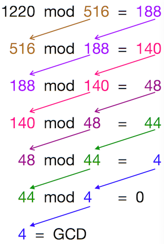

# Greatest Common Divisor (GCD)
- ### $\gcd{\left(a,~b\right)} = \begin{cases} a & \text{if }b=0 \\ \gcd{\left(b,~a\bmod b\right)} & \text{else} \end{cases},~a\ge0,~b\ge0$
    |$a,~b$|$\gcd{\left(a,~b\right)}$|
    |:---:|:---:|
    |$a>b$|$\gcd{\left(a,~b\right)} = \gcd{\left(b,~a\bmod b\right)}$|
    |$a=b$|$\gcd{\left(a,~a\right)} = \gcd{\left(a,~a\bmod a\right)} = \gcd{\left(a,~0\right)} = a$|
    |$a<b$|$\gcd{\left(a,~b\right)} = \gcd{\left(b,~a\bmod b\right)} = \gcd{\left(b,~a\right)}$|
    |$a=0$|$\gcd{\left(0,~b\right)} = \gcd{\left(b,~0\bmod b\right)} = \gcd{\left(b,~0\right)} = b$|
- ### GCD in C
    ```c
    int gcd(int a, int b){
        if(b == 0) return a;
        else return gcd(b, a%b);
    }
    ```
- ### Example：$\gcd{\left(1220,~516\right)}$
    
    

# Least Common Multiple (LCM)
- ### $\text{lcm}\left(a,~b\right) = \frac{|a\times b|}{\gcd{\left(a,~b\right)}}$
- ### LCM in C
    ```c
    int gcd(int a, int b){
        if(b == 0) return a;
        else return gcd(b, a%b);
    }
    
    int lcm(int a, int b){
        return (a*b)/gcd(a, b)
    }
    ```

# Extended Euclidean Algorithm
- ### $ax+by=\gcd{\left(a,~b\right)}$
- ### [Modular Multiplicative Inverse](/stem/math/discrete-mathematics/number-theory/modular-arithmetic.md#modular-multiplicative-inverse)
