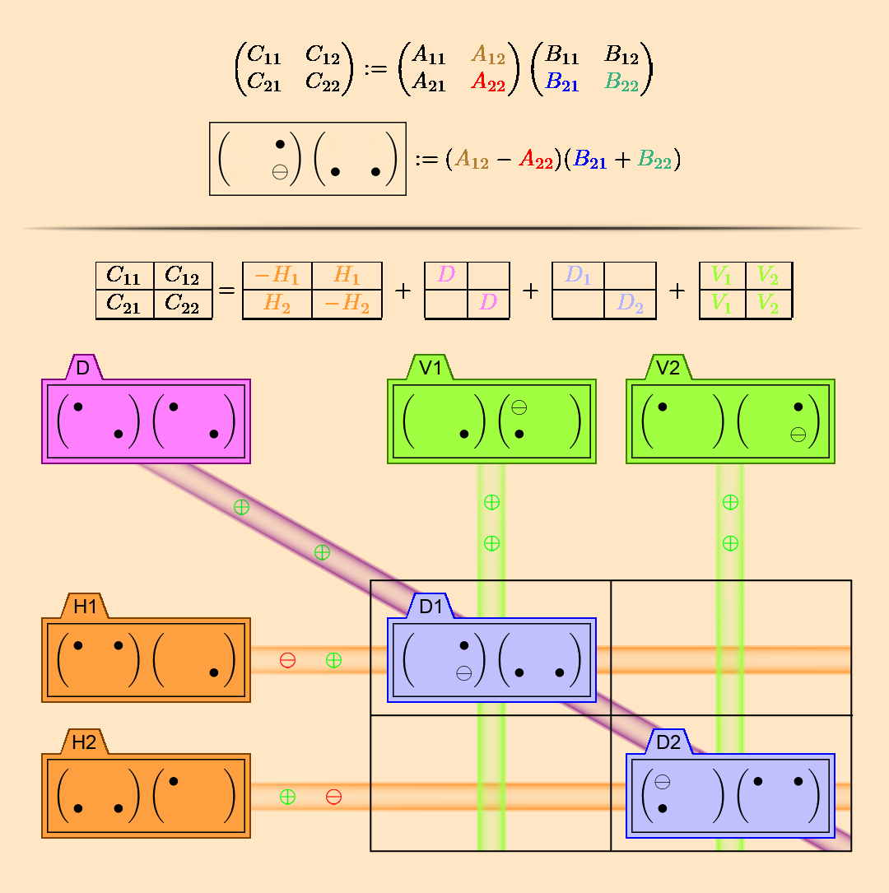

# Matrix Multiplication

# Strassen Algorithm

- $C=AB$
    - $A=\begin{bmatrix} A_{11}&A_{12} \\ A_{21}&A_{22} \end{bmatrix} ,~ B=\begin{bmatrix} B_{11}&B_{12} \\ B_{21}&B_{22} \end{bmatrix} ,~ C=\begin{bmatrix} C_{11}&C_{12} \\ C_{21}&C_{22} \end{bmatrix}$
- ### Term
    - #### Diagonal Term
        - $D=\left(A_{11}+A_{22}\right)\left(B_{11}+B_{22}\right)$
        - $D_1=\left(A_{12}-A_{22}\right)\left(B_{21}+B_{22}\right)$
        - $D_2=\left(-A_{11}+A_{21}\right)\left(B_{11}+B_{12}\right)$
    - #### Vertical Term
        - $V_1=A_{22}\left(-B_{11}+B_{21}\right)$
        - $V_2=A_{11}\left(B_{12}-B_{22}\right)$
    - #### Horizontal Term
        - $H_1=\left(A_{11}+A_{12}\right)B_{22}$
        - $H_2=\left(A_{21}+A_{22}\right)B_{11}$
- ### Combination
    - $C_{11}=-H_1+D+D_1+V_1$
    - $C_{12}=H_1+V_2$
    - $C_{21}=H_2+V_1$
    - $C_{22}=-H_2+D+D_2+V_2$

# Matrix Chain Multiplication

# Matrix Fast Exponentiating by Squaring
- ### [Matrix Fast Exponentiating by Squaring](fast-exponentiation.md#matrix-fast-exponentiating-by-squaring)
