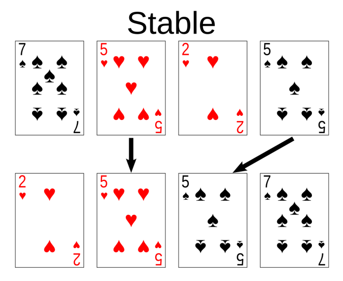
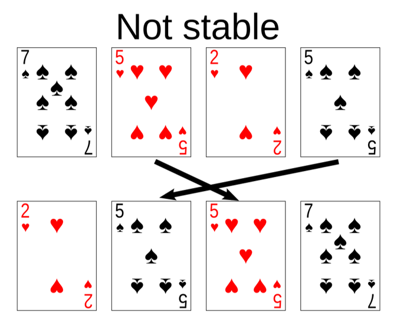

# Types of Sorting
- ### [Comparison Sort](./types-of-sorting/comparison-sort.md)
- ### [Linear Sort](./types-of-sorting/linear-sort.md)

# Properties of Sorting
- ### Stability
    |Stability|Definition|Example|
    |:---:|:---:|:---:|
    |Stable sorting| Sort equal elements while maintaining their original relative order|[Bubble Sort](./types-of-sorting/comparison-sort.md#bubble-sort), [Insertion Sort](./types-of-sorting/comparison-sort.md#insertion-sort), [Merge Sort](./types-of-sorting/comparison-sort.md#quick-sort), [Counting Sort](./types-of-sorting/linear-sort.md#counting-sort)|
    |Unstable sorting (Not stable sorting)| Sort equal elements but may change their original relative order|[Quick Sort](./types-of-sorting/comparison-sort.md#quick-sort), [Heap Sort](./types-of-sorting/comparison-sort.md#heap-sort), [Selection Sort](./types-of-sorting/comparison-sort.md#selection-sort)|
- ### Space used
    |Space used|Definition|[Auxiliary Space Complexity](../../complexity/complexity.md#auxiliary-space-complexity)|Example|
    |:---:|:---:|:---:|:---:|
    |In-place sorting|Sorts the data on the original data structure using little or no additional memory|Low (typically $O\left(1\right)$ or $O\left(\log{n}\right)$)|[Bubble Sort](./types-of-sorting/comparison-sort.md#bubble-sort), [Insertion Sort](./types-of-sorting/comparison-sort.md#insertion-sort), [Quick Sort](./types-of-sorting/comparison-sort.md#quick-sort)|
    |Not-in-place sorting (Out-of-place sorting)|Requires additional memory to store the data during the sorting process|High (typically $O\left(n\right)$ or more)|[Merge Sort](./types-of-sorting/comparison-sort.md#quick-sort), [Counting Sort](./types-of-sorting/linear-sort.md#counting-sort), [Radix Sort](./types-of-sorting/linear-sort.md#radix-sort)|
