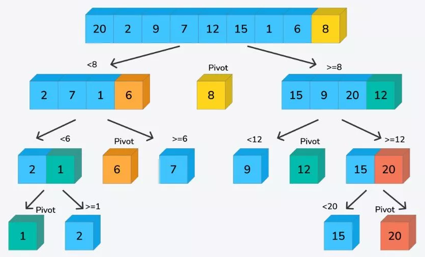
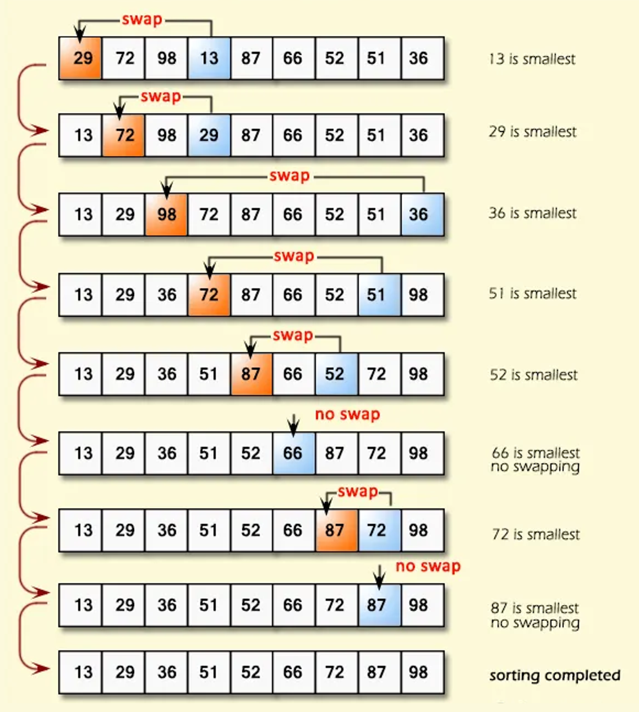

# Bubble Sort
- ### Cocktail Sort

# Quick Sort
- ### Hoare Partition
- ### Lomuto Partition
- ### Example
    

# Merge Sort

# [Heap](/stem/it/coding/programming-language/data-structures-and-algorithms/data-structure/graph/tree/types-of-trees/binary-tree/types-of-binary-trees/complete-binary-tree/binary-heap.md) Sort

# Insertion Sort
- ### Shell Sort

# Selection Sort
- ### Example
    

