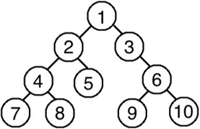
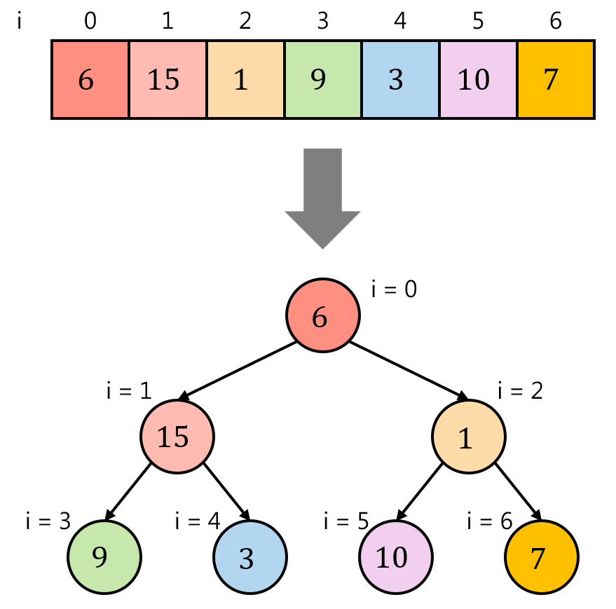
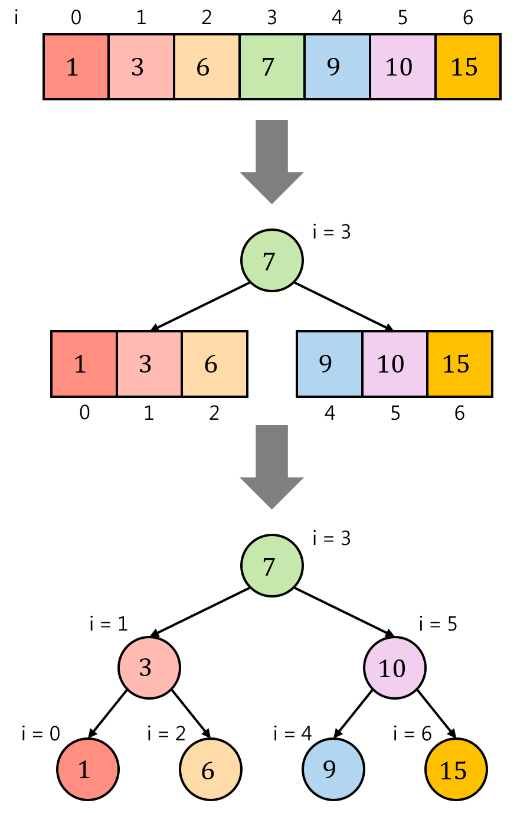
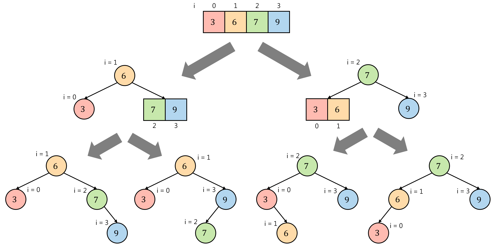

# Types of Binary Trees
- ### Complete Binary Tree
    - ### [Binary Heap](./types-of-binary-trees/complete-binary-tree/binary-heap.md)
- ### [Binary Search Tree (BST)](./types-of-binary-trees/binary-search-tree/binary-search-tree.md)
    - ### [Self-balancing BST](./types-of-binary-trees/binary-search-tree/binary-search-tree.md#self-balancing-bst)
- ### [Binary Expression Tree](./types-of-binary-trees/binary-expression-tree.md)
- ### [Huffman Tree](/stem/it/computer-science/data-representation/encoding/compression-encoding.md#huffman-tree)
    - #### [Huffman Coding](/stem/it/computer-science/data-representation/encoding/compression-encoding.md#huffman-coding)
- ### Threaded Binary Tree
- ### Segment Tree
- ### Binary Indexed Tree (Fenwick Tree)
- ### Degenerate Binary Tree

# Binary Tree Traversal
- ### [Depth-First-Search (DFS)](../../../graph-algorithms/graph-traversal.md#dfs)
    - ### Preorder：**[Root Node](../../tree.md#node)** $\to$ [Left Subtree](../../tree.md#subtree) $\to$ [Right Subtree](../../tree.md#subtree) {#preorder}
    - ### Inorder：[Left Subtree](../../tree.md#subtree) $\to$ **[Root Node](../../tree.md#node)** $\to$ [Right Subtree](../../tree.md#subtree) {#inorder}
    - ### Postorder：[Left Subtree](../../tree.md#subtree) $\to$ [Right Subtree](../../tree.md#subtree) $\to$ **[Root Node](../../tree.md#node)** {#postorder}
- ### [Breadth-First-Search (BFS)](../../../graph-algorithms/graph-traversal.md#bfs)
    - ### Level-order：Top $\to$ Bottom, Same [Level](../../tree.md#height-and-depth) (Left $\to$ Right) {#level-order}
- ### Example
    

    - Preorder：**1**→2→4→7→8→5→3→6→9→10
    - Inorder：7→4→8→2→5→**1**→3→9→6→10
    - Postorder：7→8→4→5→2→9→10→6→3→**1**
    - Level-order：**1**→2→3→4→5→6→7→8→9→10

# Convert Array to Binary Tree
- ### Convert Array to [Complete Binary Tree](#complete-binary-tree)
    - Index = i
    - [Root Node](../../tree.md#node) = First element (i = 0)
    - For the element at i
        - [Parent Node](../../tree.md#node) = `(i - 1) // 2`
        - [Left Child Node](../../tree.md#node) = `2 * i + 1`
        - [Right Child Node](../../tree.md#node) = `2 * i + 2`
    - Example

        
- ### Convert Sorted Array to [Binary Search Tree](./types-of-binary-trees/binary-search-tree/binary-search-tree.md)
    |Array Length|[Root Node](../../tree.md#node)|Example|
    |:---:|:---:|:---:|
    |Odd|`(left + right) // 2`||
    |Even|`(left + right) // 2` or `(left + right +1) // 2`||

