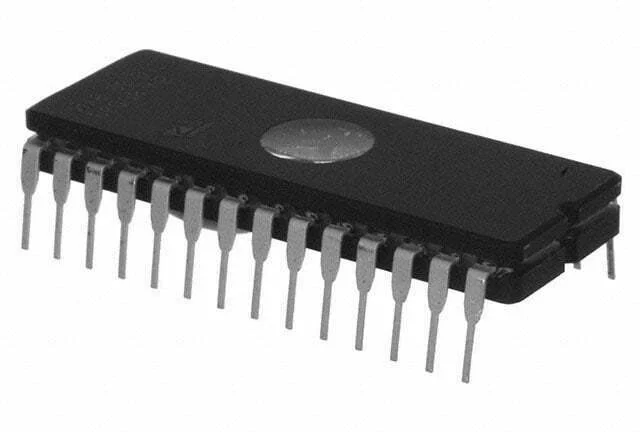
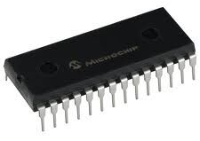

# Non-Volatile RAM (NVRAM)
- ### Resistive RAM (RRAM)

# Read Only Memory (ROM)
- ### Programmable ROM (PROM)
    - #### Erasable PROM (EPROM)
        
    - #### Electrically-Erasable PROM (EEPROM)
        

# Solid-State Storage
- ### [Flash Memory](flash-memory.md)

# [Magnetic Storage](magnetic-storage.md)
- ### [Hard Disk Drive (HDD)](magnetic-storage.md#hard-disk-drive-hdd)
- ### [Floppy Disk](magnetic-storage.md#floppy-disk)
- ### [Magnetic Tape](magnetic-storage.md#magnetic-tape)

# Disk Storage
- ### [SSD](flash-memory.md#solid-state-drive-ssd)
- ### [HDD](magnetic-storage.md#hard-disk-drive-hdd)
- ### [Floppy Disk](magnetic-storage.md#floppy-disk)
- ### [Optical Disc](optical-disc.md)
- ### [Redundant Array of Independent Disks (RAID)](raid.md)

# 3D XPoint
