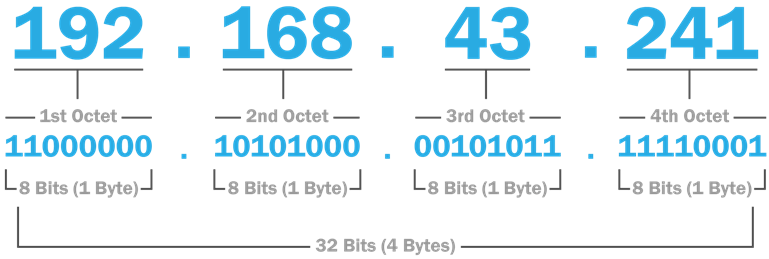
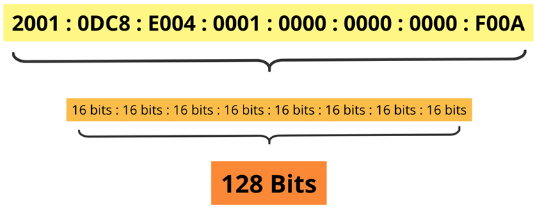
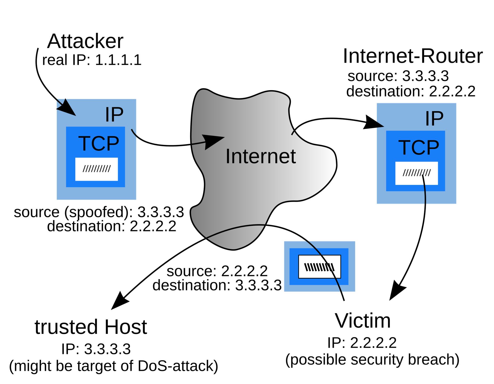

# IP Address
- ### IP Address = [Network address](#network-address)＋[Host address](#host-address)
    - ### IPv4 Address
        
    - ### IPv6 Address
        
- ### [IP Address Components](#ip-address-components-1)
- ### IP Address Spoofing
    

# IP Address Components
- ### Network address
- ### Host address

# Classful and Classless Addressing
- ### Classful Addressing
- ### Classless Inter-Domain Routing (CIDR)

# Subnetwork
- ### Subnet Mask
- ### Variable Length Subnet Mask (VLSM)

# Private Network
- ### Private IPv4 Addresses
    |RFC 1918 name|IP address range||
    |:---:|:---:|:---:|
    |24-bit block|`10.0.0.0`~`10.255.255.255`|
    |20-bit block|`172.16.0.0`~`172.31.255.255`|
    |16-bit block|`192.168.0.0`~`192.168.255.255`|
    - #### RFC 1918
- ### Private IPv6 Addresses (Unique Local Addresses, ULA)
    - #### RFC 4193
- ### Link-Local Address

# Voice over Internet Protocol (VoIP)

