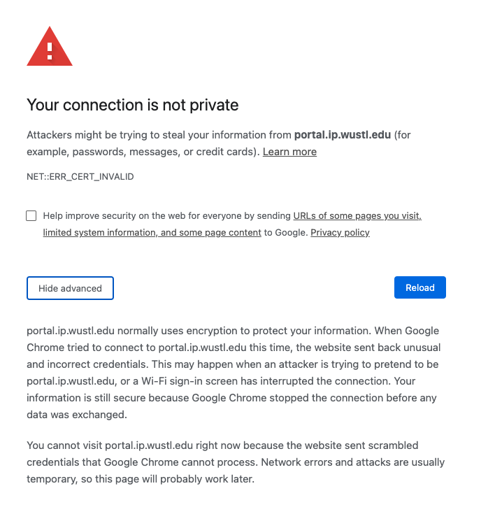

# TLS/SSL
- ### Layer：[Transport layer](../protocol-layer.md#transport-layer) < TLS/SSL < [Application layer](../protocol-layer.md#application-layer)
- ### Protocol + S = Protocol Secure (Protocol over TLS/SSL) = Protocol + TLS/SSL
- ### Evolution：Secure Sockets Layer (SSL) $\to$ Transport Layer Security (TLS)
- ### Workflow：TCP Three-way Handshake $\to$ TLS Handshake $\to$ Encrypted Data Transfer

# SSL Error
- ### Certificate Error
    
- ### Bypass Keyword
    - typing `thisisunsafe` allowed users to bypass a security warning
