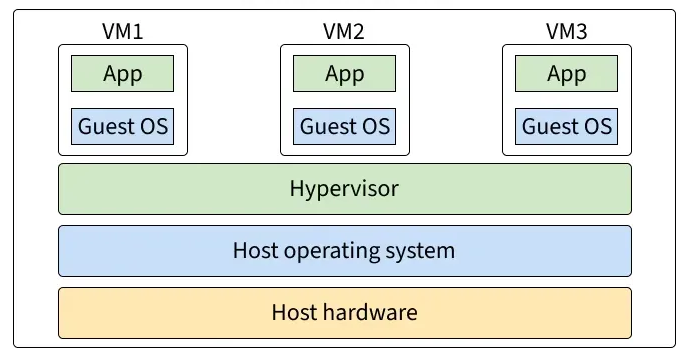

# Virtual Machine (VM)

- ### Kernel-based Virtual Machine (KVM)
- ### VirtualBox
- ### Quick Emulator (QEMU)
- ### [Java Virtual Machine (JVM)](../../../coding/programming-language/types-of-programming-language/oop/java/java.md#java-virtual-machine-jvm)
- ### Hyper-V
    - ### [Windows Subsystem for Linux 2 (WSL 2)](/stem/it/cli/powershell/wsl.md)
    - ### Windows Subsystem for Android (WSA)

# Operating System-level Virtualization (Containerization)
- ### Docker
