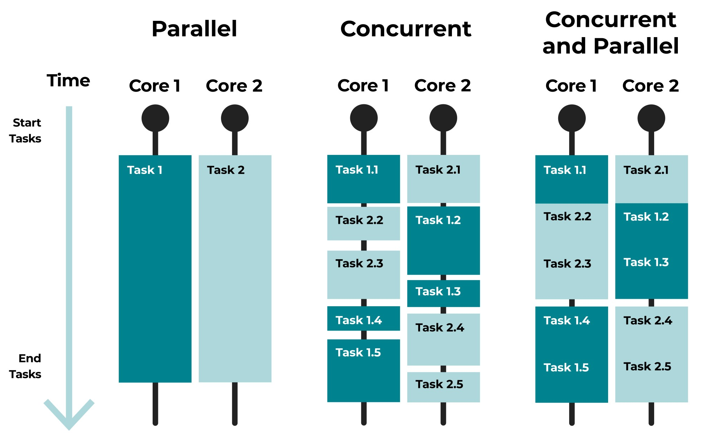
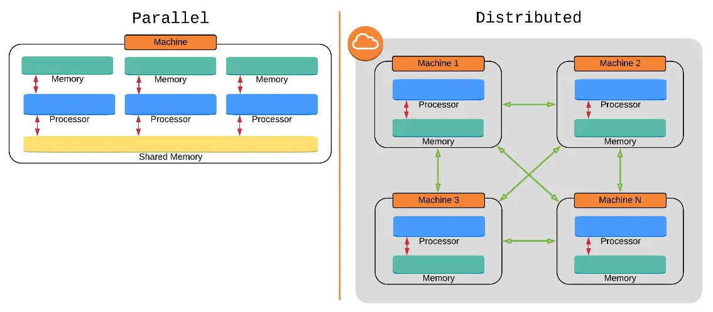

# Concurrent Computing (Concurrency)
||Concurrent Computing (Concurrency)|[Parallel Computing (Parallelism)](./parallel-computing/parallel-computing.md)|[Distributed Computing](./distributed-computing/distributed-computing.md)|
|:---:|:---:|:---:|:---:|
|**Definition**|Multiple tasks execute during overlapping periods of time|Multiple tasks execute simultaneously at the exact same time|Multiple tasks execute across multiple network-connected computers|
|**Requires Multi-core Processor**|No|Usually Yes|Not necessarily|
|**Requires Multiple Computers**|No|No|Yes|
- ### Concurrent Computing vs [Parallel Computing](./parallel-computing/parallel-computing.md)
    
- ### [Parallel Computing](./parallel-computing/parallel-computing.md) vs [Distributed Computing](./distributed-computing/distributed-computing.md)
    

# [Parallel Computing (Parallelism)](./parallel-computing/parallel-computing.md)
- ### [Multiprocessing](./parallel-computing/multiprocessing/multiprocessing.md)
- ### [Pipeline](./parallel-computing/pipeline/pipeline.md)
- ### [Tomasulo Algorithm](./parallel-computing/tomasulo-algorithm.md)

# [Distributed Computing](./distributed-computing/distributed-computing.md)
- ### [Distributed Computing System Models](./distributed-computing/distributed-computing-system-models/distributed-computing-system-models.md)
- ### [Cloud Computing](./distributed-computing/cloud-computing.md)

# Multiprogramming

# Multitasking
- ### preemptive
- ### nonpreemptive

# Critical Section
- ### Requirements for a Solution
    - #### Mutual Exclusion
    - #### Progress
    - #### Bounded Waiting

# Race Condition

# Deadlock

# Starvation

