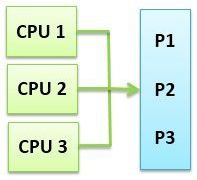
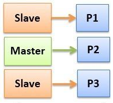

# Multiprocessing

# Types of Multiprocessing
- ### Symmetric Multiprocessing
    
- ### Asymmetric Multiprocessing
    
    
    - #### Master Processor：controls system operation, assigns specific tasks, manages resources
    - #### Slave Processors：execute assigned tasks

# Memory Architecture
- ### [Shared Memory](./memory-architecture/shared-memory.md)
- ### [Distributed Memory](./memory-architecture/distributed-memory.md)

# Processor Affinity

