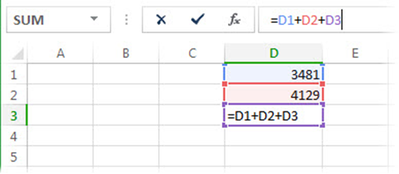

# [Database System](./database-system/database-system.md)
- ### [Entity-Relationship Model (ER Model)](./database-system/data-model/conceptual-data-model/er-model.md)
- ### [Relational Model](./database-system/data-model/logical-data-model/relational-model/relational-model.md)
- ### [Structured Query Language (SQL)](/stem/it/coding/query-language/sql.md)
- ### [Integrity Constraints](./database-system/data-integrity/integrity-constraints.md)

# Spreadsheet
- ### cell
    - #### row, column
    - #### range
- ### Circular Reference
    

# Data Engineering
- ### [Data Engineering](data-engineering.md)

# Data Mining

# Electronic Commerce(E-Commerce)
- ### Amazon
- ### eBay
- ### Uber Eats
- ### Netflix

