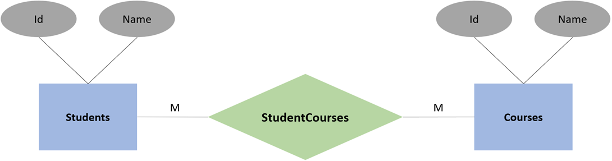
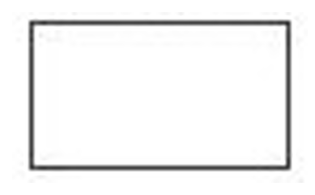
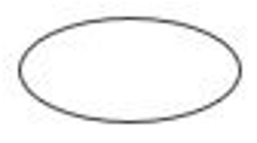
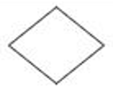
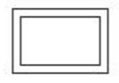
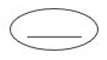
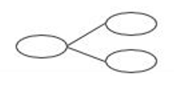
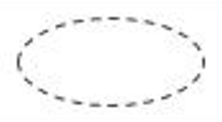
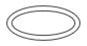
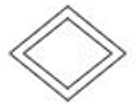

# Entity-Relationship Diagram (ER Diagram)

- ### [Element](../../database-system.md#element)
    |Element|Figure|
    |:---:|:---:|
    |**[Entity](#entity)**| Rectangle|
    |**[Attribute](#attribute)**| Ellipse|
    |**[Relationship](#relationship)**| Diamond|

# Entity
|Entity|Definition|Figure|
|:---:|:---:|:---:|
|**Strong Entity**|An entity that can exist independently of other entities and has its own key attribute| Rectangle|
|**Owner Entity**|A strong entity that provides the key attribute necessary to uniquely identify a dependent weak entity| Rectangle|
|**Weak Entity**|An entity that cannot exist independently and relies on an owner entity for its identification| Double-lined rectangle|
- ### Entity Roles
    |Entity|Definition|
    |:---:|:---:|
    |Parent Entity|An entity that provides its key attribute to another entity|
    |Child Entity|An entity that contains a key attribute referencing a parent entity|

# Attribute
|Attribute|Definition|Figure|
|:---:|:---:|:---:|
|**Key Attribute**|An attribute that uniquely identifies each entity| Ellipse with underline|
|**Composite Attribute**|An attribute that can be divided into smaller sub-attributes with independent meanings| Ellipse branched into sub-ellipses|
|**Derived Attribute**|An attribute whose value is calculated or deduced from other attributes| Dashed ellipse|
|**Multivalued Attribute**|An attribute that has more than one value for a single entity| Double-lined ellipse|

# Relationship
|Relationship|Definition|Figure|
|:---:|:---:|:---:|
|**Non-Identifying Relationship**|A relationship that connects strong entities| Diamond|
|**Identifying Relationship**|A relationship that connects a weak entity to its owner entity| Double-lined Diamond|

# Notation
- ### Chen Notation
- ### Crow's Foot Notation

# Cardinality Constraint
- ### One-to-One (1:1)
- ### One-to-Many (1:M)
- ### Many-to-One (M:1)
- ### Many-to-Many (M:N)
