# Entity Relationship Diagram (ERD)

- ### [Element](../../database-system.md#element)
    |Element|Definition|[Entity Relationship Diagram (ERD)](#entity-relationship-diagram-erd)|
    |:---:|:---:|:---:|
    |**[Entity (Entity Type)](#entity-entity-type)**|A collection of [entity instance](#entity-instance)| Rectangle|
    |**[Attribute](#attribute)**|A unique identifier of data| Ellipse|
    |**[Relationship](#relationship)**|An association connection among two or more [entity types](#entity-entity-type)| Diamond|

# Entity (Entity Type)
|Entity|Definition|[Entity Relationship Diagram (ERD)](#entity-relationship-diagram-erd)|
|:---:|:---:|:---:|
|**Strong Entity**|An entity that can exist independently of other entities and has its own key attribute| Rectangle|
|**Owner Entity**|A strong entity that provides the key attribute necessary to uniquely identify a dependent weak entity| Rectangle|
|**Weak Entity**|An entity that cannot exist independently and relies on an owner entity for its identification| Double-lined rectangle|
- ### Entity Roles
    |Entity|Definition|
    |:---:|:---:|
    |Parent Entity|An entity that provides its key attribute to another entity|
    |Child Entity|An entity that contains a key attribute referencing a parent entity|
- ### Entity Instance：a single, uniquely identifiable object or occurrence within an entity type {#entity-instance}
- ### Entity Set：a set of entity instances of the same entity type {#entity-set}

# Attribute
|Attribute|Definition|[Entity Relationship Diagram (ERD)](#entity-relationship-diagram-erd)|
|:---:|:---:|:---:|
|**Key Attribute**|An attribute that uniquely identifies each entity| Ellipse with underline|
|**Composite Attribute**|An attribute that can be divided into smaller sub-attributes with independent meanings| Ellipse branched into sub-ellipses|
|**Derived Attribute**|An attribute whose value is calculated or deduced from other attributes| Dashed ellipse|
|**Multivalued Attribute**|An attribute that has more than one value for a single entity| Double-lined ellipse|

# Relationship
|Relationship|Definition|[Entity Relationship Diagram (ERD)](#entity-relationship-diagram-erd)|
|:---:|:---:|:---:|
|**Non-Identifying Relationship (Strong Relationship)**|A relationship that connects strong entities| Diamond|
|**Identifying Relationship (Weak Relationship)**|A relationship that connects a weak entity to its owner entity| Double-lined Diamond|
- ### Relationship Set：a set of Relationships of the Same type {#relationship-set}

# Notation
- ### Chen Notation
- ### Crow's Foot Notation

# Degree
|Degree|Number of [Entities](#entity-entity-type)|[Relationship Set](#relationship-set)|
|:---:|:---:|:---:|
|**Unary Relationship (Recursive Relationship)**|1|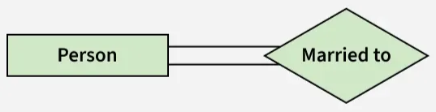|
|**Binary Relationship**|2|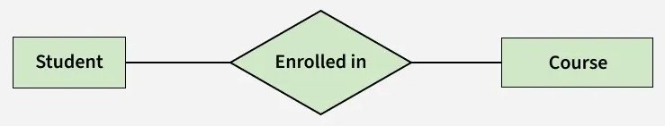|
|**Ternary Relationship**|3|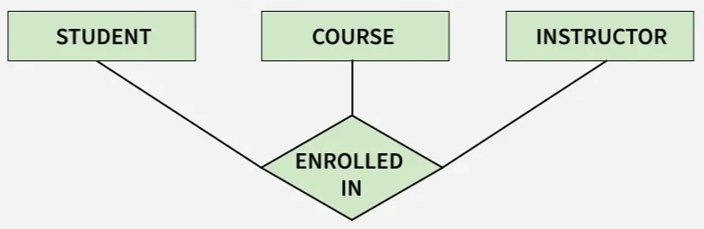|
|**N-ary Relationship**|N|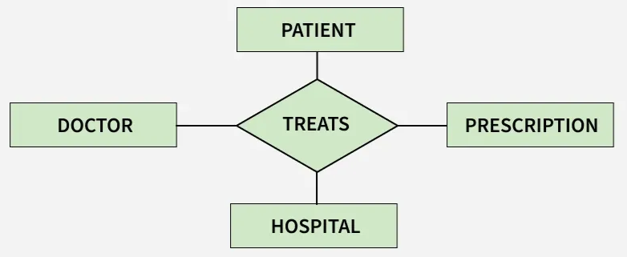|

# Cardinality
- ### Cardinality Ratio (Mapping Cardinality)
    |Relationship|Definition|[Entity Sets](#entity-set) (A, B)|[Min-Max Notation](#min-max-notation)|
    |:---:|:---:|:---:|:---:|
    |**One-to-One (1:1)**|Each [entity instance](#entity-instance) in both [entity sets](#entity-set) is associated with at most one [entity instance](#entity-instance) in the other [set](#entity-set)|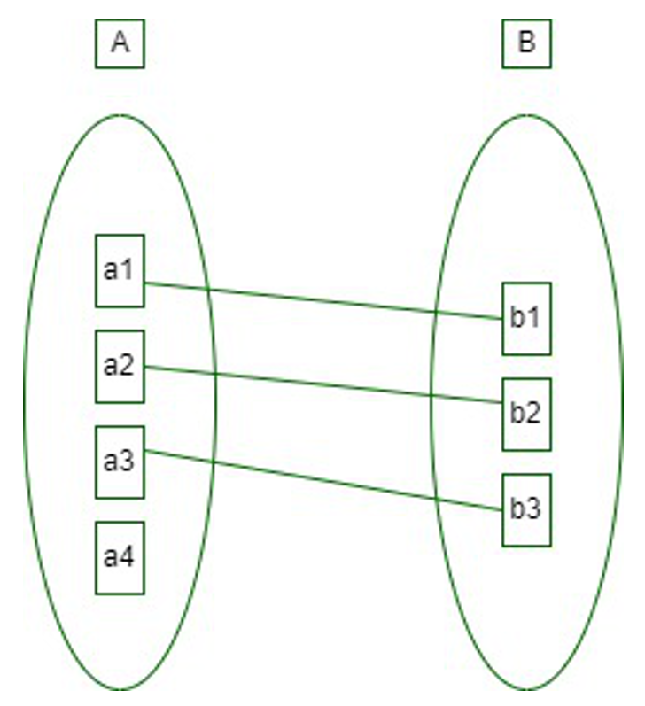||
    |**One-to-Many (1:M)**|An [entity instance](#entity-instance) in A is associated with multiple of [entity instances](#entity-instance) in B,  while an [entity instance](#entity-instance) in B is associated with at most one [entity instance](#entity-instance) in A|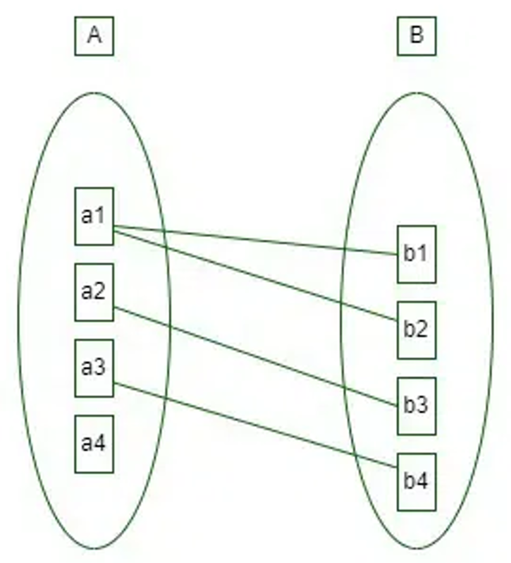||
    |**Many-to-One (M:1)**|An [entity instance](#entity-instance) in A is associated with at most one [entity instance](#entity-instance) in B,  while an [entity instance](#entity-instance) in B is associated with multiple of [entity instances](#entity-instance) in A|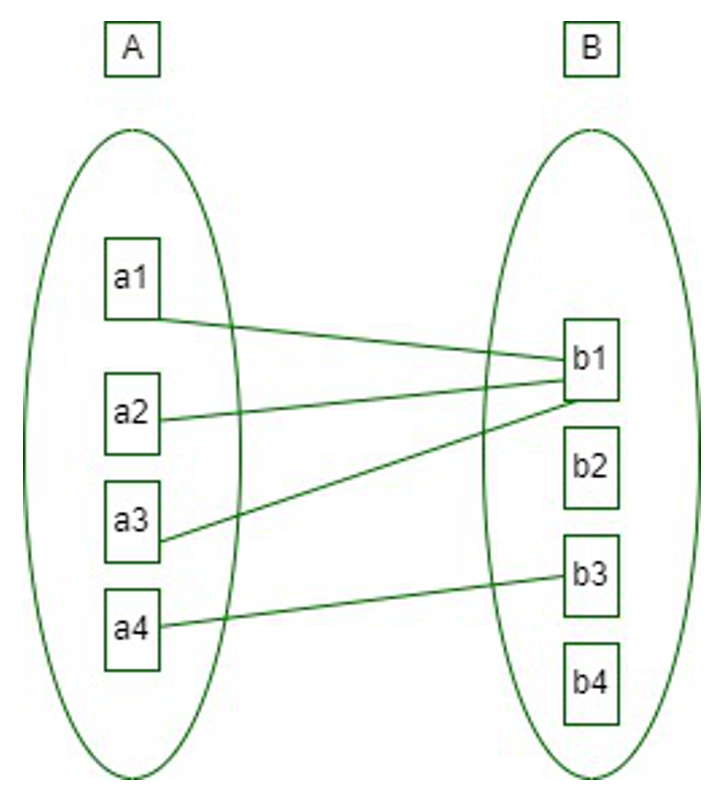||
    |**Many-to-Many (M:N)**|[Entity instances](#entity-instance) in both [entity sets](#entity-set) can be associated with multiple [entity instances](#entity-instance) in the other [set](#entity-set)|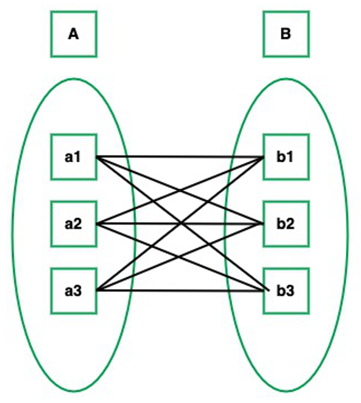||
- ### Min-Max Notation
- ### Cardinality Constraint

# Participation Constraints

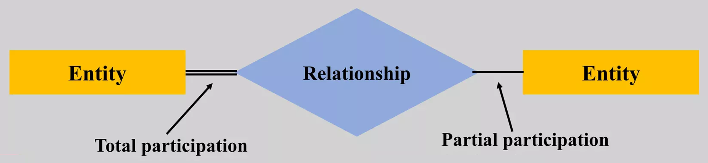  

|Participation Constraints|Definition|[Entity Sets](#entity-set) (A, B)|[Entity Relationship Diagram (ERD)](#entity-relationship-diagram-erd)|
|:---:|:---:|:---:|:---:|
|**Total Participation**|Every [entity instance](#entity-instance) in A must participate in at least one [relationship](#relationship) in the [relationship set](#relationship-set)|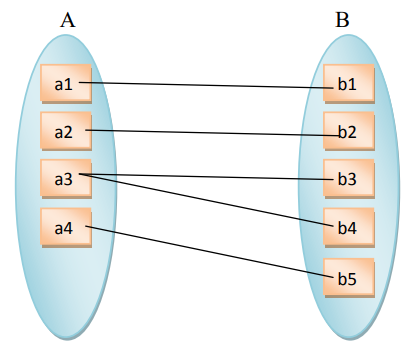|Double line|
|**Partial Participation**|Some [entity instances](#entity-instance) in A may not participate in any [relationship](#relationship) in the [relationship set](#relationship-set)|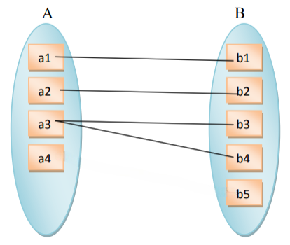|Single line|

# [Enhanced Entity-Relationship Model](enhanced-entity-relationship-model.md)
- ### [Key Concepts and Features](enhanced-entity-relationship-model.md#key-concepts-and-features)
- ### [Constraints](enhanced-entity-relationship-model.md#constraints)
