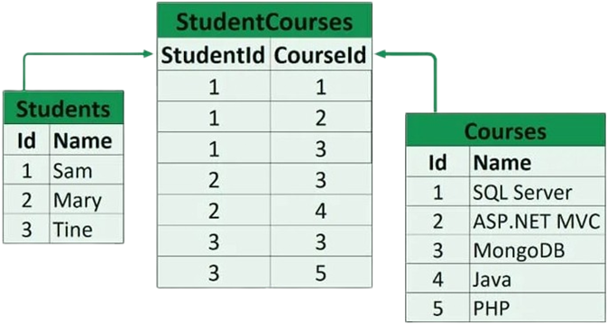
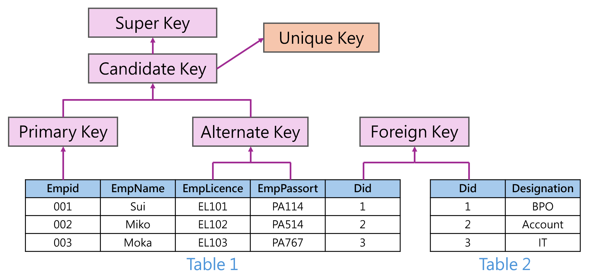
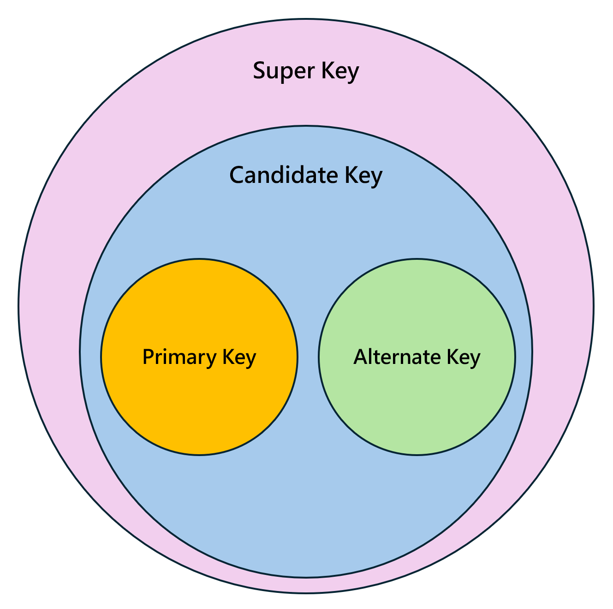

# Relational DBMS (RDBMS)
- ### MySQL

# Relation Schema

# [Keys](../../database-system.md#element) in Relational Model

  

|Keys|Definition|
|:---:|:---:|
|**Super Key**|Any column or combination of columns that can uniquely identify a row within a table|
|**Candidate Key**|A minimal super key that contains no redundant columns|
|**Primary Key**|The specific Candidate Key selected by the designer to uniquely identify each row in a table|
|**Alternate Key (Secondary Key)**|All Candidate Keys that were not chosen as the Primary Key|
|**Unique Key**|A database constraint that enforces uniqueness on a column or a set of columns|
|**Foreign Key**|A column or a set of columns used to establish a logical link between the data in two tables|
|**Composite Key**|A key that consists of two or more columns combined together|

- ### Relationship of Keys
    

# Relational Query Languages
- ### Procedural Query Language
    - ### [Relational Algebra](./relational-query-languages/relational-algebra.md)
- ### Non-procedural Query Language
    - ### Relational Calculus
        - #### Tuple Relational Calculus (TRC)
        - #### Domain Relational Calculus (DRC)
- ### Relational Completeness

# Join Decomposition
- ### Lossless Join Decomposition
- ### Lossy Join Decomposition

# Dependency
- ### Functional Dependency
- ### Multivalued Dependency

# Database Normalization
- ### [Normal Forms](./database-normalization/normal-forms.md)

# Database Denormalization

