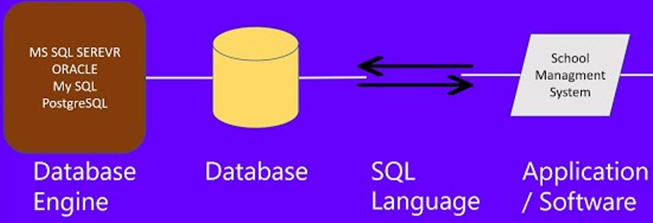
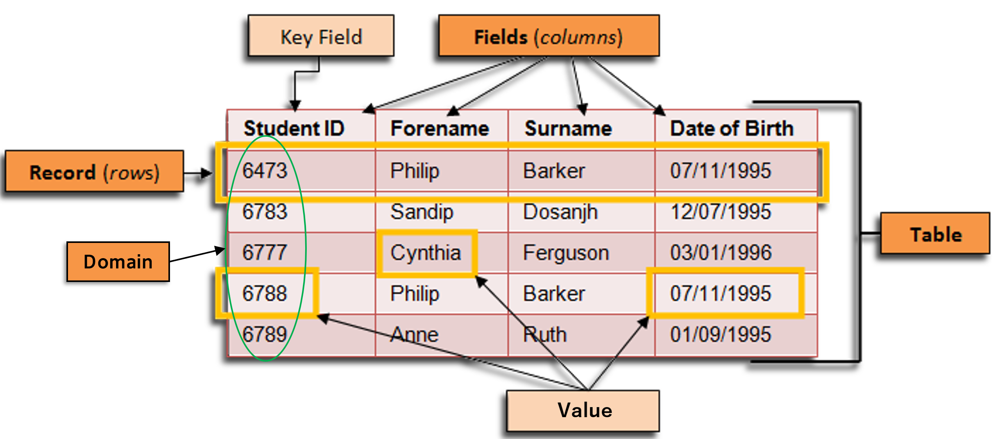

# Database Management System (DBMS)

- ### Query Language
    - #### [Structured Query Language (SQL)](/stem/it/coding/query-language/sql/sql.md)
- ### Database Engine：a software that DBMS uses to [CRUD](#crud) data from database
    - #### Query Processor
- ### Database Schema
- ### [Relational DBMS (RDBMS)](./data-model/logical-data-model/relational-model/relational-model.md#relational-dbms-rdbms)

# Data Model
- ### Conceptual Data Model
    - #### [Entity-Relationship Model (ER Model)](./data-model/conceptual-data-model/er-model.md)
- ### Logical Data Model
    - #### [Relational Model](./data-model/logical-data-model/relational-model/relational-model.md)
    - #### [Object-Oriented Model](./data-model/logical-data-model/object-oriented-model.md)
    - #### Hierarchical Database Model
    - #### Network Model
- ### Physical data Model

# Element

  

|Element|Definition|
|:---:|:---:|
|**Table**|A collection of data organized in rows and columns|
|**Record, Row, Tuple, Object, Entity**|A horizontal entry|
|**Field, Column, Attribute**|A vertical category|
|**Key, Key Attribute, Key Field, Id**|A unique identifier of data|
|**Value**|The specific data content identified or accessed by a key|
|**Atomic Value**|A single, indivisible value within a database column that cannot be further subdivided or decomposed|
|**Domain**|The set of all atomic values that a specific attribute can hold|

# Key–Value Database

# CRUD
- ### Create
- ### Read
- ### Update
- ### Delete

# Non-relational Database (Not Only SQL, NoSQL)

# Data Redundancy

# Data Integrity
- ### Physical Integrity
- ### Logical Integrity
    - ### [Integrity Constraints](./data-integrity/integrity-constraints.md)
