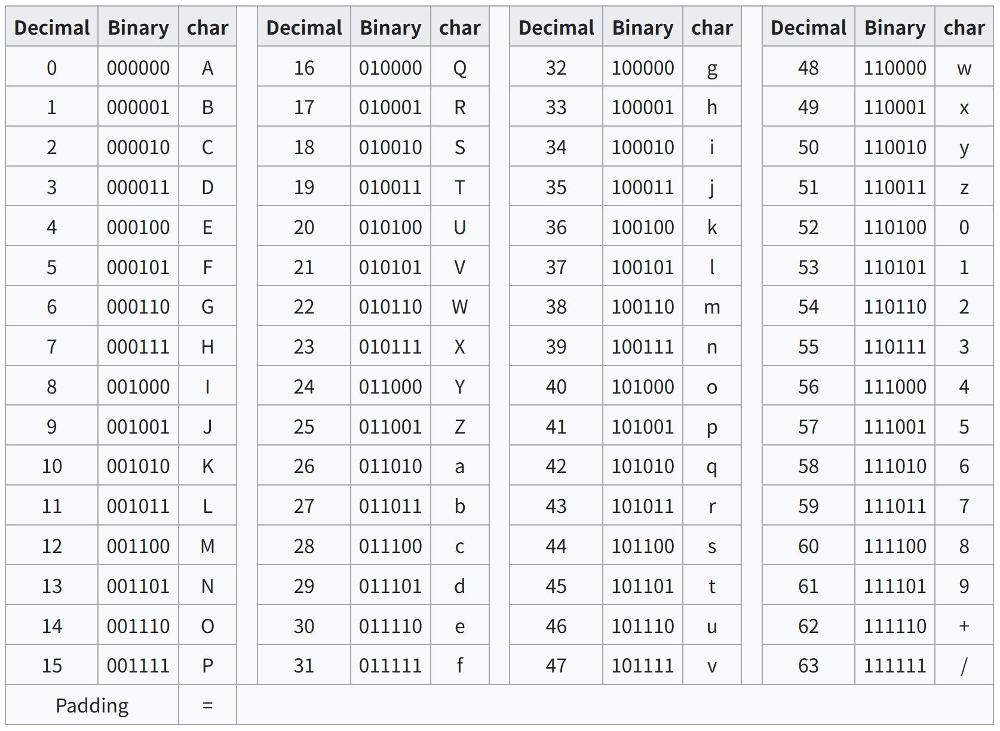
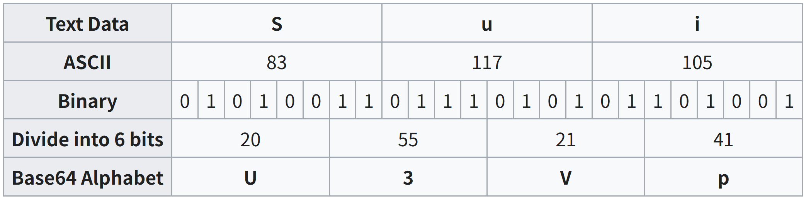

# Encoding
- ### [Character Encoding](character-encoding.md)
- ### Binary-to-text Encoding
    - ### [Base64](#base64-1)
- ### [Compression Encoding](compression-encoding.md)
- ### encodeURI/decodeURI
- ### [Error Detection and Correction (Error Control, Channel Coding)](error-detection-and-correction.md)

# Base64
- ### Base64 Encoding Process
    1. #### Convert the original data into binary
    2. #### Divide the binary data into groups of 6 bits
        - Base64：$\log_2{64}=6$ (bits)
    3. #### Map each group to a character in the [Base64 Alphabet](#base64-alphabet)
- ### Base64 Alphabet
    
- ### Example：`Sui` → `U3Vp`
    

