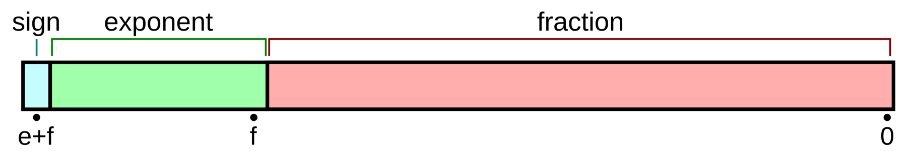
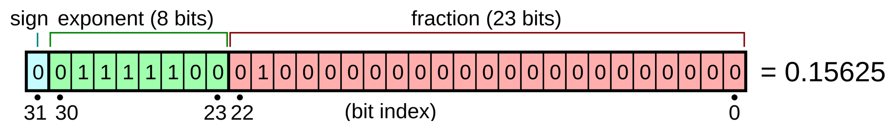

# Base, Digit
- ### $b^n=\text{base-b, n-digit}$
- ### base-b, n-digit ($b^n$)：can represent $b^n$ values
    - #### n-digit：can represent $n$ numbers

# Base
- ### Binary (base-2)：$2^n=\text{n-bit}=\text{base-2, n-digit}$
    - #### binary digit (bit)
    - #### can represent $2^n$ values
- ### Decimal (base-10)：$10^n=\text{base-10, n-digit}$

# Bit Numbering
- ### Most Significant Bit (MSB)
- ### Least Significant Bit (LSB)

# Negative Numbers
- ### Signed-magnitude representation
- ### Complement
- ### 1's Complement
- ### 2's Complement
- ### 10's Complement

# Scientific Notation
- ### $aE\pm n = a \times 10^{\pm n}$
    - Fraction (Significand, Mantissa) = $a$
    - Exponent = $n$
- ### Example
    - $1201.321=1.201321 \times 10^3 = 1.201321E+3$
    - $0.314=3.14 \times 10^{-1} = 3.14E-1$

# IEEE 754 (Binary Floating-point)
- ### Sign + Exponent + Fraction
    

    ||Value|Bits|Actual Value|
    |:---:|:---:|:---:|:---:|
    |Sign|Sign Value (S)|Sign Bits (s) = 1|$\text{Actual Sign} = {\left(-1\right)}^S$|
    |Exponent|Exponent Value (E)|Exponent Bits (e)|$\text{Actual Exponent} = 2^{\left(E-\text{Bias}\right)}$|
    |Fraction (Significand, Mantissa)|Fraction Value (F)|Fraction Bits (f)|$\text{Actual Fraction} = \left(1+\frac{F}{2^f}\right)$|
    - #### $\text{Bias} = 2^{e-1}-1$
    - #### $\text{Value} = \text{Actual Sign}\times\text{Actual Fraction}\times\text{Actual Exponent} = {\left(-1\right)}^S \times \left(1+\frac{F}{2^f}\right) \times 2^{\left(E-\text{Bias}\right)}$
- ### Single-precision, Double-precision
    ||Single-precision (32-bit Floating Point)|Double-precision (64-bit Floating Point)|
    |:---:|:---:|:---:|
    |Bits (s + e + f)|s(1 bits) + e(8 bits) + f(23 bits)|s(1 bits) + e(11 bits) + f(52 bits)|
    |Bias|127|1023|
- ### Finite Binary Fraction：an irreducible fraction whose denominator has no prime factors other than 2
    - $\frac{a}{2^n}\left(a\in Z,~n\in Z,~n\ge 0\right)$
    - Example：$\frac{19}{2},~\frac{1}{8}$
- ### Rounding Mode
    - #### Round to Nearest (Even)
    - #### Round Toward Zero (Truncation)
    - #### Round Toward Positive Infinity
    - #### Round Toward Negative Infinity
- ### GRS Bits
    - #### Position：Sign + Exponent + Fraction + G + R + S
    - #### Guard Bit (G)
        - it helps determine if the value is halfway to the next unit
    - #### Round Bit (R)
        - it provides additional precision past the guard bit during calculations
    - #### Sticky Bit (S)
        - if any bit to the right of the round bit is 1, the sticky bit is permanently set to 1
- ### Example
    

    - $\text{Value} = {\left(-1\right)}^0 \times \left(1+\frac{2^{21}}{2^{23}}\right) \times 2^{\left(124-127\right)} = 1 \times 1.25 \times 0.125 = 0.15625$

