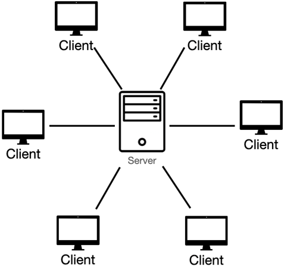
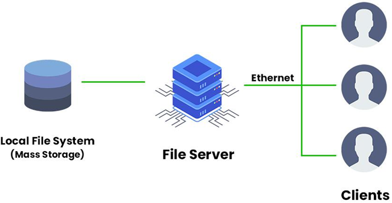
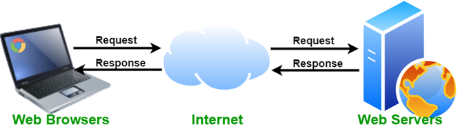
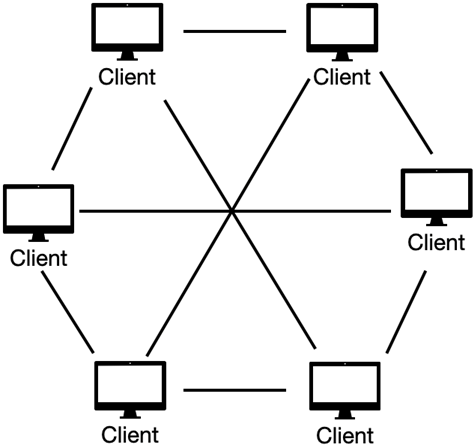
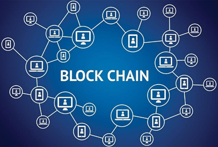

# Client-Server Model (Client-Server Architecture) {#client-server}

- ### [Representational State Transfer (REST, RESTful)](./client-server/restful.md)
- ### [Remote Procedure Call (RPC)](./client-server/rpc.md)
- ### Applications of Client–Server Model
    - #### file server
        
    - #### web server
        

# Peer-to-Peer Model (P2P Model, P2P Architecture) {#p2p}

- ### node = client = server
- ### Types of P2P
    - #### Structured P2P
    - #### Unstructured P2P
- ### Applications of P2P Model
    - #### file sharing
        
    - #### blockchain
        

        - Bitcoin(BTC)

