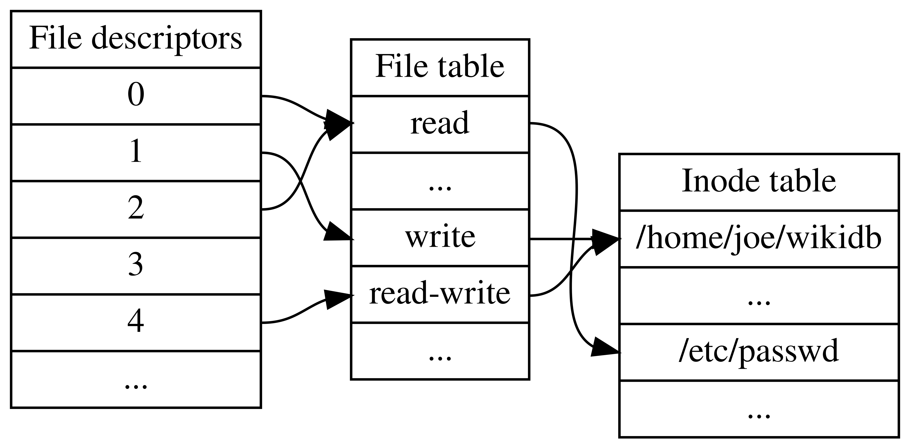

# Bash
- ### [Bash](/stem/it/cli/bash/bash.md)

# Linux Distribution (Linux Distro)
- ### Ubuntu
- ### Debian
    - ### [Kali Linux](./linux-distro/debian/kali-linux.md)
- ### [Arch Linux](./linux-distro/arch-linux/arch-linux.md)
- ### Fedora Linux

# Linux Process
- ### Process Creation
    - ### fork()
    - ### exec()
- ### systemd
- ### Zombie Process and Orphan Process
    ||Zombie Process|Orphan Process|
    |:---:|:---:|:---:|
    |**Child State**|Already terminated (dead)|Still running (alive)|
    |**Parent State**|Parent is still alive, but failed to call `wait()`|Parent has exited or died|
    |**Resource Usage**|Consumes no CPU or memory, only a process table slot (PID)|Consumes normal CPU, memory, and system resources|
    |**Cleanup**|Cleared when the parent calls `wait()` or dies (re-parented to PID 1)|Adopted by `init` or `systemd` (PID 1), which cleans it up automatically upon exit|
- ### Daemon Process
- ### File Descriptor (FD)
    |Integer value|Name|`<unistd.h>` symbolic constant|`<stdio.h>` file stream|
    |:---:|:---:|:---:|:---:|
    |0|Standard Input|`STDIN_FILENO`|`stdin`|
    |1|Standard Output|`STDOUT_FILENO`|`stdout`|
    |2|Standard Error|`STDERR_FILENO`|`stderr`|
    - #### File Descriptor Table
        
- ### [Process Management in Bash](/stem/it/cli/bash/basic-command-in-bash/process-management-in-bash.md)

# Virtual File System (VFS)
- ### Objects
    - Superblock
    - Index node (Inode)
    - Dentry
    - File
- ### System-Wide Open File Table
- ### Inode Table

# Linux File System
- ### [Linux File System](linux-file-system.md)

# Window Manager (WM)
- ### Types of WMs
    - #### Stacking Window Manager
    - #### Tiling Window Manager
    - #### Dynamic Window Manager
    - #### Compositing Window Manager
- ### Display Server
    - #### X Window System (X11)
        - i3
    - #### Wayland
        - Hyprland
        - Niri

# Desktop Environment (DE)
- ### KDE Plasma
- ### GNOME
- ### Unity
