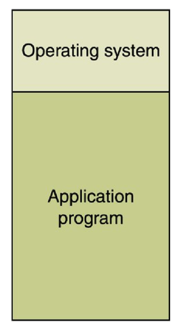
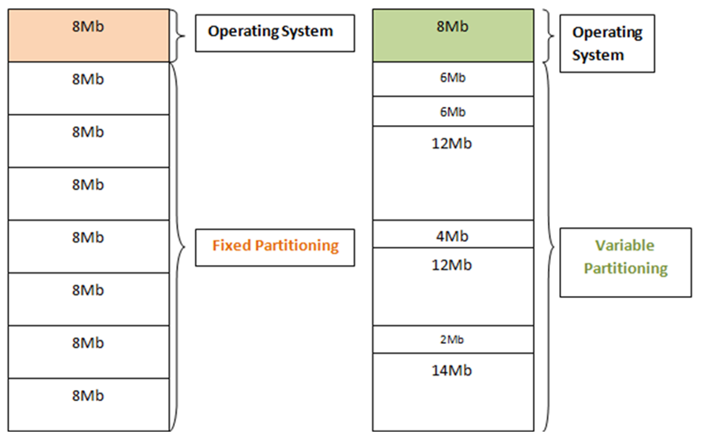
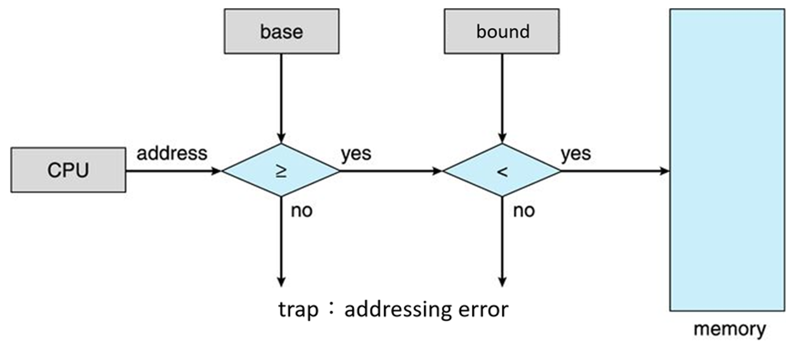
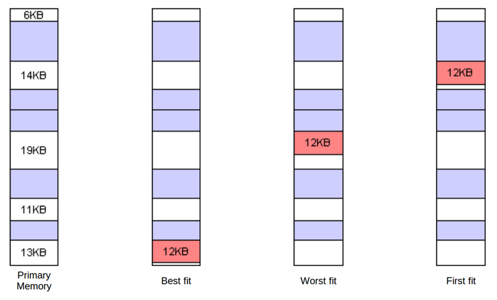

# Contiguous Memory Management Scheme
- ### [Single Contiguous](#single-contiguous)
    
- ### Multiple Partition
    

    - #### [Fixed Partition](#fixed-partition)
    - #### [Dynamic Partition (Variable Partition)](#dynamic-partition-variable-partition)

# Single Contiguous
- ### Base and Limit Registers (Base and Bound Registers)
    

    - #### Base register
    - #### Limit register (Bound register)

# Fixed Partition

# Dynamic Partition (Variable Partition)
- ### Storage Allocation Strategies
    

    - #### First fit：the first partition fit
    - #### Best fit：the smallest partition fit
    - #### Worst fit：the largest partition fit

