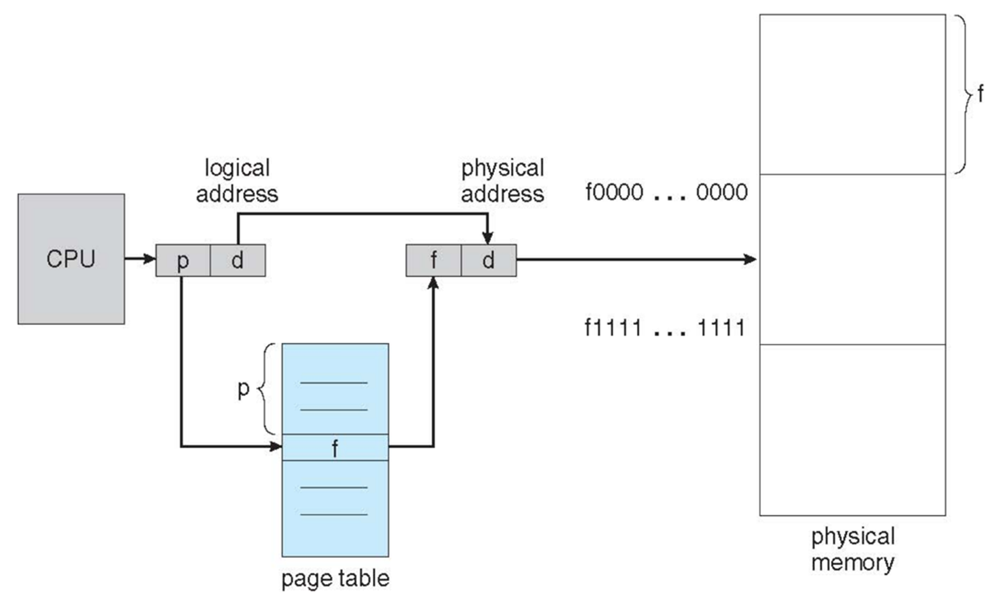
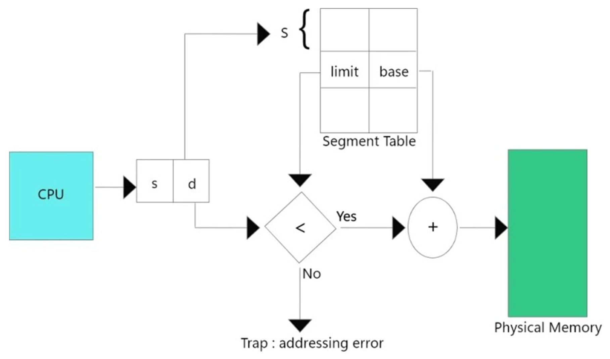

# Non-Contiguous Memory Management Scheme
- ### [Paging (fixed-size)](#paging)
    - #### Demand Paging
- ### [Segmentation (variable-size)](#segmentation)
    - #### Demand Segmentation

# Paging

- ### Page：a portion of logical memory
    - #### Page number (p)
    - #### Page offset (d)
- ### Frame：a portion of physical memory
    - #### Frame number (f)
    - #### Frame offset (d)
- ### Address translation
    - #### [Logical address](../memory-management.md#logical-address) = $p\times n + d$
    - #### [Physical address](../memory-management.md#physical-address) = $f\times n + d$
    - #### [Page offset (d)](#page-offset-d) = [Frame offset (d)](#frame-offset-d)
- ### Page size (Frame size) = $n$
- ### Page table
    - #### [Page number (p)](#page-number-p) → [Frame number (f)](#frame-number-f)

# Segmentation

- ### Segment Table
    - #### Base address
    - #### Segment limit
    - #### Segmentation number (s)
    - #### Segmentation offset (d)

