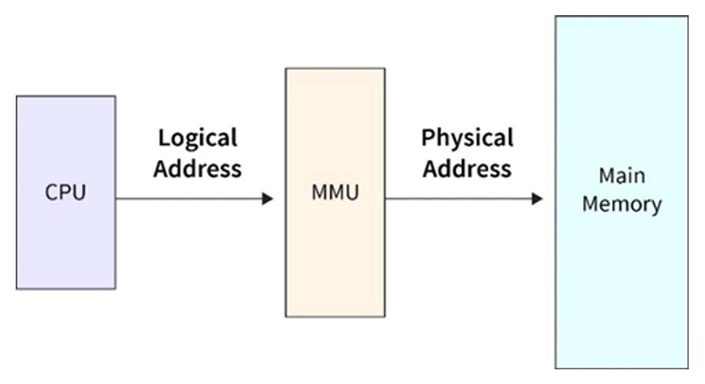
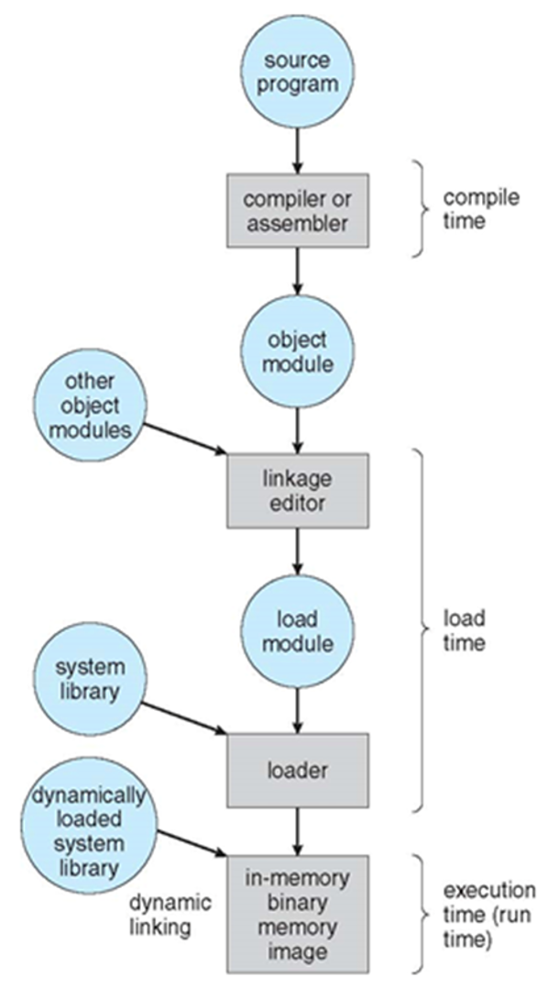
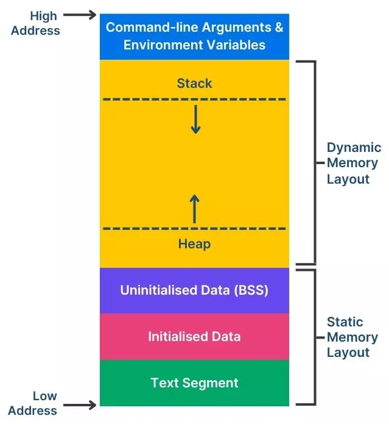
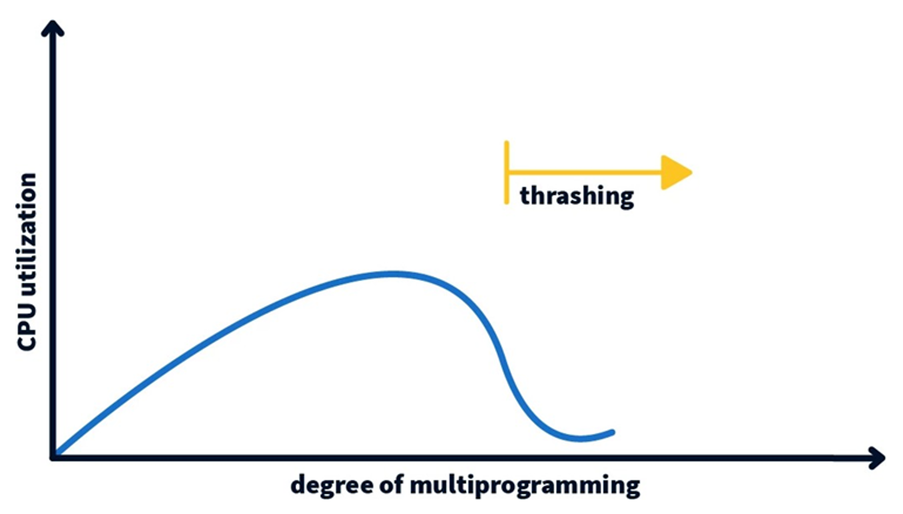
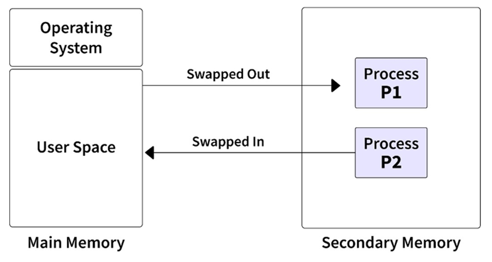

# Memory Management Scheme
- ### [Contiguous Memory Management Scheme](./memory-management-scheme/contiguous-memory-management-scheme.md)
- ### [Non-Contiguous Memory Management Scheme](./memory-management-scheme/non-contiguous-memory-management-scheme.md)

# Memory Hierarch
- ### [Memory Hierarchy](../../computer-hardware/memory/memory.md#memory-hierarchy)

# Address

- ### logical address
- ### physical address
- ### Memory-Management Unit (MMU)

# Address Binding

- ### compile time
- ### load time
- ### execution time

# Register
- ### base register：holds the first logical address
- ### bound register
- ### limit register

# Address Translation
- ### physical address = base + logical address
- ### logical address < bound
- ### bound = base + limit

# Fragmentation
- ### Internal Fragmentation (Fixed-size)
- ### External Fragmentation (Variable-size)

# Process Memory Layout

- ### Kernel Space
    - Content：Command-Line Arguments, Environment Variables
- ### Stack
    - Characteristic：Grows Downward
    - Content：Local Variables, Parameters, Return Address, Stack Frame
- ### Heap
    - Characteristic：Grows Upward
    - Content：Dynamic Memory Allocation
- ### Uninitialized Data (Block Started by Symbol, BSS)
- ### Initialized Data
    - Content：Global Variables, Static Variables
- ### Text Segment (Code Segment)
    - Characteristics：Read-Only
    - Contents：Compiled Machine Instructions ([Executable Code](../../computer-organization-and-architecture/build-process/build-process.md#executable-code))

# Out of Memory (OOM)

# Virtual memory
- ### Thrashing
    
- ### Virtual Address Space
    - #### User Space
    - #### Kernel Space

# Swapping

# Locality
- ### Temporal Locality
- ### Spatial Locality

# Cache Miss
- ### Compulsory Miss
- ### Capacity Miss
- ### Conflict Miss

# Memory Leak

