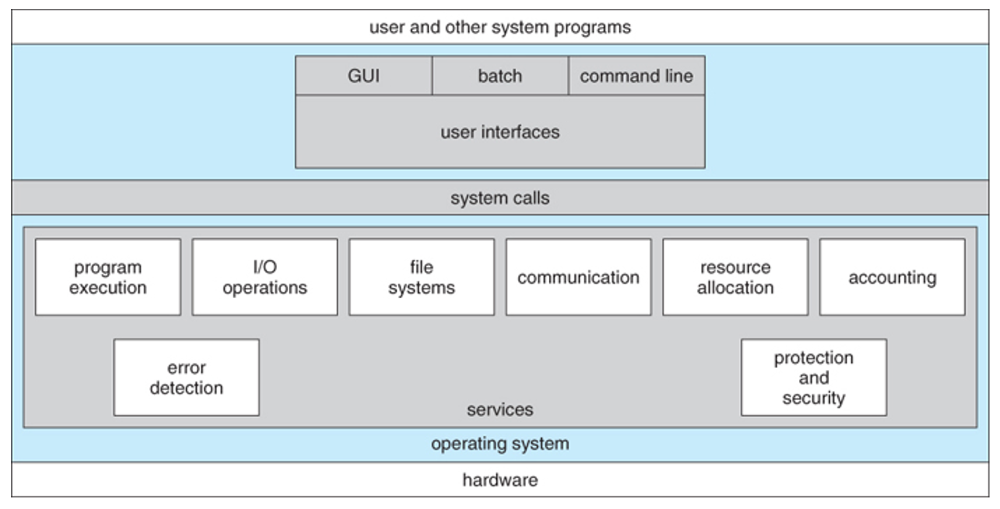
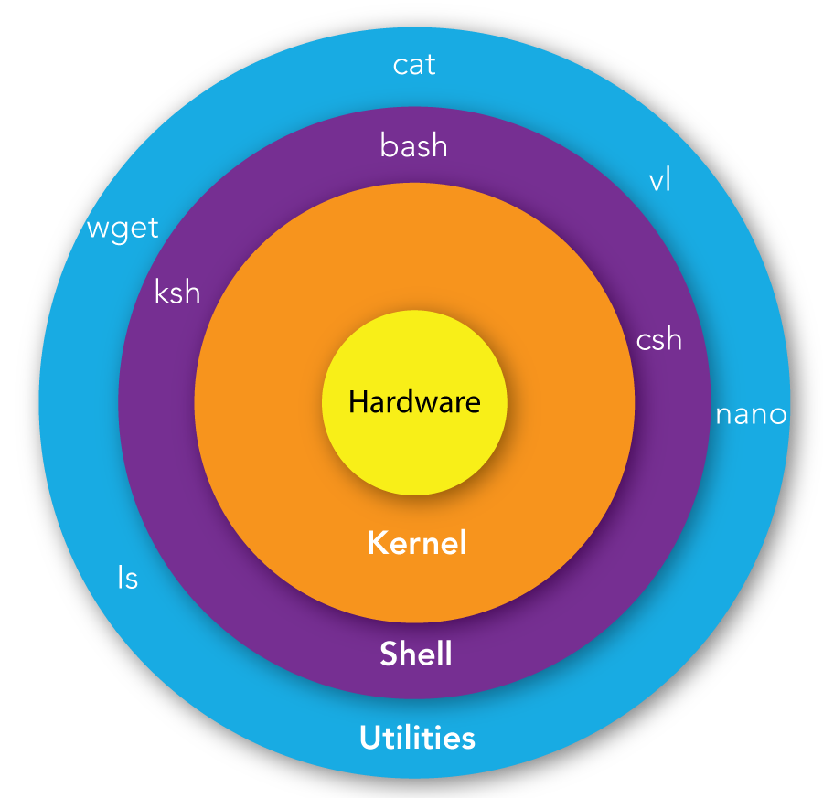

# Types of Operating System
- ### Open System
    - #### Interoperability (inter-operate-ability)：the ability of multiple systems or device to work together
    - #### Example：[Linux](#linux)
- ### Proprietary System
    - #### Example：iOS

# Operating System Services

- ### User Interface (UI)：allows users to interact with the system
    - #### [Batch Interface](./process-management/process-management.md#batch-interface)
    - #### [Command-Line Interface](/stem/it/cli/cli.md)
        - Command Interpreter (Shell)
    - #### Graphical User Interface (GUI)
    - #### Text-based User Interface (Terminal User Interface, TUI)
    - #### Natural User Interface (NUI)
        - Touchscreen Interface
- ### Program Execution
    - loads programs into memory, allocates CPU time, and runs them to completion
- ### I/O Operations
    - manages data transfer between executing programs and [input/output devices](../computer-hardware/computer-hardware.md#inputoutput-unit-io-unit-peripheral-devices)
- ### File-System Manipulation
    - allows programs to read, write, create, delete, and manage permissions
- ### Communication
    - enables processes to exchange information, either on the same computer or over a network
- ### [Error Detection](../data-representation/encoding/error-detection-and-correction/error-detection-and-correction.md#error-correction-code)
    - constantly monitors hardware and software for errors and takes corrective actions
- ### Resource Allocation
    - manages how system resources are shared among different processes
- ### Accounting
    - tracks and logs which users or processes use how much and what kinds of computer resources
- ### Protection and Security
    - #### Protection：ensures that all access to system resources is controlled {#protection}
    - #### Security：defends the system against unauthorized external access or malicious attacks {#security}

# System Call (Syscall)
- [User Space](./memory-management/memory-management.md#user-space) $\xrightarrow{\text{syscall}}$ [Kernel Space](./memory-management/memory-management.md#kernel-space)
- ### Parameter Passing
    |Parameter Passing|Definition|Number of Parameters|Execution speed|
    |:---:|:---:|:---:|:---:|
    |**Register**|Parameters are written directly into CPU registers, and the kernel fetches parameters directly from the CPU registers|Fewest (limit by number of registers)|Fastest|
    |**Memory Block/Table**|Parameters are stored in a block/table in memory, and address of block/table is passed via a register|Most (unlimited)|Slowest (due to memory access and strict address validation)|
    |**Call Stack**|Parameters are pushed onto the stack by the program, and popped off the stack by the operating system|More (limit by stack size)|Slower (due to memory access and stack context switching)|
- ### Types of System Calls
    |System Call|Definition|Example ([Linux](./linux/linux.md))|
    |:---:|:---:|:---:|
    |**Process Control**|create/terminate processes, load/execute, and wait for events|`fork()`, `exec()`, `exit()`, `wait()`|
    |**File Management**|create/delete, open/close, read/write, and set attributes|`open()`, `close()`, `read()`, `write()`|
    |**Device Management**|request/release devices, read/write, and logically attach/detach|`ioctl()`|
    |**Information Maintenance**|get/set time, date, as well as process and system attributes|`getpid()`, `time()`, `alarm()`|
    |**[Communication](#communication)**|establish connections, message passing, and shared memory|`pipe()`, `shmget()`, `socket()`|
    |**[Protection](#protection)**|control resource access permissions and set authorizations|`chmod()`, `chown()`|
- ### System Call Table

# System Programs
- ### Status Information
- ### [File Manipulation](#file-system-manipulation)
- ### File Modification
- ### [Communication](#communication)
- ### Programming Language Support
    - [Compiler](../computer-organization-and-architecture/build-process/build-process.md#compiler)
    - [Interpreter](../computer-organization-and-architecture/build-process/build-process.md#interpreter)
    - [Assembler](../computer-organization-and-architecture/build-process/build-process.md#assembler)
- ### Program Loading and Execution
    - [Loader](../computer-organization-and-architecture/build-process/loader.md)
    - [linker](../computer-organization-and-architecture/build-process/linker.md)

# Dual Mode
- ### User Mode
- ### Kernel Mode

# [Operating System Structures (OS Structures)](os-structures.md)
- ### [Simple Structure](os-structures.md#simple-structure)
- ### [Monolithic-Kernel Structure](os-structures.md#monolithic-kernel-structure)
- ### [Layered Structure](os-structures.md#layered-structure)
- ### [Microkernel Structure](os-structures.md#microkernel-structure)
- ### [Modular Structure](os-structures.md#modular-structure)
- ### [Hybrid-Kernel Structure](os-structures.md#hybrid-kernel-structure)
- ### [Exokernel Structure](os-structures.md#exokernel-structure)
- ### [Virtual Machine (VM)](../computer-organization-and-architecture/virtualization/virtualization.md#virtual-machine-vm)

# Operating System Debugging
- ### Failure Analysis
    - #### Core Dump
    - #### Crash Dump
- ### Performance Tuning
    - #### Tools
        |Resource Type|[Linux](./linux/linux.md) Tools|[Windows](#windows) Tools|
        |:---:|:---:|:---:|
        |System-wide Overview|[`ps`](/stem/it/cli/bash/basic-command-in-bash/process-management-in-bash.md#process-status-ps), [`top`](/stem/it/cli/bash/basic-command-in-bash/process-management-in-bash.md#top), [`htop`](/stem/it/cli/bash/basic-command-in-bash/process-management-in-bash.md#htop), `glances`, [`vmstat`](/stem/it/cli/bash/basic-command-in-bash/process-management-in-bash.md#virtual-memory-statistics-vmstat)|Task Manager|
        |CPU|`mpstat`, `perf`|Performance Monitor|
        |Memory|`free -m`, [`vmstat`](/stem/it/cli/bash/basic-command-in-bash/process-management-in-bash.md#virtual-memory-statistics-vmstat)|Resource Monitor|
        |Storage I/O|`iostat -x`, `iotop`|Resource Monitor (Disk Tab)|
        |Network|[`iftop`](/stem/it/cli/bash/basic-command-in-bash/networking-command-in-bash/networking-command-in-bash.md#interface-top-iftop), [`nload`](/stem/it/cli/bash/basic-command-in-bash/networking-command-in-bash/networking-command-in-bash.md#network-load-nload), [`ss`](/stem/it/cli/bash/basic-command-in-bash/networking-command-in-bash/networking-command-in-bash.md#socket-statistics-ss), [`netstat`](/stem/it/cli/bash/basic-command-in-bash/networking-command-in-bash/networking-command-in-bash.md#network-statistics-netstat)|`netstat`, Resource Monitor|
- ### Dynamic Tracing (DTrace)
    - #### Probes：can refer to various techniques or tools used to monitor and gather information about the behavior, performance, or state of the operating system and the hardware it runs on
    - #### BPF Compiler Collection (BCC)
    - #### Extended Berkeley Packet Filter (eBPF)

# Booting Process
1. ### Power-On
2. ### Power-On Self Test (POST)
3. ### Loading [BIOS/UEFI Firmware](../computer-organization-and-architecture/firmware.md)
4. ### Loading Bootstrap Loader (Bootloader)
   - #### GRand Unified Bootloader (GRUB)
5. ### Kernel Initialization
6. ### Init Process

# Kernel Data Structures

# [Process Management](process-management/process-management.md)
- ### [Scheduling](process-management/scheduling/scheduling.md)
- ### [Thread](process-management/thread.md)
- ### [Inter-Process Communication (IPC)](process-management/inter-process-communication.md)

# [Memory Management](./memory-management/memory-management.md)
- ### [Contiguous Memory Management Scheme](./memory-management/memory-management-scheme/contiguous-memory-management-scheme.md)
- ### [Non-Contiguous Memory Management Scheme](./memory-management/memory-management-scheme/non-contiguous-memory-management-scheme.md)

# File System
- ### [File System](file-system.md)

# [Linux](./linux/linux.md)

- ### [Bash](/stem/it/cli/bash/bash.md)
- ### Linux Distribution (Linux Distro)
    - #### Ubuntu
    - #### Debian
        - #### [Kali Linux](./linux/linux-distro/debian/kali-linux.md)
    - #### [Arch Linux](./linux/linux-distro/arch-linux/arch-linux.md)
    - ### Fedora Linux

# Windows
- ### Windows Registry

