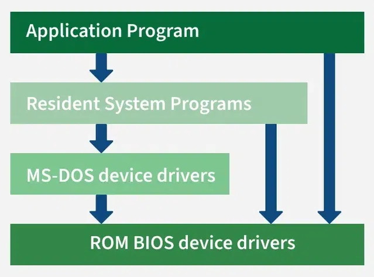
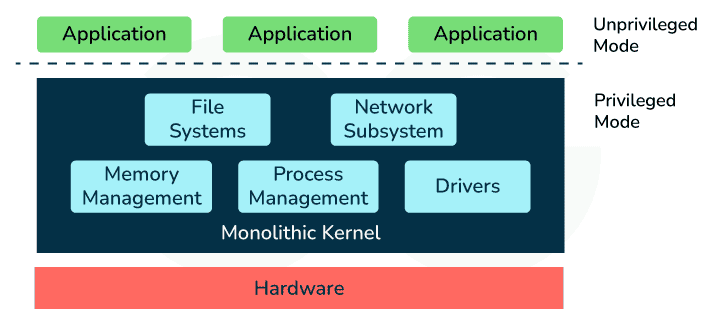
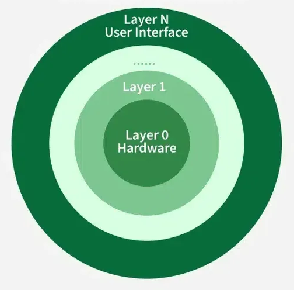
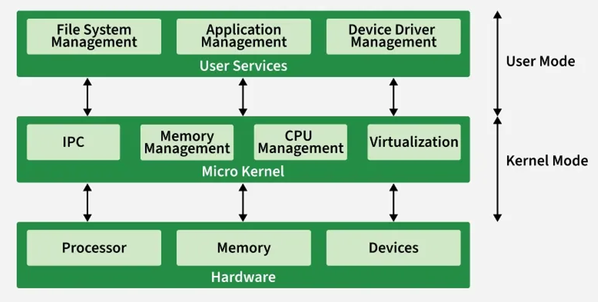
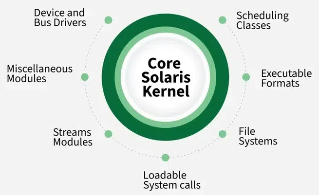
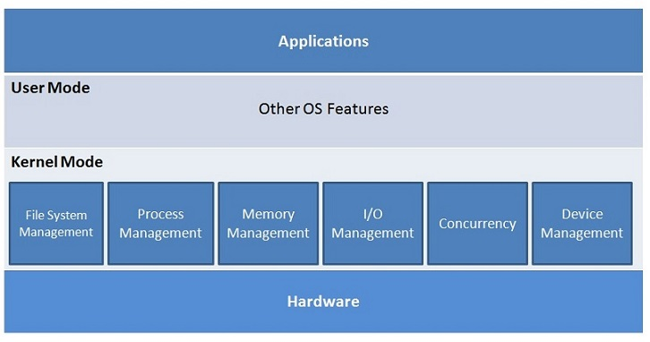
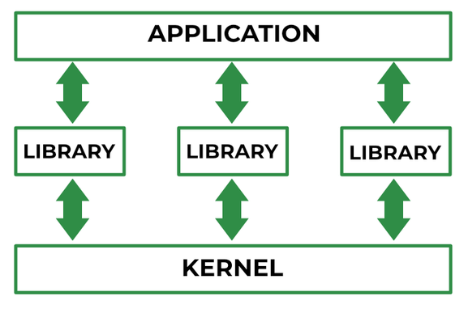

# Simple Structure

- ### Characteristics
    - **No well-defined structure**：small, simple, and limited
    - **No separation of layers**：Interfaces and functionality levels are not separated
    - **Direct hardware access**：Applications can directly access basic I/O routines, lacking protection
    - **Low fault tolerance**：A user program failure can crash the entire system
- ### Example：MS-DOS

# Monolithic-Kernel Structure

- ### Characteristics
    - **Single large kernel**：Entire OS run together in a single large kernel
    - **Tight Coupling**：The components and modules are highly interconnected and dependent on each other
    - **High performance**：High performance in system call communication
    - **Difficult to maintain**：High complexity makes it hard to modify, extend, or debug code
    - **Vulnerable to crashes**：A bug in any single service can cause the entire kernel to crash
- ### Example：Traditional UNIX

# Layered Structure

- ### Characteristics
    - **Layered Approach**：The OS is broken into a number of layers, each layer is built on top of lower layers
    - **Strict data flow**：A layer can only invoke services provided by its lower-level layers
    - **Easy debugging**：Simplifies debugging and verification, as errors can be isolated layer by layer
    - **Efficiency overhead**：Less efficient due to the overhead of passing through multiple layers for a single request
- ### Example：THE multiprogramming system, Windows NT

# Microkernel Structure

- ### Characteristics
    - **Minimalist kernel**：Moves all non-essential components from [kernel space](./memory-management/memory-management.md#kernel-space) to [user space](./memory-management/memory-management.md#user-space)
    - **High extensibility and portability**：Easy to extend the OS by adding new services directly to [user space](./memory-management/memory-management.md#user-space) without modifying the kernel
    - **Enhanced reliability**：If a service crashes, it does not affect the rest of the OS
    - **Performance overhead**：Slower performance due to increased system-call overhead from message passing between services
- ### Example：Mach, QNX

# Modular Structure

- ### Characteristics
    - **Object-oriented approach**：The kernel has a set of core components and links in additional services via modules
    - **High efficiency**：Modules talk to each other directly without message passing, maintaining near-monolithic performance
    - **Dynamic loading**：Services can be added to or removed from the kernel dynamically during runtime
- ### Loadable Kernel Module (LKM)
    - **On-demand execution**：Features like device drivers or file systems are loaded only when needed
    - **No reboot required**：Allows updating system components without restarting or recompiling the kernel
- ### Example：Sun Solaris, Linux

# Hybrid-Kernel Structure

- ### Characteristics
    - **Best of both worlds**：Combines the high performance of monolithic kernels with the modularity and security of microkernels
    - **Flexible architecture**：Strategically places critical services in kernel space for speed, while running non-critical services in user space
    - **Layered and modular design**：Utilizes multiple structural approaches
- ### Example：Windows 10/11, XNU kernel (macOS, iOS), Android

# Exokernel Structure

- ### Characteristics
    - **No hardware abstraction**：Does not abstract hardware resources; instead, it exposes raw hardware directly to applications
    - **Resource protection only**：The kernel only ensures secure resource allocation and prevents hardware conflicts
    - **Maximum flexibility and performance**：Allows heavy-duty applications to optimize hardware usage for maximum efficiency
- ### Library Operating Systems (LibOS)
    - **Application-level management**：Implements traditional OS abstractions at the application level
    - **Customizable sub-systems**：Allows applications to link to a specific LibOS tailored to their exact performance needs
    - **Hardware access simplification**：Acts as a bridge, making it easier for developers to interact with the raw hardware exposed by the exokernel
- ### Example：MIT Exokernel Operating System (ExOS)

# Virtual Machine (VM)
- ### [Virtual Machine (VM)](../computer-organization-and-architecture/virtualization/virtualization.md#virtual-machine-vm)

