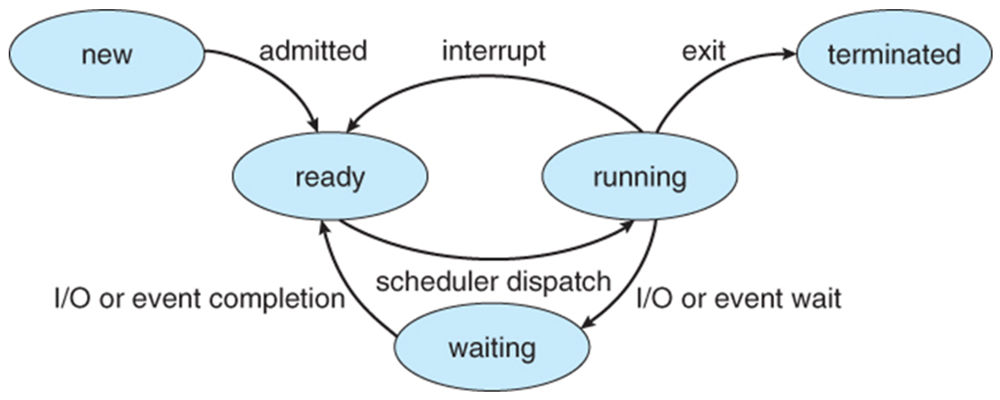
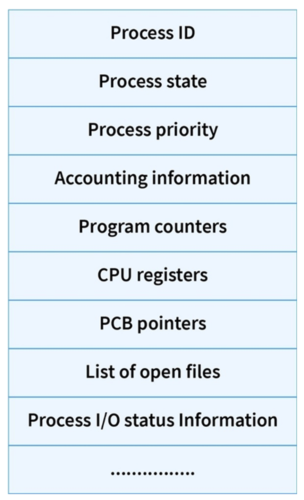

# Parent Process, Child Process
- ### Parent Process
- ### Child Process

# Interrupt
- ### Types of Interrupts
    - #### External Interrupt (Hardware Interrupt)
    - #### Internal Interrupt
    - #### Software Interrupt
    - #### Trap = Internal Interrupt + Software Interrupt
- ### Interrupt Handling
    - #### Interrupt Vector Table (IVT)
    - #### Interrupt Service Routine (ISR, Interrupt Handler)
    - #### End Of Interrupt (EOI)
    - #### Top Half and Bottom Half
- ### Nested Interrupt

# [Thread](thread.md)
- ### [User Thread and Kernel Thread](thread.md#user-thread-and-kernel-thread)
- ### [Multithreading](thread.md#multithreading)
- ### [Thread Pool](thread.md#thread-pool)

# Scheduling
- ### [Scheduling](./scheduling/scheduling.md)

# Process States

- ### New
- ### Ready
- ### Running
- ### Waiting
- ### Terminated

# Process Control Block (PCB)

- ### Process ID (PID)
- ### Context Switch：exchange of register information

# Inter-Process Communication (IPC)
- ### [Inter-Process Communication (IPC)](inter-process-communication.md)

# Process Synchronization

# Message Passing
- ### Message Queue

# Real-time
- ### Hard Real-time
- ### Soft Real-time

# Time-sharing
- ### [Virtual Memory](../memory-management/memory-management.md#virtual-memory)

# Batch Processing
- ### Batch File
- ### Batch Interface

# Concurrency and Parallelism
- ### [Concurrent Computing](../../concurrent-computing/concurrent-computing.md)
- ### [Parallel computing](../../concurrent-computing/parallel-computing/parallel-computing.md)
