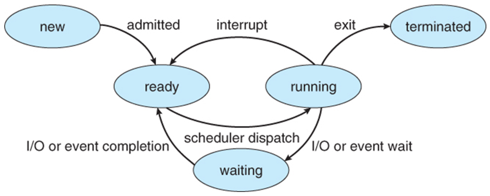
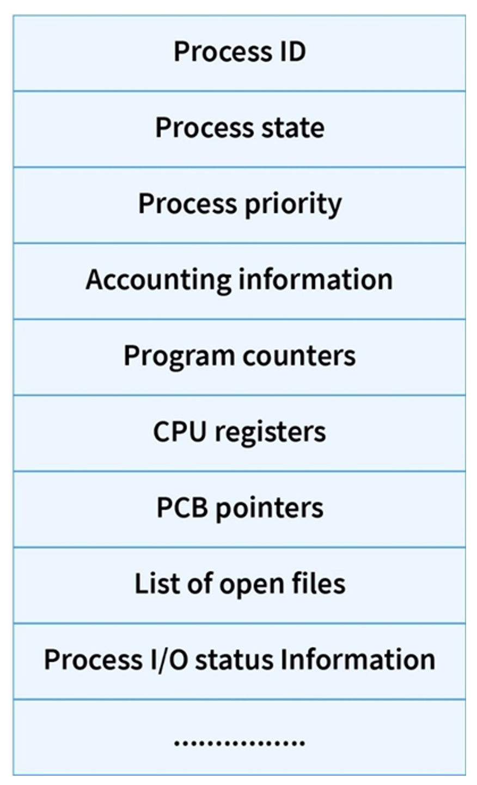

# Parent Process, Child Process
- ### Parent Process
- ### Child Process

# Multiprogramming

# Multitasking
- ### preemptive
- ### nonpreemptive

# Real-time
- ### hard real-time
- ### soft real-time

# Interrupt

- ### Types of Interrupts
    - #### External Interrupt (Hardware Interrupt)
    - #### Internal Interrupt
    - #### Software Interrupt
    - #### Trap = Internal Interrupt + Software Interrupt
- ### Interrupt Handling
    - #### Interrupt Vector Table (IVT)
    - #### Interrupt Service Routine (ISR, Interrupt Handler)
    - #### End Of Interrupt (EOI)
    - #### Top Half and Bottom Half
- ### Nested Interrupt

# Time-sharing
- ### virtual memory

# Batch processing
- ### batch file

# Process States

- ### New
- ### Ready
- ### Running
- ### Waiting
- ### Terminated

# Process Control Block (PCB)

- ### Context Switch：exchange of register information

# Inter-Process Communication (IPC)
- ### [Inter-Process Communication (IPC)](inter-process-communication.md)

# Thread
- ### User Thread
- ### Kernel Thread

# Scheduling
- ### [Scheduling](scheduling.md)

# Process Synchronization

# Deadlock

