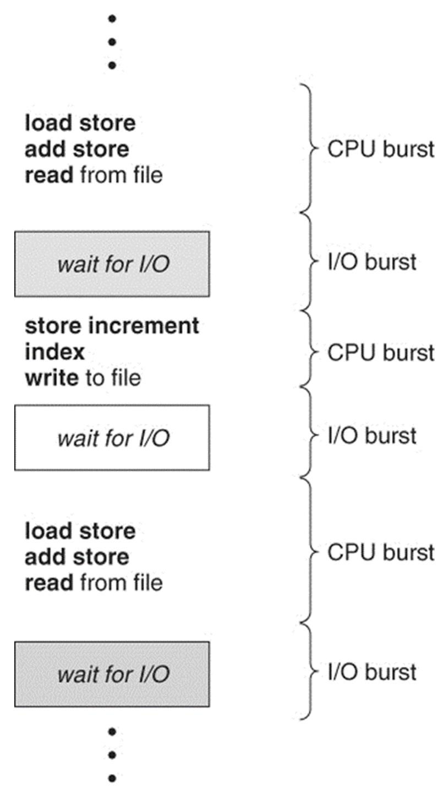

# Scheduler
- ### CPU Scheduler (short-term scheduler)
    - #### preemptive
    - #### nonpreemptive
- ### long-term scheduler
- ### medium-term scheduler

# Dispatcher
- ### dispatch latency

# CPU Scheduling
- ### First Come, First Serve scheduling (FCFS)
- ### Shortest Job First scheduling (SJF)
- ### Round-Robin scheduling (RR)
    - #### time slice (time quantum)
- ### Priority scheduling
- ### Multilevel Queue scheduling
- ### Multilevel Feedback Queue scheduling

# CPU-I/O Burst Cycle

- ### Time
    - #### CPU Burst Time (Burst Time)
    - #### I/O Burst Time (I/O Time)
- ### Boung
    - #### CPU Bound
    - #### I/O Bound

# Scheduling Criteria
- ### CPU Utilization
- ### $\text{Throughput} = \frac{\text{Number of Completed Processes}}{\text{Total Time}}$
- ### $\text{Turnaround Time} = \text{Completion Time} - \text{Arrival Time}$
- ### $\text{Waiting Time} = \text{Turnaround Time} - \text{Burst Time} - \text{I/O Time}$
- ### $\text{Response Time} = \text{First Response Time} - \text{Arrival Time}$

