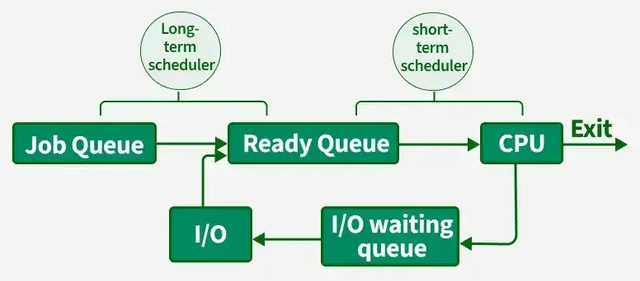
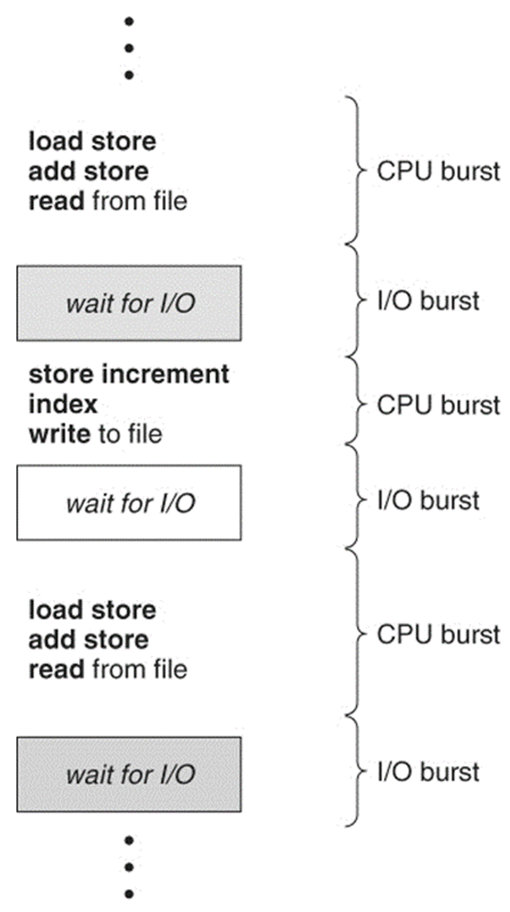

# Scheduling Queues

- ### Job Queue
- ### Ready Queue
- ### Device Queues (I/O Waiting Queues)

# Scheduler
- ### CPU Scheduler (Short-term Scheduler)
    - #### Preemptive
    - #### Nonpreemptive
- ### Medium-term Scheduler
- ### Long-term Scheduler

# Dispatcher
- ### Functions 
    - [Context Switch](../process-management.md#context-switch)
    - Switch to user mode
    - Jump to the proper location
- ### Dispatch Latency

# [CPU Scheduling](cpu-scheduling.md)
- ### [First Come, First Serve scheduling (FCFS)](cpu-scheduling.md#first-come-first-serve-scheduling-fcfs)
- ### [Shortest Job First scheduling (SJF)](cpu-scheduling.md#shortest-job-first-scheduling-sjf)
- ### [Round-Robin scheduling (RR)](cpu-scheduling.md#round-robin-scheduling-rr)
- ### [Priority scheduling](cpu-scheduling.md#priority-scheduling)
- ### [Multilevel Queue scheduling](cpu-scheduling.md#multilevel-queue-scheduling)
- ### [Multilevel Feedback Queue scheduling](cpu-scheduling.md#multilevel-feedback-queue-scheduling)

# CPU-I/O Burst Cycle

- ### Time
    - #### CPU Burst Time (Burst Time, BT)
    - #### I/O Burst Time (I/O Time, IOT)
    - #### Arrival Time (AT)
    - #### Completion Time (CT)
- ### Bound
    - #### CPU Bound
    - #### I/O Bound

# Scheduling Criteria
- ### CPU Utilization
- ### $\text{Throughput} = \frac{\text{Number of Completed Processes}}{\text{Total Time}}$
- ### Turnaround Time：$\text{TAT} = \text{CT}-\text{AT}$
- ### Waiting Time：$\text{WT} = \text{TAT}-\text{BT}-\text{IOT}$
- ### Response Time：$\text{RT} = \text{First Response Time}-\text{AT}$

