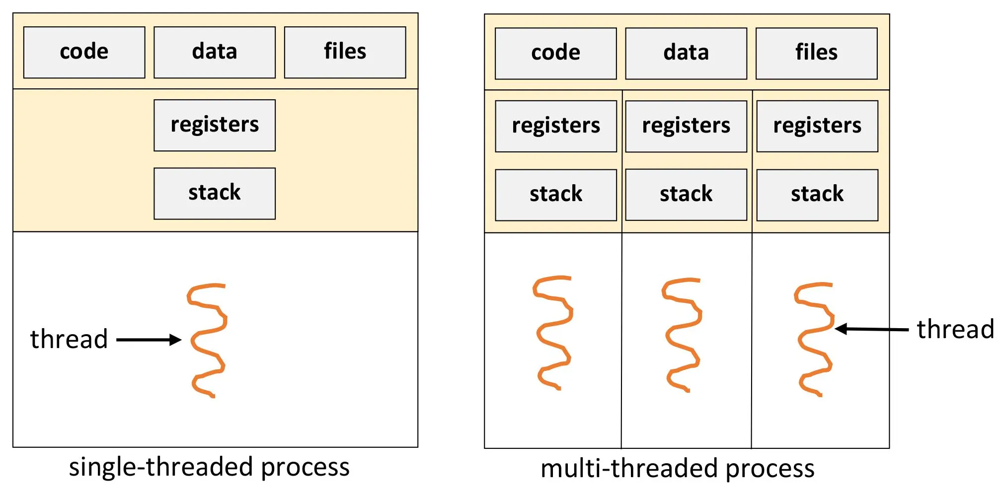
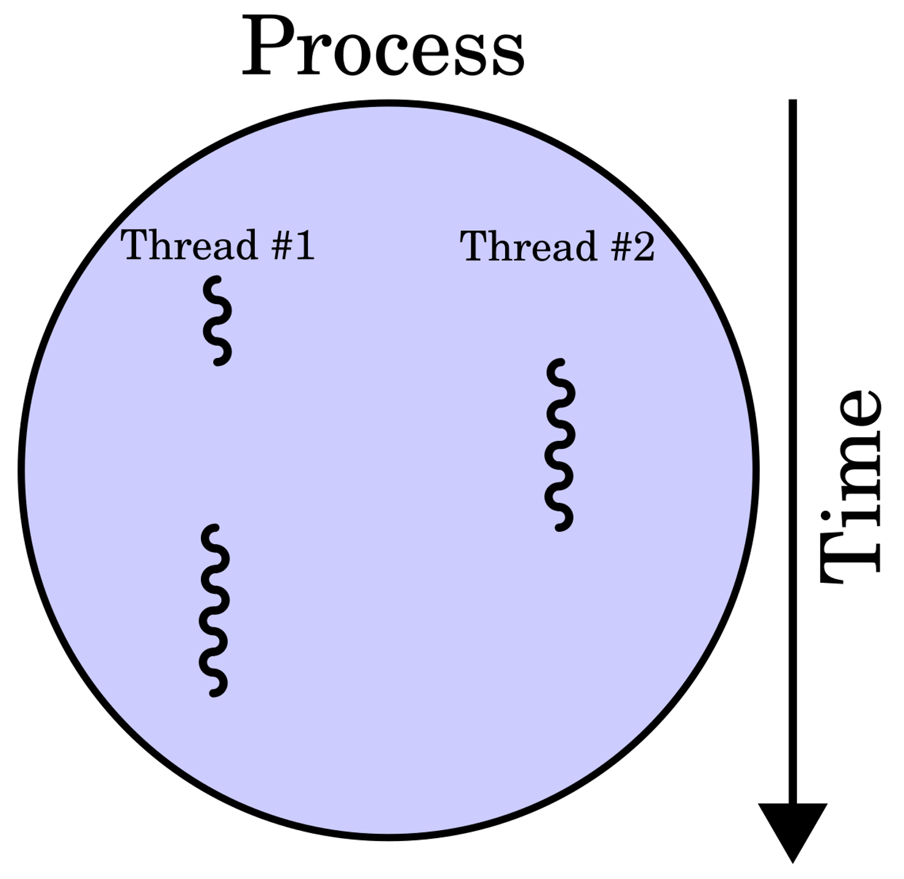
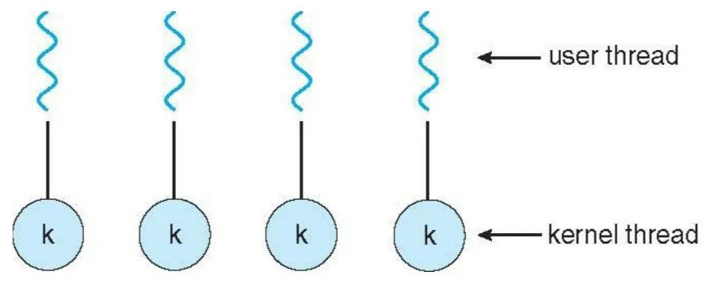
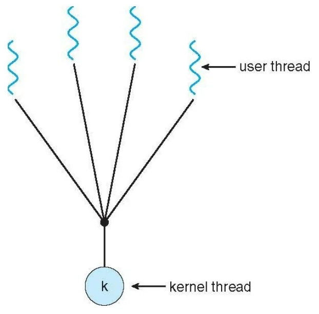
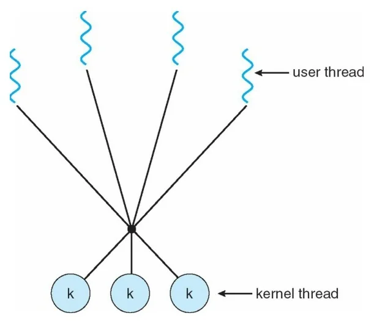

# Thread

# User Thread and Kernel Thread
- ### User Thread (User-Level Thread)
- ### Kernel Thread (Kernel-Level Thread)

# Multithreading

- ### Multithreading Models
    - #### One-to-One Model
        
    - #### Many-to-One Model
        
    - #### Many-to-Many Model
        
    - ### Multithreaded Programming

# Thread Pool

# Thread Libraries

