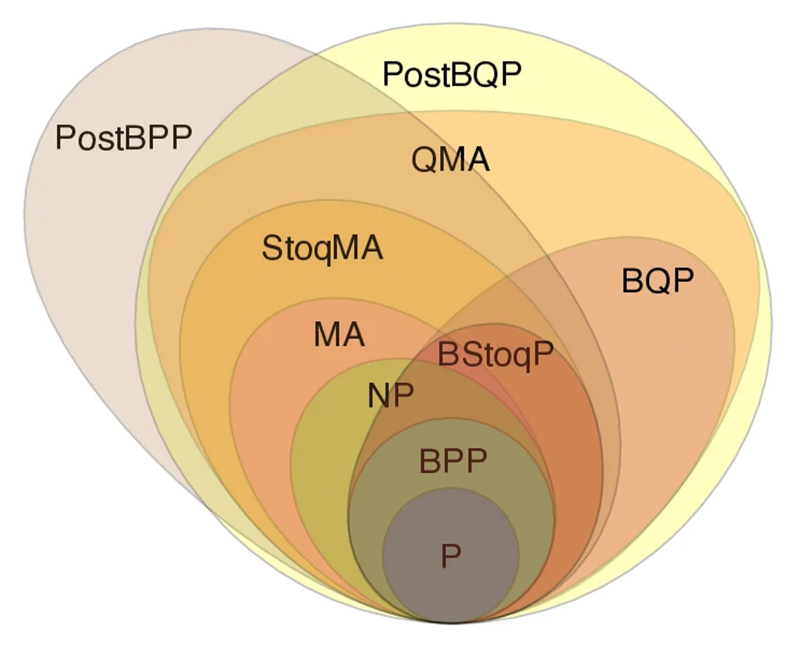
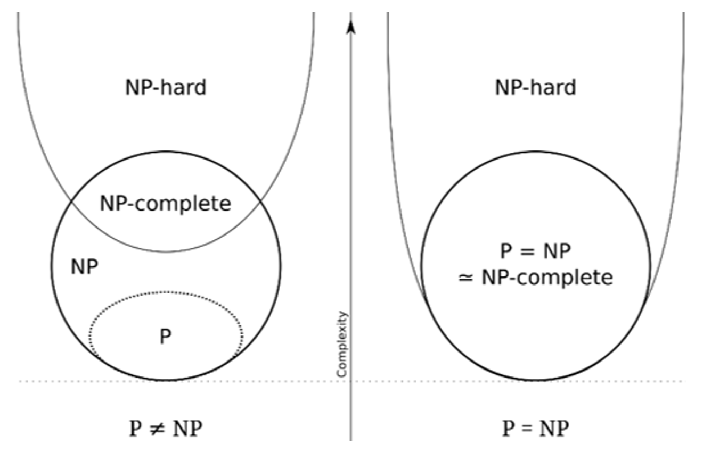

# Complexity Class
- $\text{L} \subseteq \text{NL} \subseteq \text{P} \subseteq \text{NP} \subseteq \text{PSPACE} \subseteq \text{EXPTIME} \subseteq \text{EXPSPACE}$
- ### [Time Complexity Classes](#time-complexity-classes-1)
- ### [Space Complexity Classes](#space-complexity-classes-1)

# Time Complexity Classes

- ### [P and NP](#p-and-np-1)
- ### Deterministic Time (DTIME)
- ### Nondeterministic Time (NTIME)
- ### Exponential Time (EXPTIME)
- ### Bounded-error Quantum Polynomial Time (BQP)

# P and NP

- ### Polynomial Time (P)
- ### Nondeterministic Polynomial Time (NP)
- ### NP-Hard
- ### NP-Complete
    - $\text{NP-Complete}=\text{NP}\cap \text{NP-Hard}$
- ### P versus NP problem

# Space Complexity Classes
- ### Polynomial Space (PSPACE)
- ### Nondeterministic Polynomial Space (NPSPACE)
- ### Deterministic Space (DSPACE)
- ### Logarithmic Space (LOGSPACE, L)
- ### Nondeterministic Logarithmic Space (NLOGSPACE, NL)
- ### Exponential Space (EXPSPACE)

# Hierarchy Theorem
- ### Space Hierarchy Theorem
- ### Time Hierarchy Theorem

# Savitch's Theorem
- $\text{NSPACE}\Bigl( f\left(n\right) \Bigr) \subseteq \text{DSPACE}\Bigl( f\left(n\right)^2 \Bigr)$

# [Polynomial-time Reduction](polynomial-time-reduction.md)
- ### [Many-one Reduction](polynomial-time-reduction.md#many-one-reduction)
- ### [Truth-table Reduction](polynomial-time-reduction.md#truth-table-reduction)
- ### [Turing Reduction](polynomial-time-reduction.md#turing-reduction)

# Space Hierarchy Theorem
- ### [Space Hierarchy Theorem](space-hierarchy-theorem.md)
