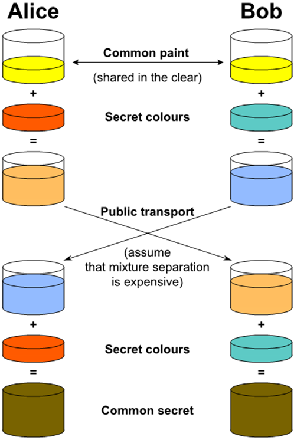
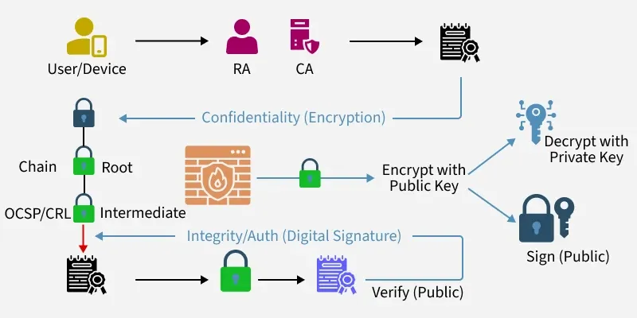

# Cryptography
- ### [Encoding](../../computer-science/data-representation/encoding/encoding.md)
- ### Encryption
    - ### [Symmetric Encryption](./encryption/symmetric-encryption/symmetric-encryption.md)
    - ### [Asymmetric Encryption](./encryption/asymmetric-encryption/asymmetric-encryption.md)
    - ### [Hybrid Encryption](./encryption/hybrid-encryption.md)
- ### [Cryptographic Hash Function (CHF)](/stem/it/coding/programming-language/data-structures-and-algorithms/hashing/cryptographic-hash-function.md)

# Kerckhoffs's Principle
- Even if a secure algorithm is made public, as long as the key is not leaked, the ciphertext remains secure.

# Avalanche Effect
- ### Strict Avalanche Criterion
- ### Bit Independence Criterion
- ### Example：Block Cipher, CHF

# Diffie-Hellman Key Exchange (DH Key Exchange)

# Cryptanalysis

# Public Key Infrastructure (PKI)

- ### Digital Signature
- ### Authority
    - #### Registration Authority (RA)
    - #### Certificate Authority (CA)
    - #### Validation Authority (VA)
- ### OCSP/CRL
    - #### Certificate Revocation List (CRL)
    - #### Online Certificate Status Protocol (OCSP)
- ### Trusted Third Party (TTP)
