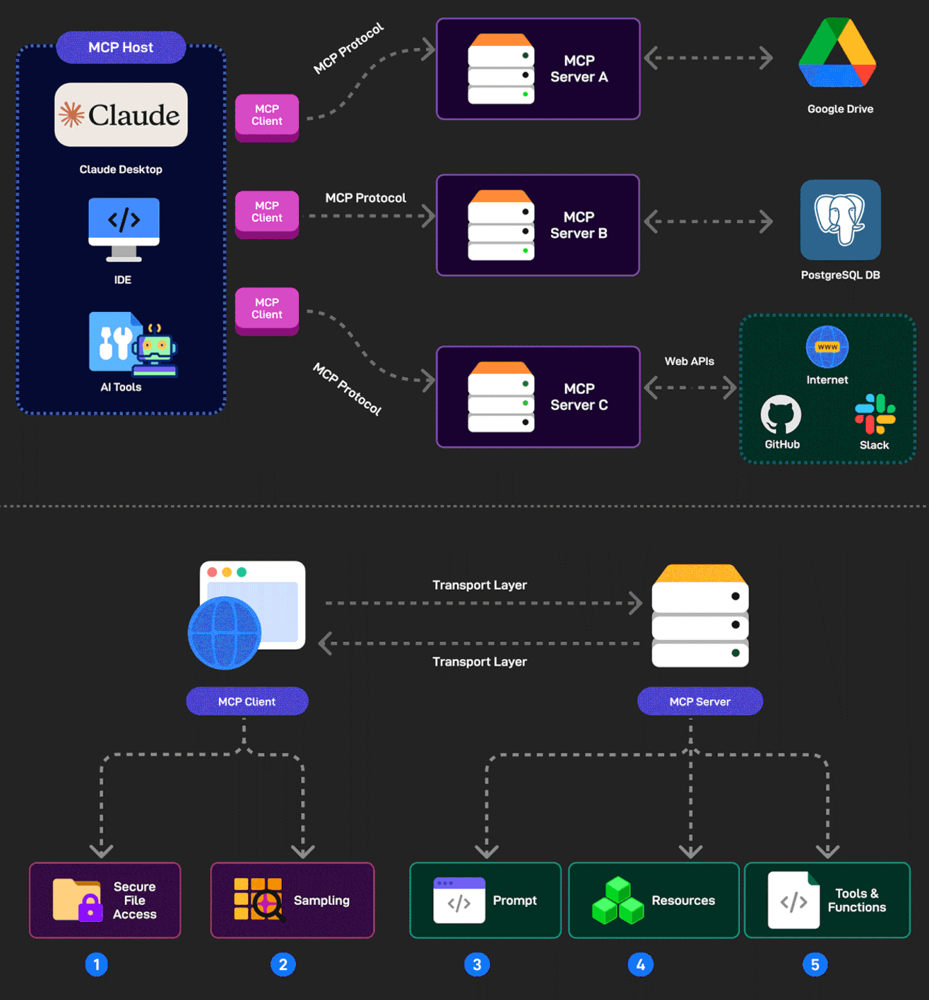

# Large Language Model (LLM)
- ### Pre-training $\to$ [AI Alignment](../ai-safety/ai-alignment.md) ([SFT](../transfer-learning/fine-tuning.md#supervised-fine-tuning-sft) $\to$ [RLHF](../transfer-learning/fine-tuning.md#reinforcement-learning-from-human-feedback-rlhf), [DPO](../transfer-learning/fine-tuning.md#direct-preference-optimization-dpo))

# Test-time scaling

# Context Window
- ### Token
- ### Context Engineering

# Model Context Protocol (MCP)

# Retrieval-Augmented Generation (RAG)

# Data Poisoning
- ### Label Flipping

# [Prompt Injection](/stem/it/cybersecurity/cyberattack/injection-attack/prompt-injection.md)
- ### [Direct Prompt Injection](/stem/it/cybersecurity/cyberattack/injection-attack/prompt-injection.md#direct-prompt-injection)
- ### [Indirect Prompt Injection](/stem/it/cybersecurity/cyberattack/injection-attack/prompt-injection.md#indirect-prompt-injection)
- ### [Stored Prompt Injection](/stem/it/cybersecurity/cyberattack/injection-attack/prompt-injection.md#stored-prompt-injection)
