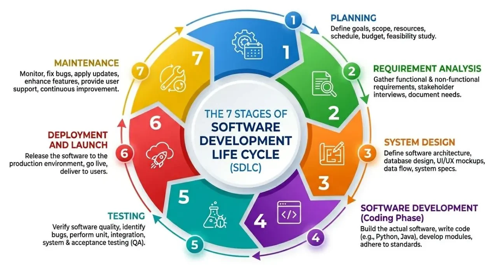

# Software Development Life Cycle (SDLC)

1. ### Planning
2. ### Requirement Analysis
3. ### System Design
4. ### Implementation, Development, Coding
5. ### Testing
6. ### Deployment
7. ### Support and Maintenance

# Software Development Models
- ### [Software Development Models](software-development-models.md)

# Software Release Life Cycle (SRLC)

# DevOps (Development and Operations)
- ### [DevOps (Development and Operations)](devops.md)
