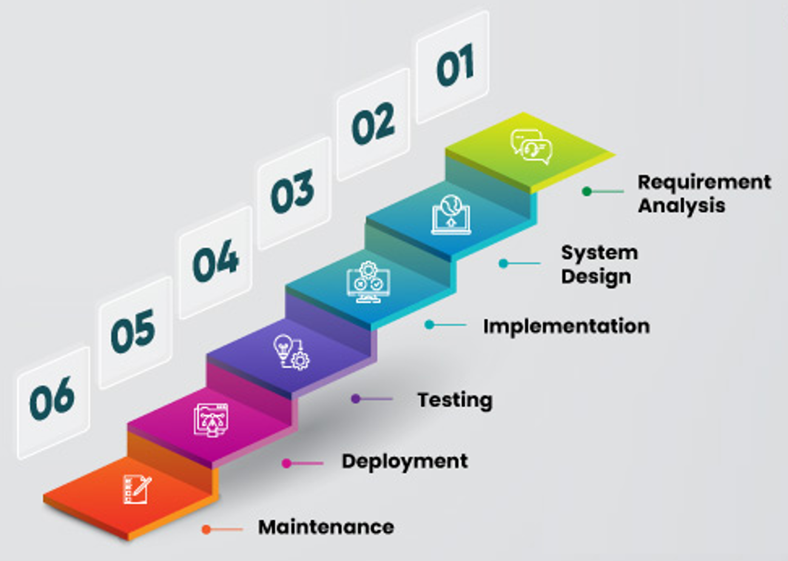
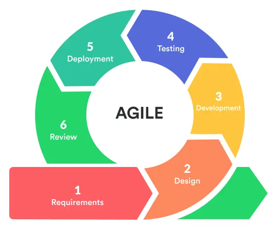
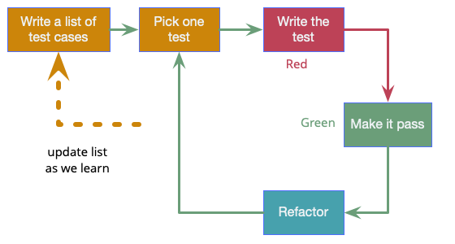
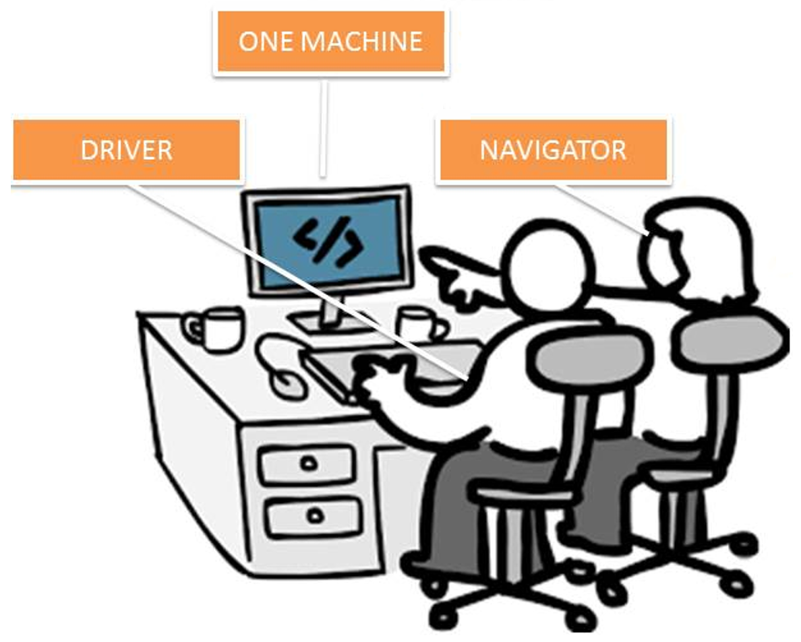
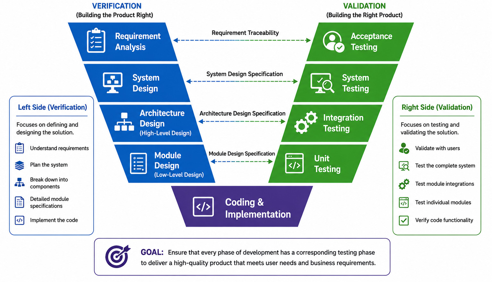

# Waterfall Model

# Agile Model (Agile Development)

- ### Extreme Programming (XP)
    - ### Test-Driven Development (TDD)：writing automated unit tests before writing the actual functional code
        
    - ### Pair Programming：two developers sharing a single workstation
        
        
        - the Driver：the person who writes the code
        - the Navigator (or Observer)：the person who reviews each line of code as it is written
- ### Scrum
- ### カンバン

# Iterative Model (Iterative Development)
- ### Rational Unified Process (RUP)

# Incremental Model (Incremental Development)

# Spiral Model

# V-Model

- ### Verification and Validation

# Rapid Application Development (RAD)
