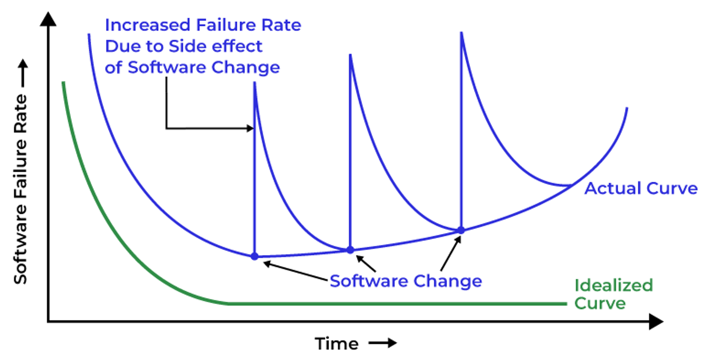

# [Software Development Life Cycle (SDLC)](./sdlc/sdlc.md)
- ### [Software Development Models](./sdlc/software-development-models.md)
- ### [DevOps (Development and Operations)](./sdlc/devops.md)

# Computer-Aided Software Engineering (CASE)
- ### Upper CASE
- ### Lower CASE

# Component-Based Software Engineering (CBSE)

# Object-Oriented Software Engineering (OOSE)

# [Software Architecture](./software-architecture/software-architecture.md)
- ### [Architectural Model](/stem/it/computer-science/concurrent-computing/distributed-computing/distributed-computing-system-models/architectural-model/architectural-model.md)

# Failure Curve for Software

# Data Engineering
- ### [Data Engineering](../../computer-science/data-management/data-engineering.md)

# Configuration File
- ### `.conf`, `.cfg`, `.config`
- ### Initialization File (`.ini`)
- ### Environment File (`.env`)
    - [Key-Value Pair](/stem/it/coding/programming-language/data-structures-and-algorithms/data-structure/data-structure.md#key-value-pair-kvp)：`KEY=VALUE`
- ### [Extensible Markup Language (XML)](/stem/it/coding/data-serialization/xml/xml.md)
- ### [JavaScript Object Notation (JSON)](/stem/it/coding/data-serialization/json.md)
- ### [YAML](/stem/it/coding/data-serialization/yaml.md)
