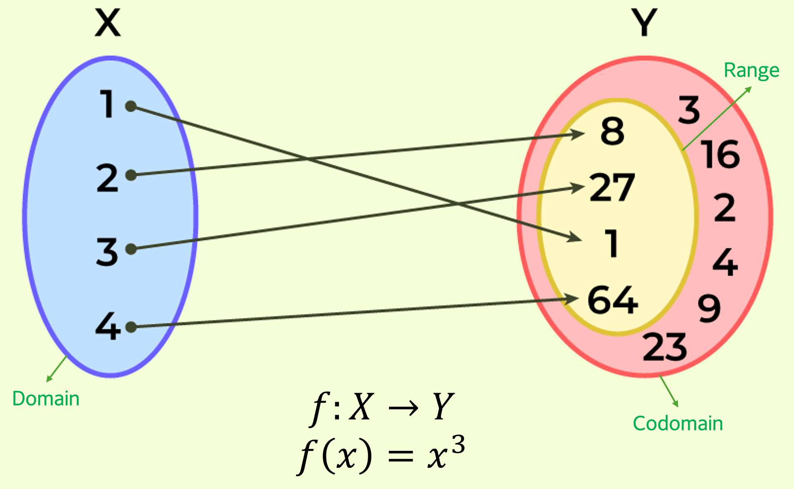
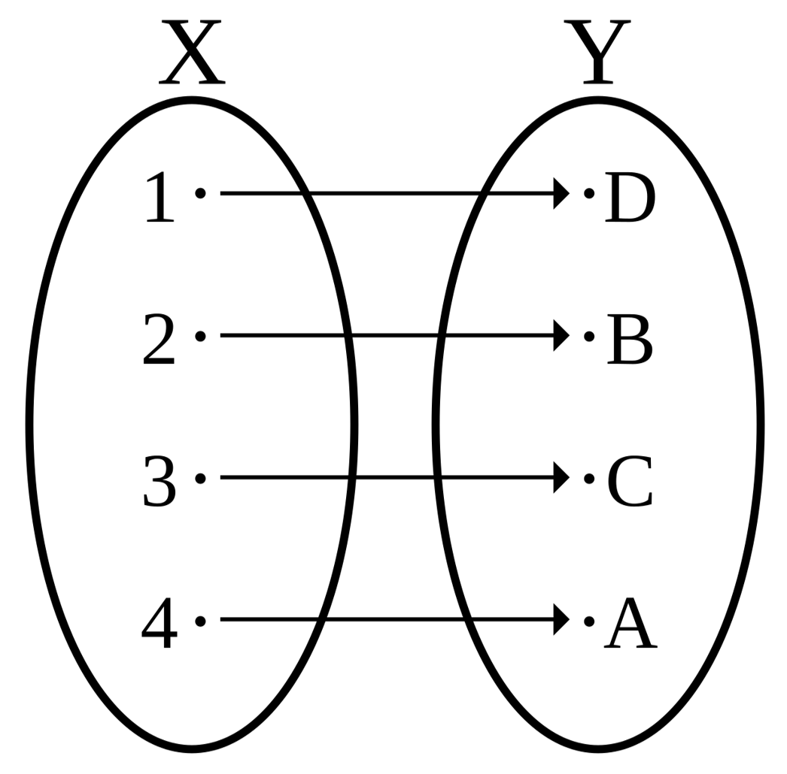
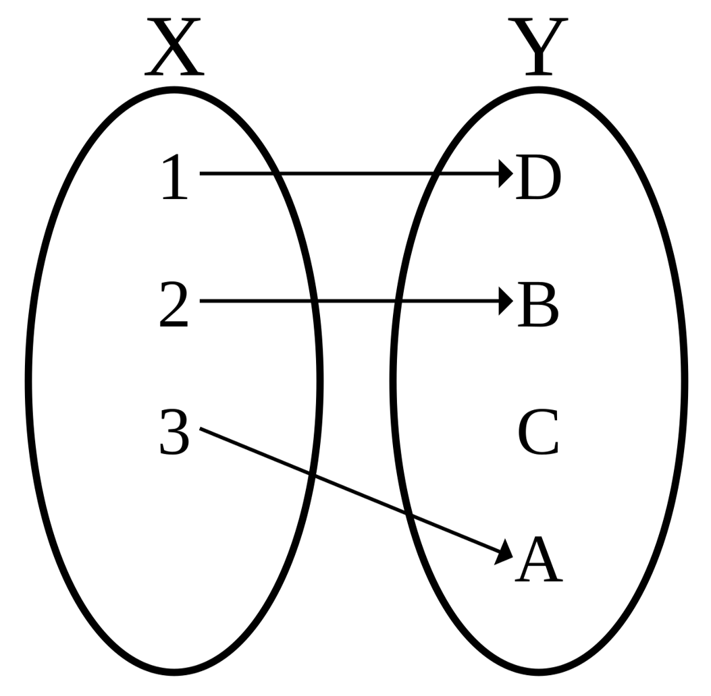
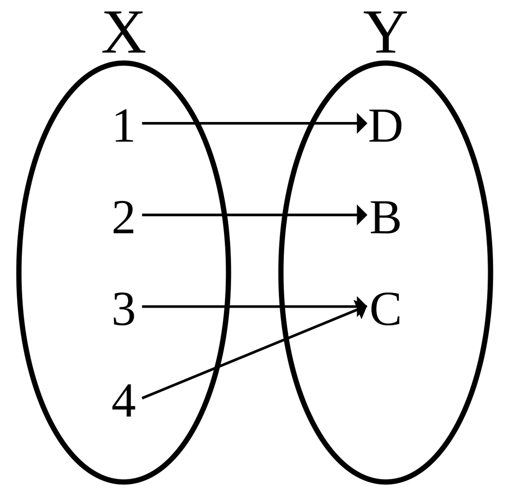
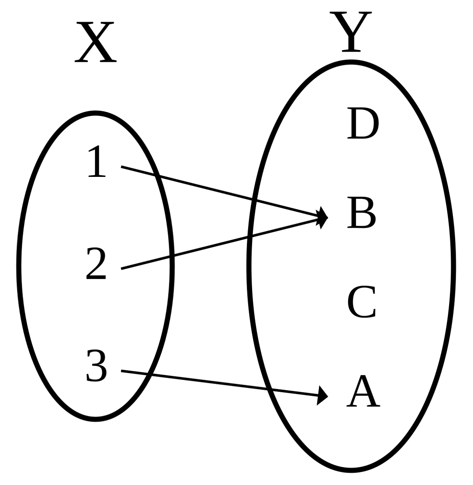
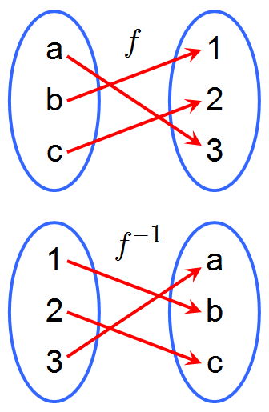
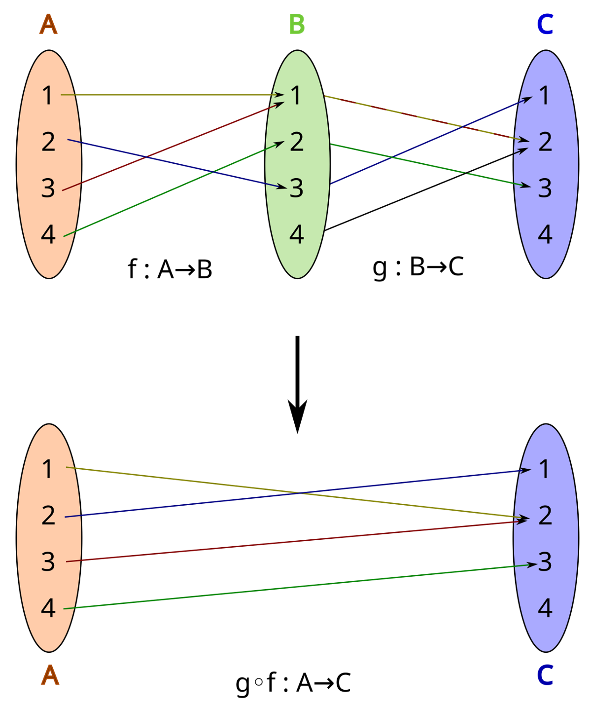
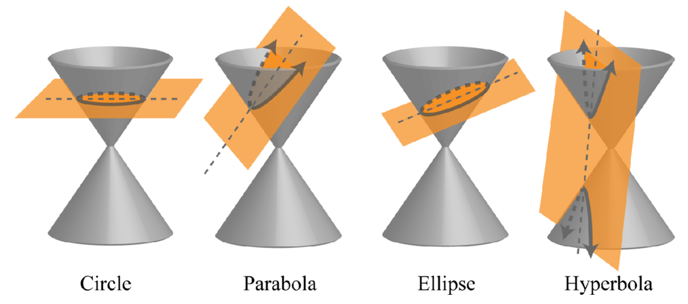

# Vector of a function
- ### Normal Vector
    - #### A vector that is Perpendicular to a function
- ### Direction Vector
    - #### A vector that is Parallel to a function
- ### $\text{Normal Vector}\cdot \text{Direction Vector}=0$

# Domain, Codomain and Range
- ### Domain：the set of all input values that the function can accept {#domain}
- ### Codomain：the set of all potential output values that the function is declared to target {#codomain}
- ### Range：the set of all output values that the function can produce {#range}
- ### Example
    

    - $y=f\left(x\right)=x^3$
    - Domain：$X=\left\{1,~2,~3,~4\right\}$
    - Codomain：$Y=\left\{1,~2,~3,~4,~8,~9,~16,~23,~27,~64\right\}$
    - Range：$\left\{1,~8,~27,~64\right\}$

# Types of Functions
- ### Injection, Surjection and Bijection
    ||Surjective|Non-surjective|
    |:---:|:---:|:---:|
    |**Injective**|||
    |**Non-injective**|||
    - #### Injection (one-to-one)：each element of the codomain is mapped to by at most one element of the domain {#injection}
    - #### many-to-one：there exists at least one element of the codomain that is mapped to by at least two elements of the domain
    - #### Surjection (onto)：each element of the codomain is mapped to by at least one element of the domain {#surjection}
    - #### Bijection：the function is both injective and surjective {#bijection}
- ### Even Function, Odd Function
    ||Definition|
    |:---:|:---:|
    |Even Function|Function is symmetric with respect to the Y-axis $f\left(x\right)=f\left(-x\right)$|
    |Odd Function|Function is symmetric with respect to the Origin $-f\left(x\right)=f\left(-x\right)$|
- ### Concave Function, Convex Function
    - #### Jensen's Inequality
- ### Periodic Function
    - $f\left(x+n\times \text{Period}\right)=f\left( x \right)$

# Inverse Function

- $f\text{ is invertible} \iff f\text{ is bijective}$
- $f^{-1}\left(y\right)=x,~f\left(x\right)=y$
- $f^{-1}\left(f\left(x\right)\right)=x,~f\left(f^{-1}\left(y\right)\right)=y$

# Function Composition

- $\left(f \circ g\right)\left(x\right) = f\left(g\left(x\right)\right)$

# Equation
- ### [Equation of the Line](equation/equation-of-the-line.md)
- ### [Equation of Plane](equation/equation-of-plane.md)
- ### [Equation of the Line in 3D](equation/equation-of-the-line-in-3d.md)
- ### Conic Section
    

    - ### [Equations of Circle](equation/conic-section/equations-of-circle.md)
    - ### [Equations of Parabola](equation/conic-section/equations-of-parabola.md)
    - ### [Equations of Ellipse](equation/conic-section/equations-of-ellipse.md)
    - ### [Equations of Hyperbola](equation/conic-section/equations-of-hyperbola.md)

# Polynomial
- ### Polynomial Inequality
- ### Polynomial Interpolation

# Function
- ### Polynomial Functions
    - #### [Linear Function](equation/equation-of-the-line.md)
    - #### Quadratic Function
    - #### Cubic Function
- ### Transcendental function
    - #### Exponential Function
    - #### Logarithmic Function
    - #### Trigonometric Functions
- ### Piecewise Function
    - #### Step Function
- ### Absolute Value Function
- ### Error Function (erf)
- ### Kronecker Delta

