# Set
|Set|Notation|Definition|Example|
|:---:|:---:|:---:|:---:|
|Element|$a$|an individual object that belongs to a set|$3.14$|
|Set|$S=\set{a_1,~\cdots ,~a_n}$|a collection of different objects|$S=\set{3.14,~\text{sui},~x^2+5}$|
|Universal Set|$U$|a set that contains all of the objects|
|Empty Set|$\varnothing=\Set{}$|a set having no elements|
|Cardinality| $|S|$ |the number of distinct elements in a set| $S=\set{3.14,~\text{sui},~x^2+5},~|S|=3,~|\varnothing|=0$ |
- ### Set-Builder Notation
    |Set-Builder Notation|Definition|Example|
    |:---:|:---:|:---:|
    |$\{x\mid Φ\left(x\right)\},~\{x:Φ\left(x\right)\}$|the set of all elements $x$ that satisfy the condition $Φ\left(x\right)$|$\{x\mid x>35\}$, $\{x\mid x>35,~x\in \mathbb{R}\}$|
    |$\{x\in S \mid Φ\left(x\right)\},~\{x\in S:Φ\left(x\right)\}$|the set of all elements $x$ belonging to set $S$ that satisfy the condition $Φ\left(x\right)$|$\{x\in \mathbb{R} \mid x>35\}$|
- ### Properties of Set
    |Properties of Set|Definition|Example|
    |:---:|:---:|:---:|
    |Unorderedness|the elements in a set are unordered $S=\set{a_1,~\cdots ,~a_n}=\set{a_n,~\cdots ,~a_1}$|$S=\set{1,~2,~3}=\set{3,~1,~2}$|
    |Distinctness|the elements in a set are distinct $S=\set{a_1,~\cdots ,~a_n},~a_i\ne a_j,~\text{for all }i\ne j$|$S=\set{1,~2,~2,~3}=\set{1,~2,~3}$|

# [Sequence](sequence.md)
- ### [Tuple](sequence.md#tuple)
- ### [Ordered Pair](sequence.md#ordered-pair)
- ### [Subsequence](sequence.md#subsequence)
- ### [Number Sequence](sequence.md#number-sequence)
- ### [String](sequence.md#string)

# [Family of Sets](family-of-sets.md)
- ### [Indexed Family](family-of-sets.md#indexed-family)
- ### [Partition of a Set](family-of-sets.md#partition-of-a-set)
- ### [Power Set](family-of-sets.md#power-set)

# Venn Diagram
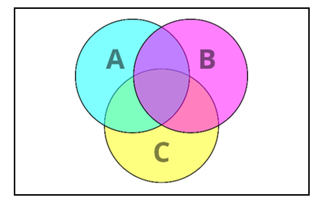

# Set Operations
|Set Operations|Notation|Definition|Venn Diagram|
|:---:|:---:|:---:|:---:|
|Complement|$\overline{A},~A'$|$\text{⁠not belong to }A$|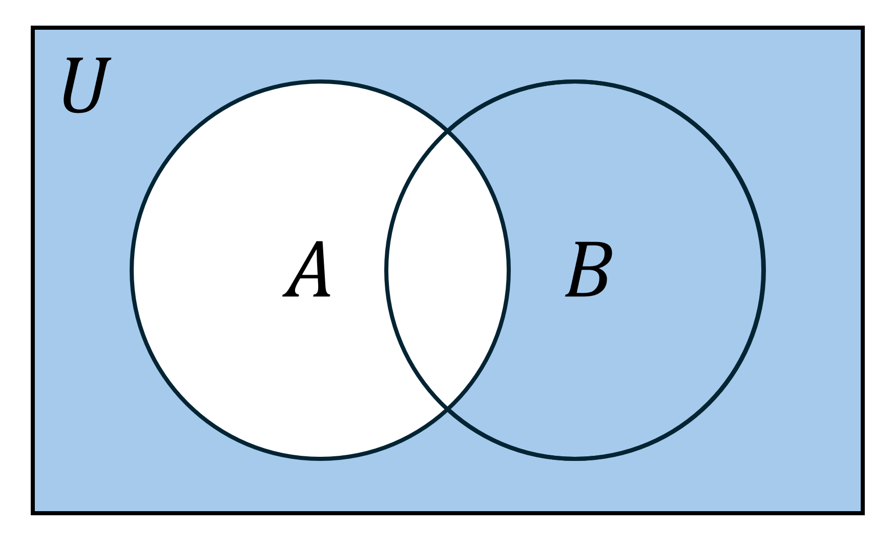|
|Intersection|$A\cap B$|$\text{both }A\text{ and }B$|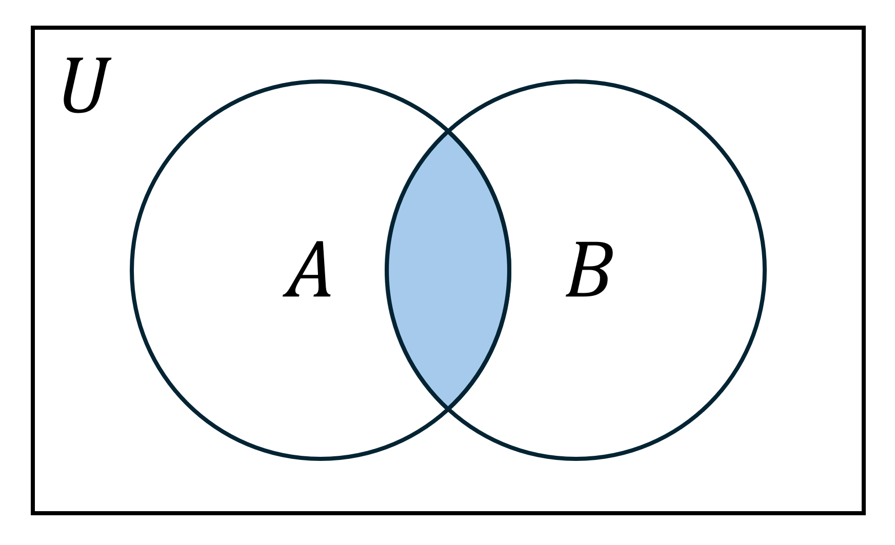|
|Union|$A\cup B$|$A\text{ or }B\text{ or both}$|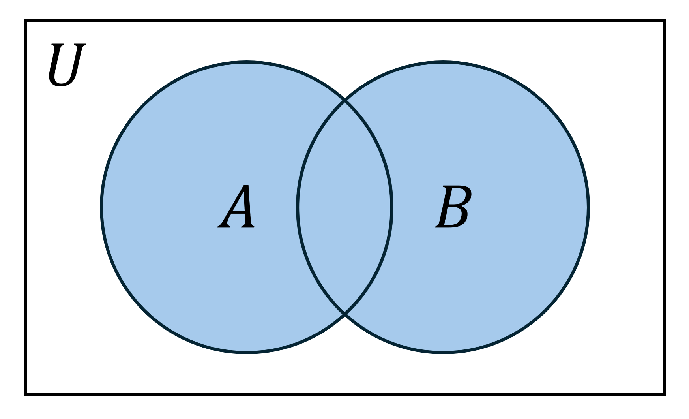|
|Difference|$A-B,~A\backslash B$|$\text{belong to }A,~\text{but not to }B$|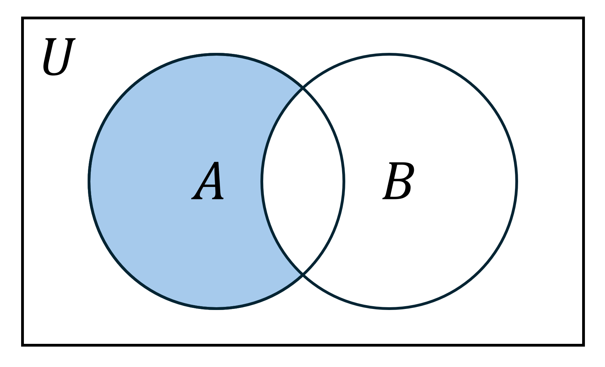|
|Symmetric Difference|$A\,Δ\,B = \left(A-B\right) \cup \left(A-B\right)$|$\text{belong to }A\text{ or }B,~\text{but not to both}$|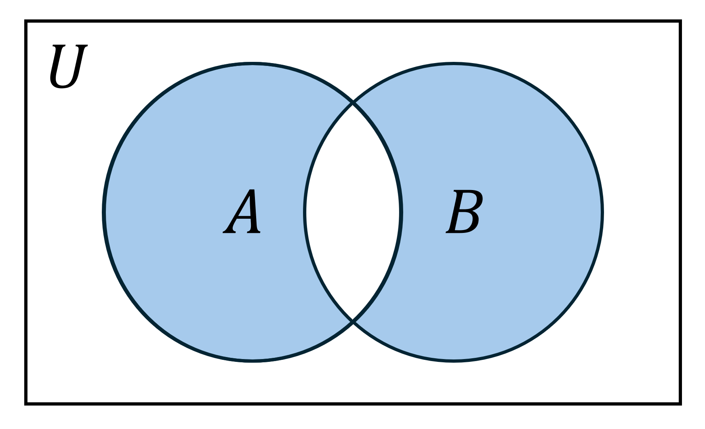|
- ### Finite Set Operations
    |Finite Set Operations|Notation|
    |:---:|:---:|
    |Finite Intersection|$\bigcap\limits_{i=1}^{n}A_i=A_1\cap\cdots\cap A_n$|
    |Finite Union|$\bigcup\limits_{i=1}^{n}A_i=A_1\cup\cdots\cup A_n$|
- ### Membership Table：[truth table](../mathematical-logic/mathematical-logic.md#truth-table) in set theory

# Set Relations
|Set Relations|Notation|Definition|Venn Diagram|Example|
|:---:|:---:|:---:|:---:|:---:|
|Superset|$A\supseteq B$|$A\text{ is a superset of }B,~A\text{ contains }B$|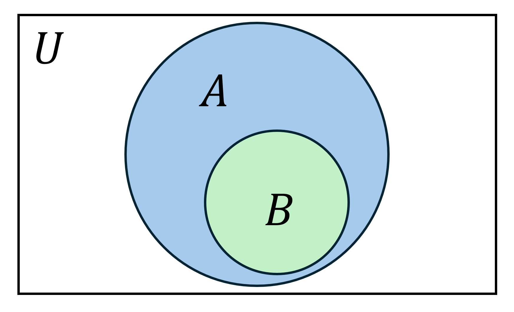|$\set{1,~2,~3}\supseteq \set{1,~2},~\set{1,~2,~3}\supseteq \set{1,~2,~3}$|
|Subset|$A\subseteq B$|$A\text{ is a subset of }B,~B\text{ contains }A$|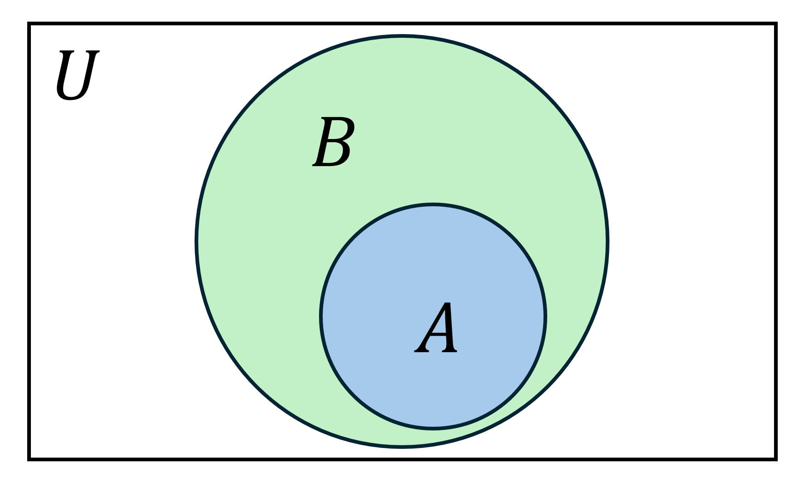|$\set{1,~2}\subseteq \set{1,~2,~3},~\set{1,~2,~3}\subseteq \set{1,~2,~3}$|
|Proper Superset|$A\supset B$|$A\text{ is a superset of }B,~\text{but }A\ne B$||$\set{1,~2,~3}\supset \set{1,~2}$|
|Proper Subset|$A\subset B$|$A\text{ is a subset of }B,~\text{but }A\ne B$||$\set{1,~2}\subset \set{1,~2,~3}$|
|Element of|$A\in B$|$A\text{ is a element of }B$||$2\in \set{1,~2,~3}$|
- ### Equal And Equivalent Sets
    |Equal And Equivalent Sets|Definition|Example|
    |:---:|:---:|:---:|
    |Equal Sets ($A=B$)|contain the exact same elements $\forall x\left(x\in A\iff x\in B\right)$|$A=\set{1,~2,~3},~B=\set{3,~1,~2}$|
    |Equivalent Sets ($A \sim B$)|contain the same [cardinality](#set) $|A|=|B|$|$A=\set{1,~2,~3},~B=\set{4,~6,~5}$|

# Properties of Relations
- ### Reflexive
- ### Symmetric
    - ### Asymmetric
- ### Transitive

# Properties of Sets
- ### [Logical Equivalences](../mathematical-logic/mathematical-logic.md#logical-equivalences)
- ### Commutative Laws
    - $A\cap B=B\cap A$
    - $A\cup B=B\cup A$
- ### Associative Laws
    - $\left(A\cap B\right)\cap C=A\cap\left(B\cap C\right)$
    - $\left(A\cup B\right)\cup C=A\cup\left(B\cup C\right)$
- ### Distributive Laws
    - $\left(A\cap B\right)\cup C=\left(A\cup C\right)\cap\left(B\cup C\right)$
    - $\left(A\cup B\right)\cap C=\left(A\cap C\right)\cup\left(B\cap C\right)$
- ### Absorption Laws
    - $\left(A\cap B\right) \cup A = A$
    - $\left(A\cup B\right) \cap A = A$
- ### Identity Laws
    - $A\cap U = A$
    - $A\cup\emptyset = A$
- ### Idempotent Laws
    - $A\cup A = A$
    - $A\cap A = A$
- ### Complement Laws
    - $A\cup A'=U$
    - $A\cap A'=\emptyset$
- ### Double Complement Laws
    - $\left(A'\right)' = A$
- ### [De Morgan's Laws](../mathematical-logic/mathematical-logic.md#de-morgans-laws)
    - $\left(A\cap B\right)'=A'\cup B'$

        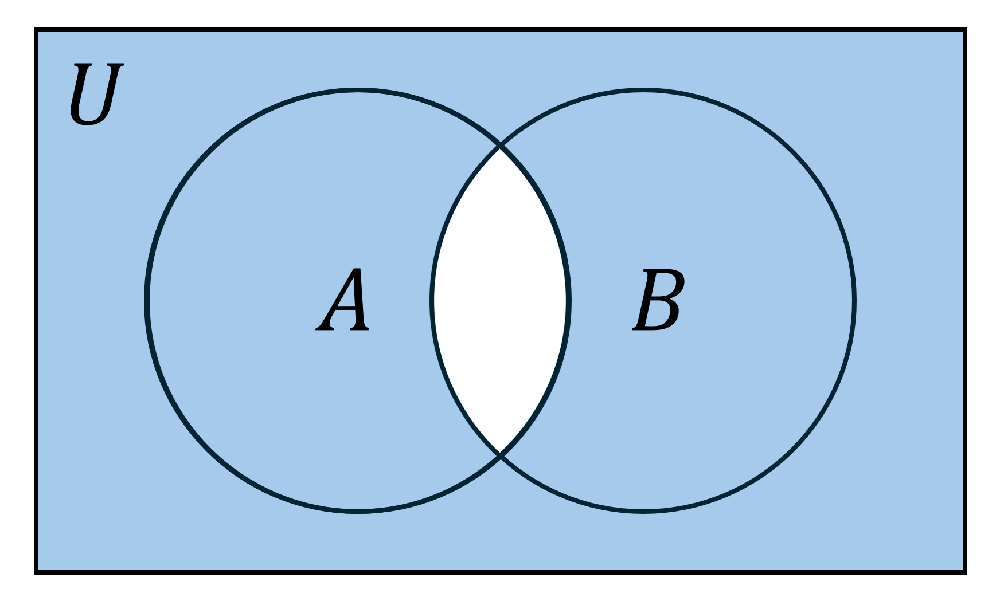
    - $\left(A\cup B\right)'=A'\cap B'$

        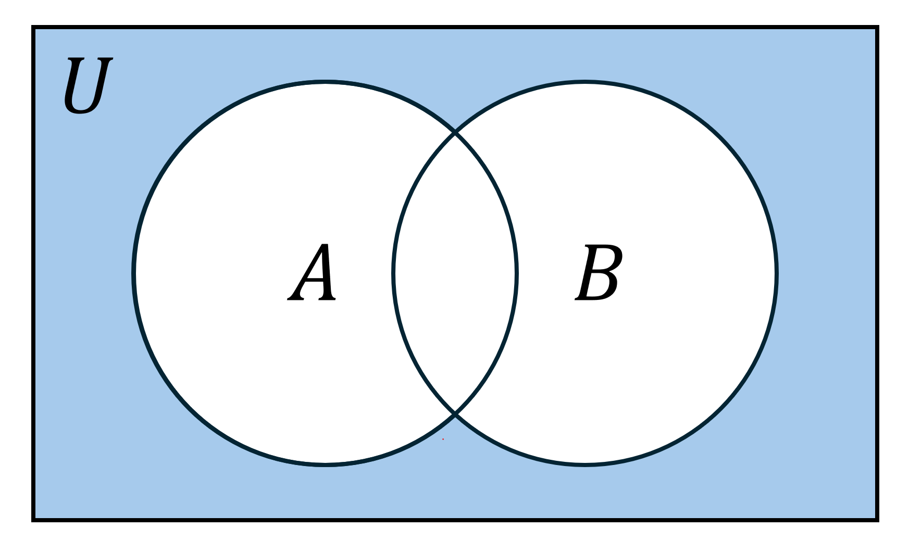
- ### Set Difference Law
    - $A-B=A \cap B'$

# Inclusion–Exclusion Principle
- ### $n$ sets：$\bigcup\limits_{i=1}^{n}A_i=\sum\limits_{k=1}^{n}\left(\left(-1\right)^{k+1}\left(\sum\limits_{1\le i_1<\cdots<i_k\le n}\left(A_{i_1}\cap\cdots\cap A_{i_k}\right)\right)\right)=\sum\limits_{i=1}^{n}A_i-\sum\limits_{1\le i_1<i_2\le n}\left(A_{i_1}\cap A_{i_2}\right)+\cdots+\left(-1\right)^{n+1}\left(A_1\cap\cdots\cap A_n\right)$
- ### 2 sets：$\left(A\cup B\right)=\left(A+B\right)-\left(A\cap B\right)$
- ### 3 sets：$\left(A\cup B\cup C\right)=\left(A+B+C\right)-\left(\left(A\cap B\right)+\left(A\cap C\right)+\left(B\cap C\right)\right)+\left(A\cap B\cap C\right)$
    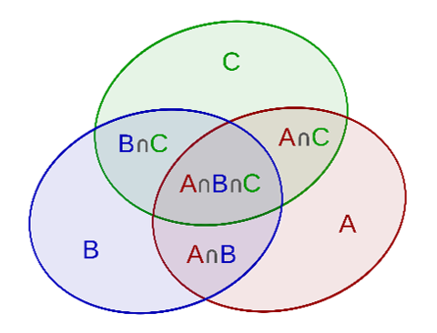

# Cartesian Product

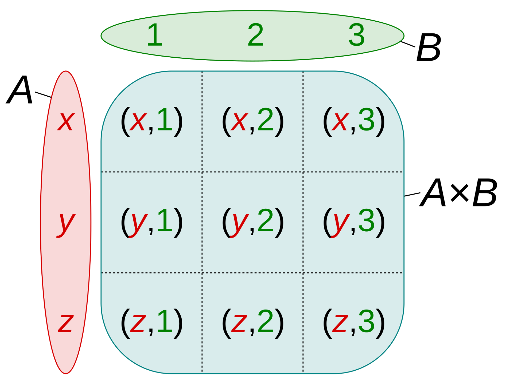

- $A\times B = \{\left(a,~b\right) \mid a\in A \text{ and } b\in B\}$

# Number Set

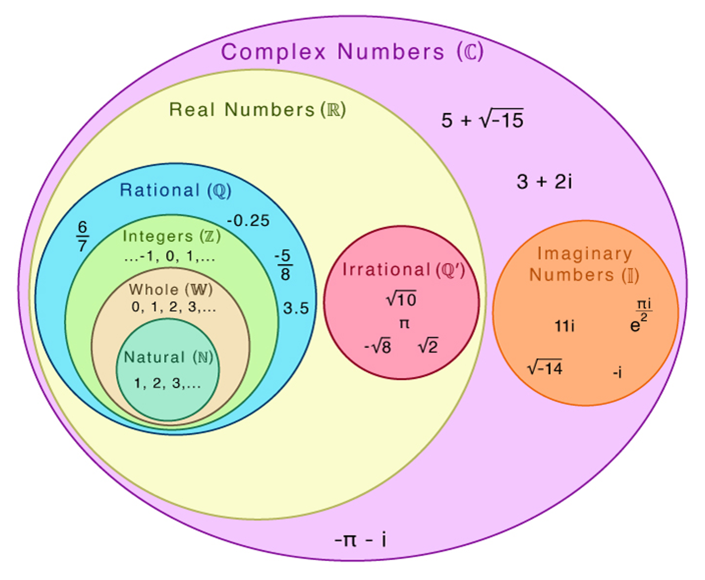

- $\mathbb{N} \subset \mathbb{Z} \subset \mathbb{Q} \subset \mathbb{R} \subset \mathbb{C}$
    |Number Set|Definition|Set Relations|Example|
    |:---:|:---:|:---:|:---:|
    |Natural Numbers ($\mathbb{N}$)|integers that are positive|$\mathbb{N} \subset \mathbb{W} \subset \mathbb{Z}$|$1,~2$|
    |Whole Numbers ($\mathbb{W}$)|integers that are not negative|$\mathbb{W}=\set{0}\cup\mathbb{N}$ $\mathbb{W} \subset \mathbb{Z}$|$0,~1,~2$|
    |Integers ($\mathbb{Z}$)|rational numbers that can be written without a fractional part|$\mathbb{Z} \subset \mathbb{Q}$|$-2,~-1,~0,~1,~2$|
    |Rational Numbers ($\mathbb{Q}$)|real numbers that can be expressed as a fraction|$\mathbb{Q} \subset \mathbb{R}$|$2,~-\frac{6}{7},~3.5,~0.\overline{3}$|
    |Irrational Numbers ($\mathbb{Q}'$)|real numbers that cannot be written as a simple fraction|$\mathbb{Q}' \subset \mathbb{R}$|$\sqrt{2},~π,~e$|
    |Real Numbers ($\mathbb{R}$)|all numbers that can be found on the number line|$\mathbb{R}=\mathbb{Q} \cup \mathbb{Q}'$ $\mathbb{R} \subset \mathbb{C}$|$2,~-\frac{6}{7},~π$|
    |Imaginary Numbers ($\mathbb{I}$)|complex numbers with a non-zero imaginary part ($a+bi,~b\ne 0$)|$\mathbb{I} \subset \mathbb{C}$|$i,~\sqrt{-35},~-2i^3,~e^{i}$|
    |Complex Numbers ($\mathbb{C}$)|numbers in the form $a+bi$ where $a,~b \in \mathbb{R}$||$π,~i,~3-5i$|
- ### Positive/Negative Number Set
    |Number Set|Definition|Set Relations|Example|
    |:---:|:---:|:---:|:---:|
    |Positive Integers ($\mathbb{Z}^+$)|integers that are positive|$\mathbb{Z}^+ \subset \mathbb{Z}$|$1,~2,~3$|
    |Negative Integers ($\mathbb{Z}^-$)|integers that are negative|$\mathbb{Z}^- \subset \mathbb{Z}$|$-1,~-2,~-3$|
    |Positive Real Numbers ($\mathbb{R}^+$)|real numbers that are positive|$\mathbb{R}^+ \subset \mathbb{R}$|$35,~\frac{6}{7},~π$|
    |Negative Real Numbers ($\mathbb{R}^-$)|real numbers that are negative|$\mathbb{R}^- \subset \mathbb{R}$|$-35,~-\frac{6}{7},~-π$|

# Zermelo–Fraenkel Set Theory with the Axiom of Choice (ZFC)

# Russell's Paradox
- ### Barber Paradox

# Cantor's Diagonal Argument
