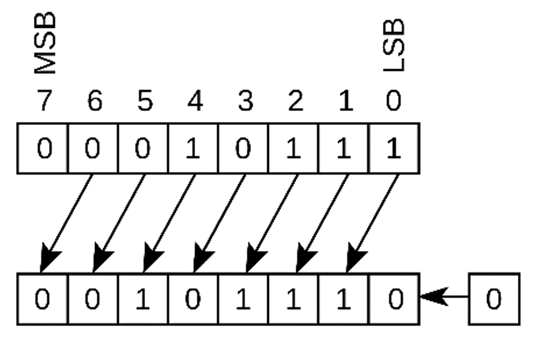
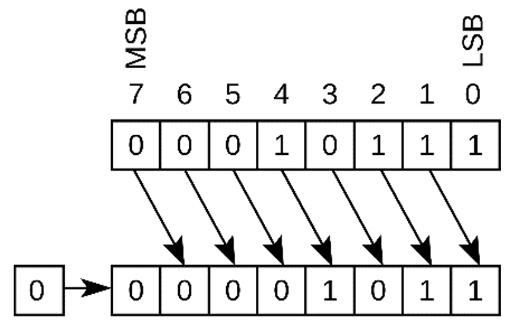
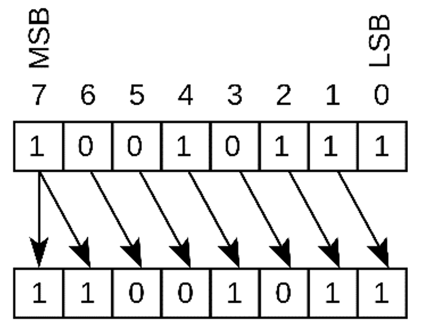
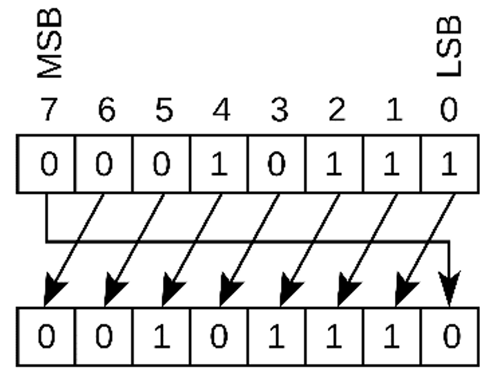
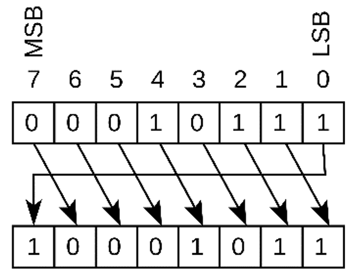
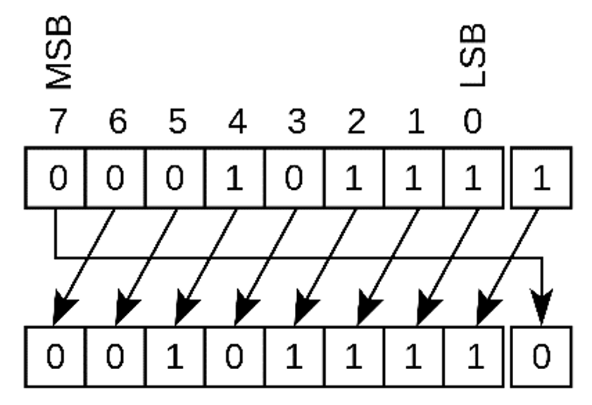
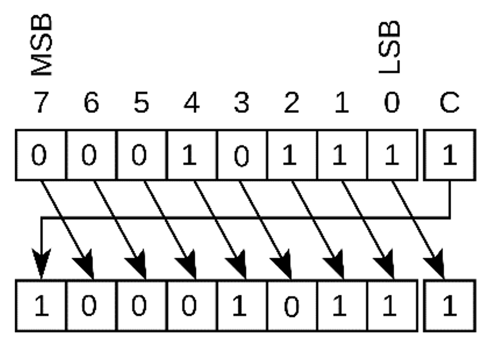

# Logical Shift
|Logical Left Shift (Arithmetic Left Shift)|Logical Right Shift|
|:---:|:---:|
|||
|[LSB](/stem/it/computer-science/data-representation/number-system.md#least-significant-bit-lsb) = 0|[MSB](/stem/it/computer-science/data-representation/number-system.md#most-significant-bit-msb) = 0|

# Arithmetic Shift
|Arithmetic Left Shift (Logical Left Shift)|Arithmetic Right Shift|
|:---:|:---:|
|||
|[LSB](/stem/it/computer-science/data-representation/number-system.md#least-significant-bit-lsb) = 0|[MSB](/stem/it/computer-science/data-representation/number-system.md#most-significant-bit-msb) = Original [LSB](/stem/it/computer-science/data-representation/number-system.md#least-significant-bit-lsb)|
|$x$ shifted left by $n$ bits = $x \times 2^n$|$x$ shifted right by $n$ bits = $x / 2^n$|
- ### Used for：[2's complement](/stem/it/computer-science/data-representation/number-system.md#2s-complement)
    - [MSB](/stem/it/computer-science/data-representation/number-system.md#most-significant-bit-msb) = sign bit
    - Arithmetic Right Shift：[MSB](/stem/it/computer-science/data-representation/number-system.md#most-significant-bit-msb) (sign bit) remains unchanged

# Rotate (Circular Shift)
|Left Rotate (Circular Left Shift)|Right Rotate (Circular Right Shift)|
|:---:|:---:|
|||
|[LSB](/stem/it/computer-science/data-representation/number-system.md#least-significant-bit-lsb) = Original [MSB](/stem/it/computer-science/data-representation/number-system.md#most-significant-bit-msb)|[MSB](/stem/it/computer-science/data-representation/number-system.md#most-significant-bit-msb) = Original [LSB](/stem/it/computer-science/data-representation/number-system.md#least-significant-bit-lsb)|
- ### Rotate through carry (Circular Shift through carry)
    |Left Rotate through carry (Circular Left Shift through carry)|Right Rotate through carry (Circular Right Shift through carry)|
    |:---:|:---:|
    |||
    |[LSB](/stem/it/computer-science/data-representation/number-system.md#least-significant-bit-lsb) = Original [MSB](/stem/it/computer-science/data-representation/number-system.md#most-significant-bit-msb)|[MSB](/stem/it/computer-science/data-representation/number-system.md#most-significant-bit-msb) = Original [LSB](/stem/it/computer-science/data-representation/number-system.md#least-significant-bit-lsb)|

# Barrel Shifter

