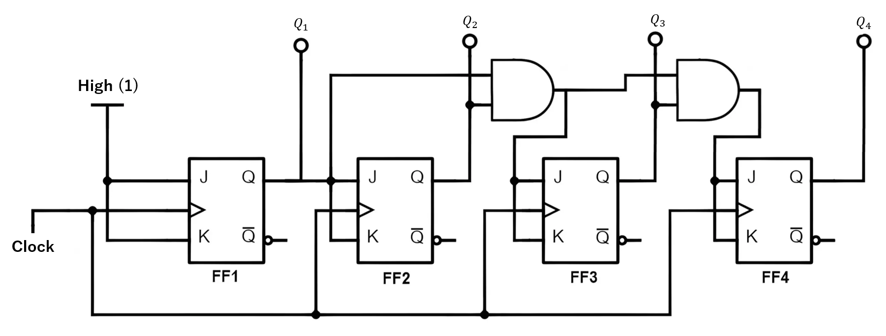
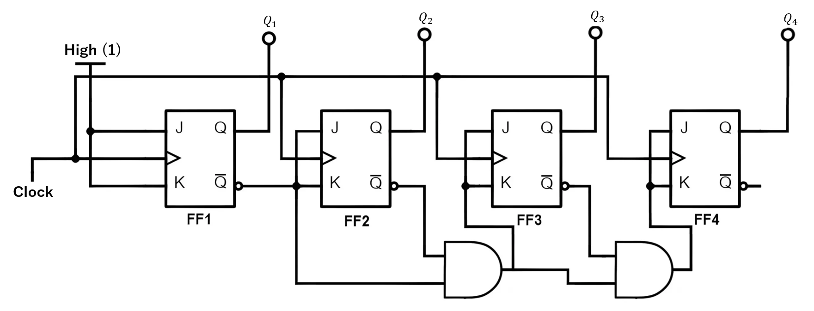
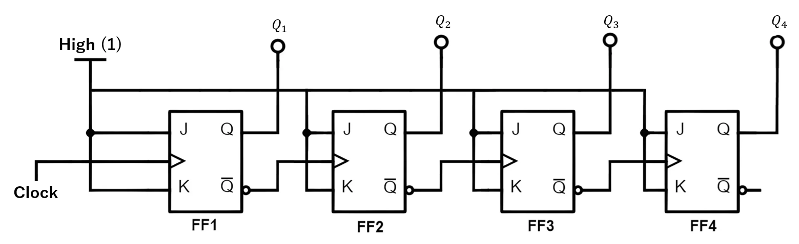
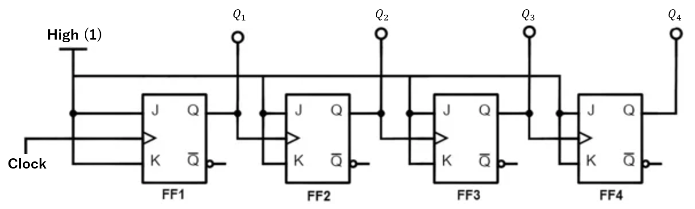
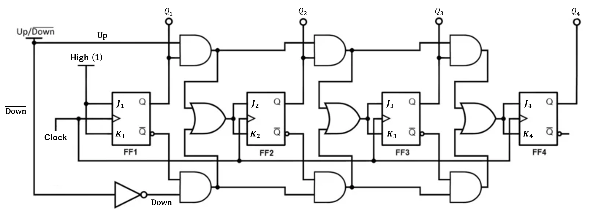

# Binary Counter
- ### Signals
    - $clk=\href{../sequential-logic.md#clk}{\text{Clock input}}$
    - $Q=\text{Data output}$
- ### Number of States ($n$-bit)：$m=2^n$
- ### Binary Up Counter
    - #### State Table ($3$-bit)
        |State|Data Output ($Q$)|
        |:---:|:---:|
        |$S_0$|000|
        |$S_1$|001|
        |$S_2$|010|
        |$S_3$|011|
        |$S_4$|100|
        |$S_5$|101|
        |$S_6$|110|
        |$S_7$|111|
    - #### [State-Transition Table](../finite-state-machine/representations-of-finite-state-machine.md#state-transition-table)
        |Current State|Next State|
        |:---:|:---:|
        |$S_i$ ($0\leq i<m-1$)|$S_{i+1}$|
        |$S_{m-1}$|$S_0$|
- ### Binary Down Counter
    - #### State Table ($3$-bit)
        |State|Data Output ($Q$)|
        |:---:|:---:|
        |$S_0$|111|
        |$S_1$|110|
        |$S_2$|101|
        |$S_3$|100|
        |$S_4$|011|
        |$S_5$|010|
        |$S_6$|001|
        |$S_7$|000|
    - #### [State-Transition Table](../finite-state-machine/representations-of-finite-state-machine.md#state-transition-table)
        |Current State|Next State|
        |:---:|:---:|
        |$S_i$ ($0\leq i<m-1$)|$S_{i+1}$|
        |$S_{m-1}$|$S_0$|
- ### Uses [JK Flip-Flop](../memory-element/flip-flop.md#jk-flip-flop)

# [Synchronous](../sequential-logic.md#sequential-circuit) Binary Counter
- ### Synchronous [Binary Up Counter](#binary-up-counter)
    - #### Logic Diagram (4-bit)
        
    - #### [Truth Table](../../../digital-electronics-and-logic-design.md#truth-table)
        - $Q_1$
            |Action|$clk$|$Q_1$|
            |:---:|:---:|:---:|
            |Hold|$0/1/\downarrow$|$Q_1$|
            |Toggle|$\uparrow$|$\overline{Q_1}$|
        - $Q_i,~i\ne1$
            |Action|$clk$|$Q_1 \cdots Q_{i-1}$|$Q_i$|
            |:---:|:---:|:---:|:---:|
            |Hold|$0/1/\downarrow$|X|$Q_i$|
            |Hold|$\uparrow$|$0$|$Q_i$|
            |Toggle|$\uparrow$|$1$|$\overline{Q_i}$|
- ### Synchronous [Binary Down Counter](#binary-down-counter)
    - #### Logic Diagram (4-bit)
        
    - #### [Truth Table](../../../digital-electronics-and-logic-design.md#truth-table)
        - $Q_1$
            |Action|$clk$|$Q_1$|
            |:---:|:---:|:---:|
            |Hold|$0/1/\downarrow$|$Q_1$|
            |Toggle|$\uparrow$|$\overline{Q_1}$|
        - $Q_i,~i\ne1$
            |Action|$clk$|$\overline{Q_1} \cdots \overline{Q_{i-1}}$|$Q_i$|
            |:---:|:---:|:---:|:---:|
            |Hold|$0/1/\downarrow$|X|$Q_i$|
            |Hold|$\uparrow$|$0$|$Q_i$|
            |Toggle|$\uparrow$|$1$|$\overline{Q_i}$|

# [Asynchronous](../sequential-logic.md#sequential-circuit) Binary Counter (Ripple Counter)
- ### Asynchronous [Binary Up Counter](#binary-up-counter)
    - #### Logic Diagram (4-bit)
        
    - #### [Truth Table](../../../digital-electronics-and-logic-design.md#truth-table)
        - $Q_1$
            |Action|$clk$|$Q_1$|
            |:---:|:---:|:---:|
            |Hold|$0/1/\downarrow$|$Q_1$|
            |Toggle|$\uparrow$|$\overline{Q_1}$|
        - $Q_i,~i\ne1$
            |Action|$\overline{Q_{i-1}}$|$Q_i$|
            |:---:|:---:|:---:|
            |Hold|$0/1/\downarrow$|$Q_i$|
            |Toggle|$\uparrow$|$\overline{Q_i}$|
- ### Asynchronous [Binary Down Counter](#binary-down-counter)
    - #### Logic Diagram (4-bit)
        
    - #### [Truth Table](../../../digital-electronics-and-logic-design.md#truth-table)
        - $Q_1$
            |Action|$clk$|$Q_1$|
            |:---:|:---:|:---:|
            |Hold|$0/1/\downarrow$|$Q_1$|
            |Toggle|$\uparrow$|$\overline{Q_1}$|
        - $Q_i,~i\ne1$
            |Action|$Q_{i-1}$|$Q_i$|
            |:---:|:---:|:---:|
            |Hold|$0/1/\downarrow$|$Q_i$|
            |Toggle|$\uparrow$|$\overline{Q_i}$|

# [Synchronous](../sequential-logic.md#sequential-circuit) Binary Up/Down Counter
- ### Signals
    - $\text{UP}/\overline{\text{DOWN}}$
- ### Logic Diagram (4-bit)
    
- ### [Boolean Expression](../../../digital-electronics-and-logic-design.md#boolean-expression)
    - $J_1=K_1=1$
    - $J_i=K_i = \text{UP}\cdot\left(Q_1 \cdots Q_{i-1}\right) + \text{DOWN}\cdot\left(\overline{Q_1} \cdots \overline{Q_{i-1}}\right) ,~i\ne1$
- ### [Truth Table](../../../digital-electronics-and-logic-design.md#truth-table)
    - $Q_1$
		|Action|$clk$|$Q_1$|
		|:---:|:---:|:---:|
		|Hold|$0/1/\downarrow$|$Q_1$|
		|Toggle|$\uparrow$|$\overline{Q_1}$|
	- $Q_i,~i\ne1$
        |Action|$clk$|$J_i,~K_i$|$Q_i$|
		|:---:|:---:|:---:|:---:|
		|Hold|$0/1/\downarrow$|X|$Q_i$|
		|Hold|$\uparrow$|$0$|$Q_i$|
		|Toggle|$\uparrow$|$1$|$\overline{Q_i}$|
