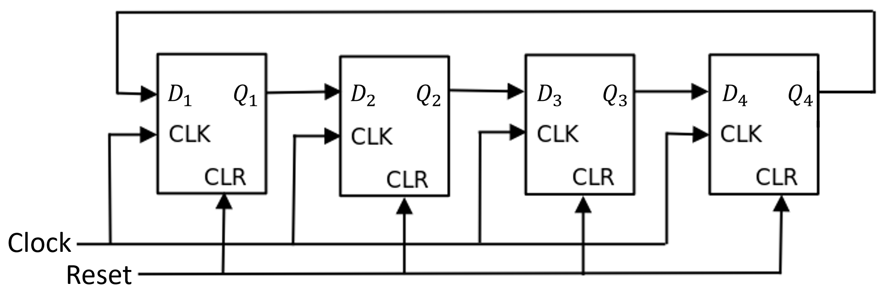
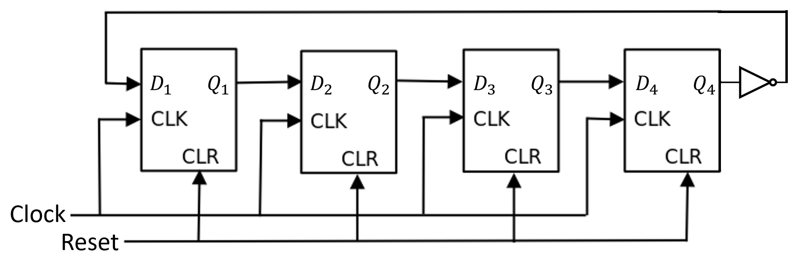

# [Circular Shift](../../../combinational-logic/shift/shift.md#rotate-circular-shift) Register
||[Ring Counter](#ring-counter)|[Johnson Counter](#johnson-counter)|
|:---:|:---:|:---:|
|**[Feedback](../../sequential-logic.md#feedback)**|Non-Inverted|Inverted|
|**Number of States ($n$-bit)**|$m=n$|$m=2n$|
- ### Signals
    - $clk=\href{../../sequential-logic.md#clk}{\text{Clock input}}$
    - $Reset$
    - $D=\text{Data input}$
    - $Q=\text{Data output}$
- ### [State-Transition Table](../../finite-state-machine/representations-of-finite-state-machine.md#state-transition-table)
    |Current State|Next State|
    |:---:|:---:|
    |$S_i$ ($0\leq i<m-1$)|$S_{i+1}$|
    |$S_{m-1}$|$S_0$|
- ### Uses [SISO Shift Register](../../shift-register/shift-register.md#serial-in-serial-out-siso) ([D Flip-Flop](../../memory-element/flip-flop.md#d-flip-flop-data))

# Ring Counter
- ### Encoding：[One-Hot](../../../../digital-electronics-and-logic-design.md#one-hot)
- ### State ($n$-bit)：$S_i=\underbrace{0\cdots 0}_{i}\,1\,\underbrace{0\cdots 0}_{n-i-1}$
- ### Logic Diagram ($4$-bit)
    
- ### [Truth Table](../../../../digital-electronics-and-logic-design.md#truth-table)
    |Action|$Reset$|$clk$|$Q_i$|
    |:---:|:---:|:---:|:---:|
    |Reset|$1$|X|$\begin{cases} 1 & i=1 \\ 0 & i \neq 1 \end{cases}$|
    |Hold|$0$|$0/1/\downarrow$|$Q_i$|
    |Shift|$0$|$\uparrow$|$\begin{cases} Q_m & i=1 \\ Q_{i-1} & i \neq 1 \end{cases}$|
- ### State Table ($4$-bit)
    |State|Data Output ($Q_1 Q_2 Q_3 Q_4$)|
    |:---:|:---:|
    |$S_0$|1000|
    |$S_1$|0100|
    |$S_2$|0010|
    |$S_3$|0001|

# Johnson Counter
- ### State ($n$-bit)：$S_i=\begin{cases}{\underbrace{1\cdots 1}_{i}\,\underbrace{0\cdots 0}_{n-i}}&{\text{if }0\leq i\leq n}\\ {\underbrace{0\cdots 0}_{i-n}\,\underbrace{1\cdots 1}_{2n-i}}&{\text{if }n<i< 2n}\end{cases}$
- ### Logic Diagram ($4$-bit)
    
- ### [Truth Table](../../../../digital-electronics-and-logic-design.md#truth-table)
    |Action|$Reset$|$clk$|$Q_i$|
    |:---:|:---:|:---:|:---:|
    |Reset|$1$|X|$0$|
    |Hold|$0$|$0/1/\downarrow$|$Q_i$|
    |Shift|$0$|$\uparrow$|$\begin{cases} \overline{Q_m} & i = 1 \\ Q_{i-1} & i \neq 1 \end{cases}$|
- ### State Table ($4$-bit)
    |State|Data Output ($Q_1 Q_2 Q_3 Q_4$)|
    |:---:|:---:|
    |$S_0$|0000|
    |$S_1$|1000|
    |$S_2$|1100|
    |$S_3$|1110|
    |$S_4$|1111|
    |$S_5$|0111|
    |$S_6$|0011|
    |$S_7$|0001|
