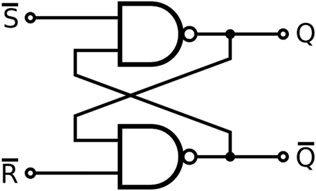
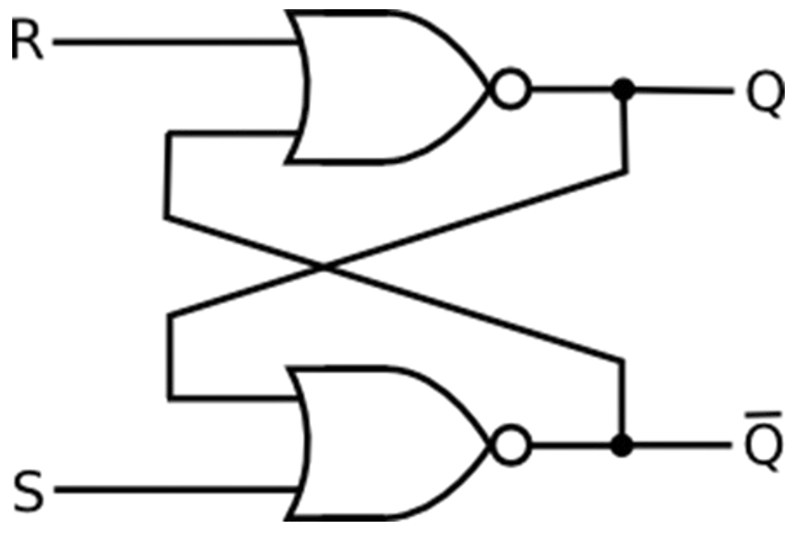
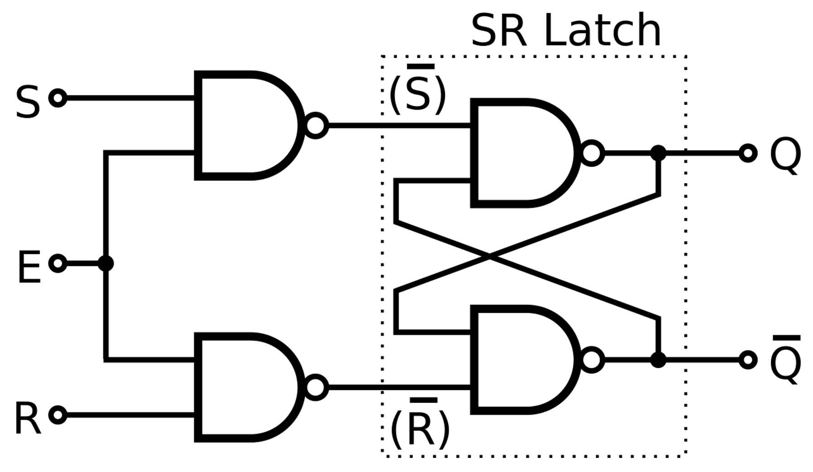
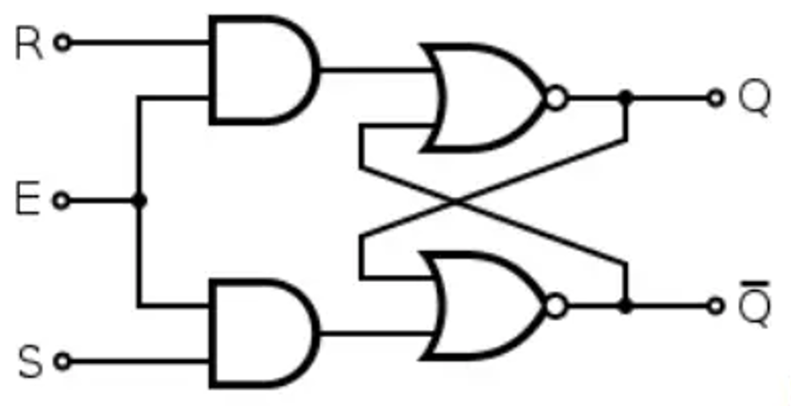

# Signals
- ### $Q=\text{Present state}$
- ### $Q_{next}=\text{Next state}$
- ### $E=\text{Enable}$

# SR Latch (Set-Reset)
- ### Signals
    - Input：$S,~R,~Q$
    - Output：$Q_{next}$
- ### Logic Diagram
    - #### NAND SR Latch
        
    - #### NOR SR Latch
        
- ### [Truth Table](../../../digital-electronics-and-logic-design.md#truth-table)
    |Action|$S$|$R$|$Q_{next}$|
    |:---:|:---:|:---:|:---:|
    |Hold|0|0|$Q$|
    |Reset|0|1|0|
    |Set|1|0|1|
    |Not Allowed|1|1|Invalid|

# Gated SR Latch
- ### Signals
    - Input：$E,~S,~R,~Q$
    - Output：$Q_{next}$
- ### Logic Diagram
    - #### NAND Gated SR Latch
        
    - #### NOR Gated SR Latch
        
- ### [Truth Table](../../../digital-electronics-and-logic-design.md#truth-table)
    |Action|Enable ($E$)|$S$|$R$|$Q_{next}$|
    |:---:|:---:|:---:|:---:|:---:|
    |Hold|0|X|X|$Q$|
    |Hold|1|0|0|$Q$|
    |Reset|1|0|1|0|
    |Set|1|1|0|1|
    |Not Allowed|1|1|1|Invalid|

# D Latch (Data)
- ### Signals
    - Input：$E,~D,~Q$
      - $E=\text{Enable}$
    - Output：$Q_{next}$
- ### Logic Diagram
    - #### Logic Diagram (NAND、NOR)
- ### [Truth Table](../../../digital-electronics-and-logic-design.md#truth-table)
    |Action|$E$|$Q_{next}$|
    |:---:|:---:|:---:|
    |Hold|0|$Q$|
    |Data|1|$D$|
