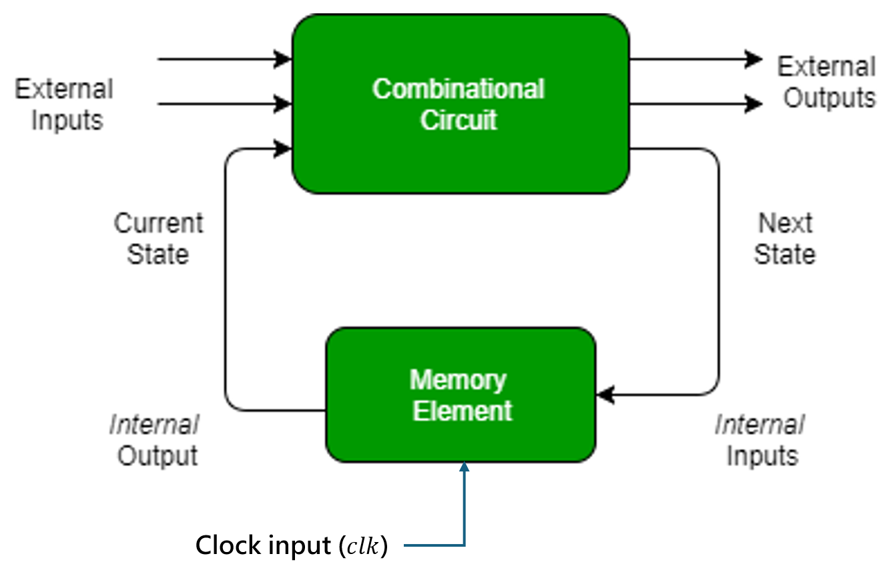
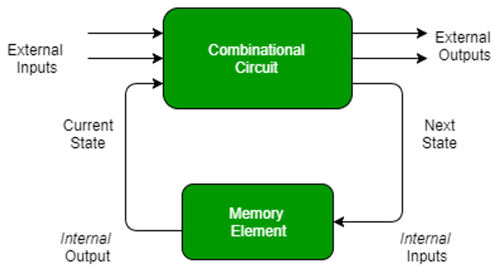
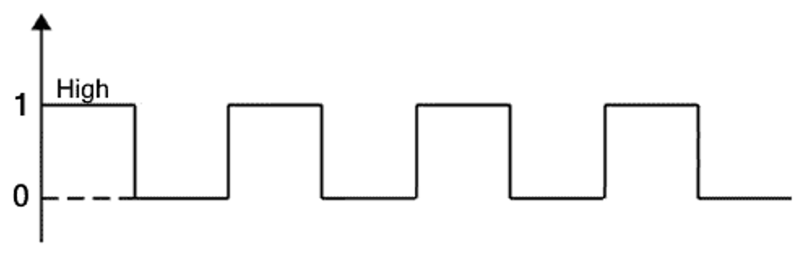
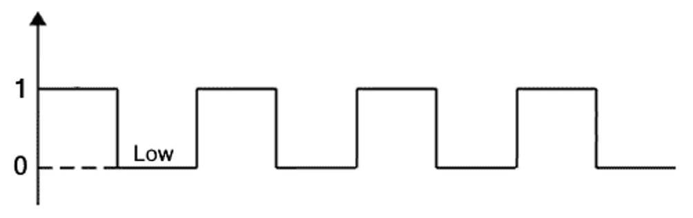
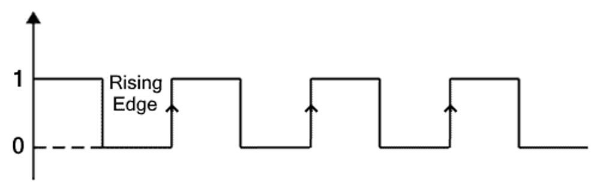
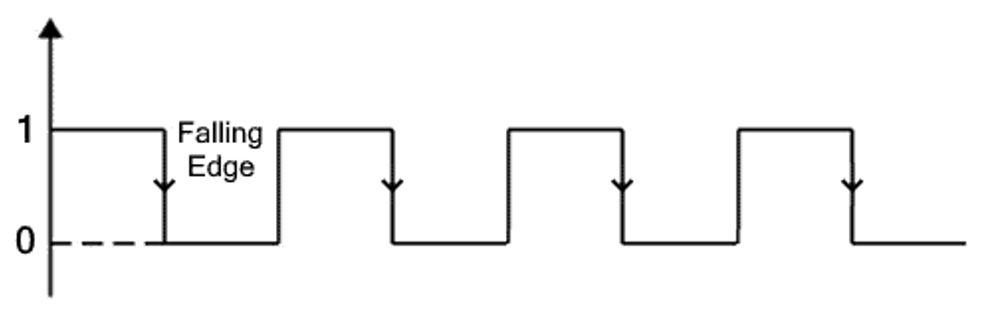

# Sequential Circuit
||Synchronous Sequential Circuit|Asynchronous Sequential Circuit|
|:---:|:---:|:---:|
|**Sequential Circuit**|||
|**Clock Signal**|Present (global clock controls all memory elements)|Absent or uses independent clocks|
|**Memory Element**|[Flip-Flop](./memory-element/flip-flop.md)|[Latch](./memory-element/latch.md) or Delay Element|
|**Triggering Method**|[Edge-triggering](#edge-triggering)|[Level-triggering](#level-triggering) or direct input change|
|**Design Complexity**|Easier, Predictable, Reliable|More difficult, Prone to [race conditions]() and hazards|
|**Speed**|Slower (limited by maximum clock frequency)|Faster (no waiting for clock edges)|
|**Power Consumption**|Higher (due to continuous clock switching)|Lower (switches only when inputs change)|

# Memory Element
- ### [Flip-Flop (FF)](./memory-element/flip-flop.md)
- ### [Latch](./memory-element/latch.md)

# [Counter](./counter/counter.md)
- ### [Binary Counter](./counter/binary-counter.md)
- ### [Circular Shift Register](./counter/circular-shift-register/circular-shift-register.md)

# [Shift Register](./shift-register/shift-register.md)
- ### [Serial-In Serial-Out (SISO)](./shift-register/shift-register.md#serial-in-serial-out-siso)
- ### [Serial-In Parallel-Out (SIPO)](./shift-register/shift-register.md#serial-in-parallel-out-sipo)
- ### [Parallel-In Serial-Out (PISO)](./shift-register/shift-register.md#parallel-in-serial-out-piso)
- ### [Parallel-In Parallel-Out (PIPO)](./shift-register/shift-register.md#parallel-in-parallel-out-pipo)
- ### [Linear Feedback Shift Register (LFSR)](./shift-register/shift-register.md#linear-feedback-shift-register-lfsr)
- ### [Circular Shift Register](./counter/circular-shift-register/circular-shift-register.md)

# [Finite State Machine (FSM)](./finite-state-machine/finite-state-machine.md)
- ### [Finite State Acceptor](./finite-state-machine/types-of-finite-state-machine/finite-state-acceptor.md)
- ### [Finite-State Transducer (FST)](./finite-state-machine/types-of-finite-state-machine/finite-state-transducer.md)
- ### [Representations of Finite State Machine](./finite-state-machine/representations-of-finite-state-machine.md)

# Triggering Methods
- ### Level-triggering
    |Level-triggering|Definition|Clock signal|
    |:---:|:---:|:---:|
    |**High Level-triggering**|active while the signal is high (1)||
    |**Low Level-triggering**|active while the signal is low (0)||
    - Memory Element：[Latch](./memory-element/latch.md)
- ### Edge-triggering
    |Level-triggering|Definition|Clock signal|
    |:---:|:---:|:---:|
    |**Rising Edge-triggering (Positive Edge-triggering)**|active on the transition from low to high (0 $\to$ 1)||
    |**Falling Edge-triggering (Negative Edge-triggering)**|active on the transition from high to low (1 $\to$ 0)||
    - Memory Element：[Flip-Flop](./memory-element/flip-flop.md)

# Input Signals
- ### Clock input ($clk$)
    - Clock Domain Crossing (CDC)
- ### Clear ($Clr$)：Clear the State
    |$Clr$|Action|
    |:---:|:---:|
    |$0$|Hold|
    |$1$|Reset|
    - Clear Negative：$ClrN=\overline{Clr}$
- ### [Feedback](../../../electronics/electronics.md#feedback)：part of the output is fed back to the input {#feedback}

# Clock Gating
- ### Clock Gating：When a register is not in use, turn off its clock to reduce dynamic power.
    - Cons：potential timing issues and synchronization problems
- ### Input Signals
    - ### $clk=\text{Clock input}$
    - ### $en=\text{Enable}$
- ### Boolean Expression：$output=clk\cdot en$
- ### [Truth Table](../../digital-electronics-and-logic-design.md#truth-table)
    |$en$|$output$|
    |:---:|:---:|
    |$0$|$0$|
    |$1$|$clk$|

