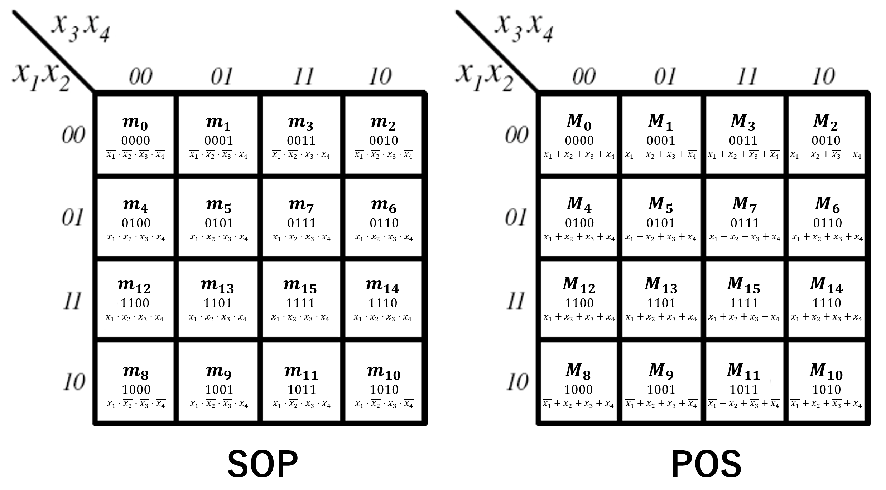

# Standard Form
- ### Sum-of-Products (SOP)：an expression formed by adding (ORing) two or more [product terms](#product-term) {#sop}
    - #### Product Term：made of literals multiplied (ANDing) together {#product-term}
- ### Product-of-Sums (POS)：an expression formed by multiplying (ANDing) two or more [sum terms](#sum-term) {#pos}
    - #### Sum Term：made of literals added (ORing) together {#sum-term}
- ### Example (3 variables)
    - #### Example (SOP)
        - SOP：$F=\overline{A}B + BC + AC$
        - Product Term：$\overline{A}B,~BC,~AC$
    - #### Example (POS)
        - POS：$F=\left(\overline{A}+B\right) \cdot \left(B+C\right) \cdot \left(A+C\right)$
        - Sum Term：$\left(\overline{A}+B\right),~\left(B+C\right),~\left(A+C\right)$

# Canonical Normal Form
- ### Variables in the Boolean Function：$x_1 ,~\cdots,~ x_n$ {#variables-in-the-boolean-function}
    - #### Number of Variables = $n$
    - #### Number of Minterms/Maxterms = $2^n$
- ### Canonical [SOP](#sop)：a [SOP](#sop) in which every [product term](#product-term) is a [minterm](#minterm) {#canonical-sop}
    - #### Minterm：a [product term](#product-term) that contains all the [variables in the Boolean function](#variables-in-the-boolean-function) exactly once, either complemented or uncomplemented {#minterm}
- ### Canonical [POS](#pos)：a [POS](#pos) in which every [sum term](#sum-term) is a [maxterm](#maxterm) {#canonical-pos}
    - #### Maxterm：a [sum term](#sum-term) that contains all the [variables in the Boolean function](#variables-in-the-boolean-function) exactly once, either complemented or uncomplemented {#maxterm}
- ### Indexing
    |Term|Designated Output|Definition|
    |:---:|:---:|:---:|
    |Minterm ($m_i$)|$1$|An AND operation involving all variables evaluates to `1` for exactly one input combination|
    |Maxterm ($M_i$)|$0$|An OR operation involving all variables evaluates to `0` for exactly one input combination|
    - #### $\text{value}\left(x_j\right)$
        |Literals|$\text{value}_m\left(x_j\right)$|$\text{value}_M\left(x_j\right)$|
        |:---:|:---:|:---:|
        |$x_j$|$1$|$0$|
        |$\overline{x_j}$|$0$|$1$|
    - #### Minterm：$m_i$
        - #### Minterm Index：$i=\sum\limits_{j=1}^n{2^{n-j}\text{value}_m\left(x_j\right)}$
    - #### Maxterm：$M_i$
        - #### Maxterm Index：$i=\sum\limits_{j=1}^n{2^{n-j}\text{value}_M\left(x_j\right)}$
    - #### Indexing Boolean Function
        - Canonical SOP：$F=\sum{m\left(i_1,~\cdots,~i_k\right)} = m_{i_1} + \cdots + m_{i_k}$
        - Canonical POS：$F=\prod{M\left(i_1,~\cdots,~i_k\right)} = M_{i_1} \cdots M_{i_k}$
- ### Example (3 variables)
    - #### Example (Canonical SOP)
        - Minterm：$m_5=A\overline{B}C$
            - Minterm Index：$5_{10}=101_2$
        - Canonical SOP：$F=\sum{m\left(3,~5,~7\right)} = m_3+m_5+m_7 = \overline{A}BC + A\overline{B}C + ABC$
    - #### Example (Canonical POS)
        - Maxterm：$M_5 = \left(\overline{A}+B+\overline{C}\right)$
            - Maxterm Index：$5_{10}=101_2$
        - Canonical POS：$F=\prod{M\left(3,~5,~7\right)} = M_3 \cdot M_5 \cdot M_7 = \left(A+\overline{B}+\overline{C}\right) \cdot \left(\overline{A}+B+\overline{C}\right) \cdot \left(\overline{A}+\overline{B}+\overline{C}\right)$

# Karnaugh map (K-map)
- ### Construction
    |Input|Construction|
    |:---:|:---:|
    |[Canonical SOP](#canonical-sop)|Fill the cells corresponding to the [Minterm Indices](#indexing) with `1`|
    |[Canonical POS](#canonical-pos)|Fill the cells corresponding to the [Maxterm Indices](#indexing) with `0`|
    - The row and column indices are ordered in [Gray code](digital-electronics-and-logic-design.md#gray-code)
- ### Grouping
    |Output Form|Grouping|Output|
    |:---:|:---:|:---:|
    |Simplified [SOP](#sop)|Each group consists of adjacent `1`s, Every `1` must be covered by at least one group, Ignoring `0`s|Convert each group into a [product term](#product-term), then add (OR) all [product terms](#product-term) together|
    |Simplified [POS](#pos)|Each group consists of adjacent `0`s, Every `0` must be covered by at least one group, Ignoring `1`s|Convert each group into a [sum term](#sum-term), then multiply (AND) all [sum terms](#sum-term) together|
    - #### Group Size
        - The total cell count per group must be $2^n$
        - Make groups as large as possible to minimize the expression
    - #### Group Shape
        - Groups must be rectangles
        - Groups must be horizontal or vertical but cannot be diagonal
    - #### Minimal Coverage
        - Use the minimum number of groups needed to minimize the expression
        - Eliminate redundant groups
    - #### Overlapping Groups
        - Cells can be reused across multiple groups
    - #### Wrap-around Adjacency
        - The leftmost and rightmost columns are adjacent to each other
        - The top and bottom rows are adjacent to each other
        - Groups can wrap around the edges of the K-map
    - #### Don't Care Conditions (X)
        - Can be treated as either `0` or `1` to form larger groups, or ignored if they do not help
- ### Example (4 variables)
    

# Quine-McCluskey Method
- ### Prime Implicant
- ### Prime Implicant Chart

# Consensus Theorem
- ### Consensus Term
- ### Form
    |Form|Boolean Expression|Consensus Term|
    |:---:|:---:|:---:|
    |[SOP Form](#sop)|$xy+\overline{x}z+yz=xy+\overline{x}z$|$yz$|
    |[POS Form](#pos)|$\left(x+y\right) \left(\overline{x}+z\right) \left(y+z\right)=\left(x+y\right) \left(\overline{x}+z\right)$|$\left(y+z\right)$|
