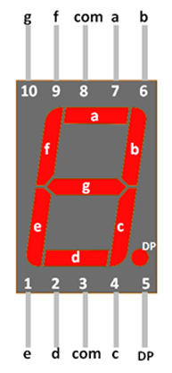

# Types of Diode
- ### Zener Diode
    - ### 齊納效應
    - ### 穩壓
- ### Light-Emitting Diode (LED)
- ### Photodiode
- ### Varicap Diode (Varactor Diode)

# Diode

# Seven-Segment Display
- ### Pinout
    
- ### Segments
    - A, B, C, D, E, F, G
    - Decimal Point (DP)
- ### Common
    |Common|Common Pin (com)|Segments|
    |:---:|:--:|:---:|
    |Common Anode (CA)|Anode (VCC)|Cathode (GND)|
    |Common Cathode (CC)|Cathode (GND)|Anode (VCC)|
