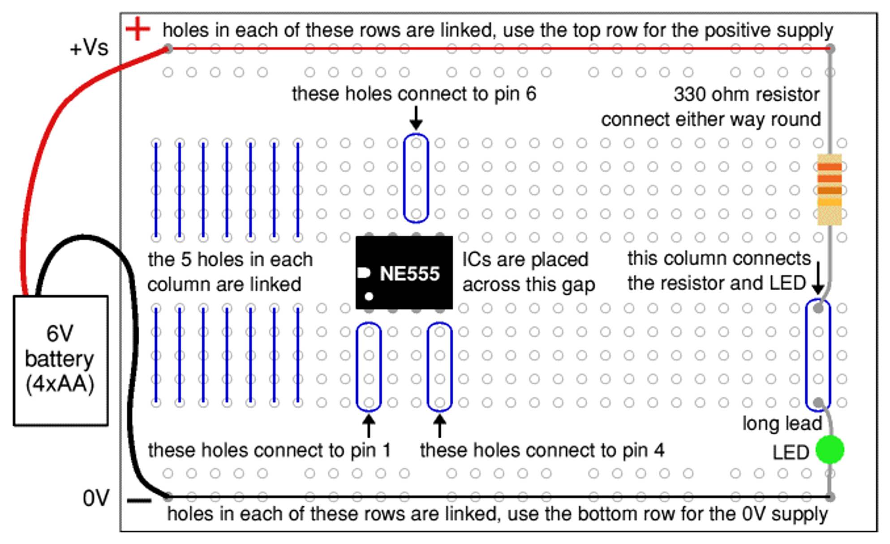
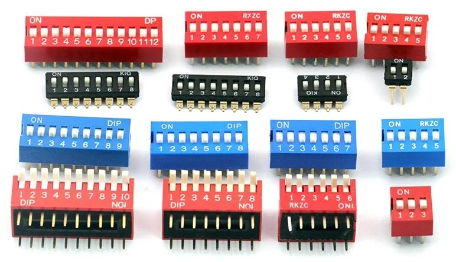
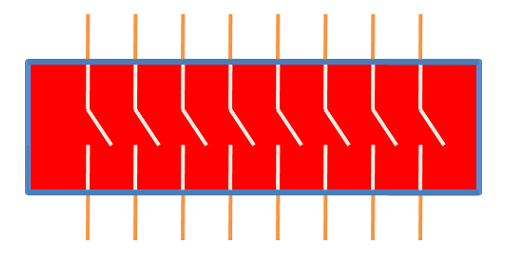

# Types of Electronic Component
- ### Active/Passive
    - ### Active Component：[Transistor](#transistor), [Diode](./diode/diode.md), Vacuum Tube
    - ### Passive Component：Resistor, Capacitor, Inductor, Transformer
- ### Linear/Nonlinear
    - ### [Linear Component](../analog-electronics/immittance.md#linear-component)：[Resistor](../analog-electronics/immittance.md#resistor), [Capacitor](../analog-electronics/immittance.md#capacitor), [Inductor](../analog-electronics/immittance.md#inductor)
    - ### Nonlinear Component：[Transistor](#transistor), [Diode](./diode/diode.md)

# Power and Ground Pins
- ### Voltage Common Collector (VCC)
- ### Voltage Drain-Drain (VDD)
- ### Voltage Source-Source (VSS)
- ### Voltage Emitter-Emitter (VEE)
- ### Ground (GND)

# [General-Purpose Input/Output (GPIO)](./gpio/gpio.md)
- ### [Input Mode](./gpio/gpio.md#input-mode)
- ### [Output Mode](./gpio/gpio.md#output-mode)
- ### [Alternate Function](./gpio/gpio.md#alternate-function)
- ### [Analog Mode](./gpio/gpio.md#analog-mode)

# Power Supply Unit
- ### 交流電 $\to$ 降壓 $\to$ 整流 $\to$ 濾波 $\to$ 穩壓 $\to$ 直流電
- ### Rectifier
- ### Filter

# Conductor
- ### Conductor
- ### [Semiconductor](./semiconductor/semiconductor.md)
    - #### [Semiconductor Manufacturing Process](./semiconductor/semiconductor-manufacturing-process.md)
    - #### [Integrated Circuits (IC, Chip)](./semiconductor/integrated-circuits/integrated-circuits.md)
- ### Insulator

# Transistor
- ### [Bipolar Junction Transistor (BJT)](./transistor/bipolar-junction-transistor/bipolar-junction-transistor.md)
    - PNP Transistor
    - NPN Transistor
- ### [Field-Effect Transistor (FET)](./transistor/field-effect-transistor/field-effect-transistor.md)
    - #### Junction FET (JFET)
        - P-channel JFET
        - N-channel JFET 
    - #### Insulated Gate FET (IGFET)
        - [Metal-Oxide-Semiconductor FET (MOSFET)](./transistor/field-effect-transistor/mosfet.md)
        - High Electron Mobility Transistor (HEMT)
    - #### Metal Semiconductor FET (MESFET)

# Breadboard

# Printed Circuit Board (PCB)
- ### High Density Interconnect PCB (HDI PCB)
- ### [Printed Circuit Board Assembly](#printed-circuit-board-assembly-1)

# Single-Board Computer (SBC)
- ### Raspberry Pi

# [DIP](./semiconductor/semiconductor-manufacturing-process.md#dual-in-line-package-dip) Switch

- ### Pinout (8 position)
    

# Printed Circuit Board Assembly
- ### Through Hole Technology (THT)
    - #### Plating Through Hole (PTH)
    - #### Non Plating Through Hole (NPTH)
- ### Vertical Interconnect Access (VIA)
    - #### Through-Hole Via
    - #### Blind Via
    - #### Buried Via
    - #### Through Silicon Via (TSV)
- ### Surface-Mount Technology (SMT)

# Electrical Wiring and Cable
- ### DuPont Jumper Wire

