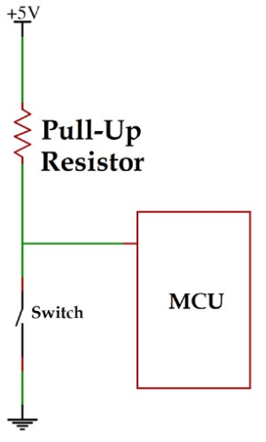
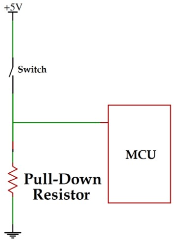

# Input Mode
- ### Floating Input
- ### Pull-up Input
- ### Pull-down Input
- ### Analog Input

# Output Mode
- ### Push-Pull Output
    - #### Sink Current
    - #### Source Current
- ### Open-Drain Output
    - need [Pull-up Resistor](#pull-up-resistor)

# Alternate Function

# Analog Mode

# Pull-up/Pull-down Resistor
- ### Pull-up Resistor
    
- ### Pull-down Resistor
    

# Wired-AND
