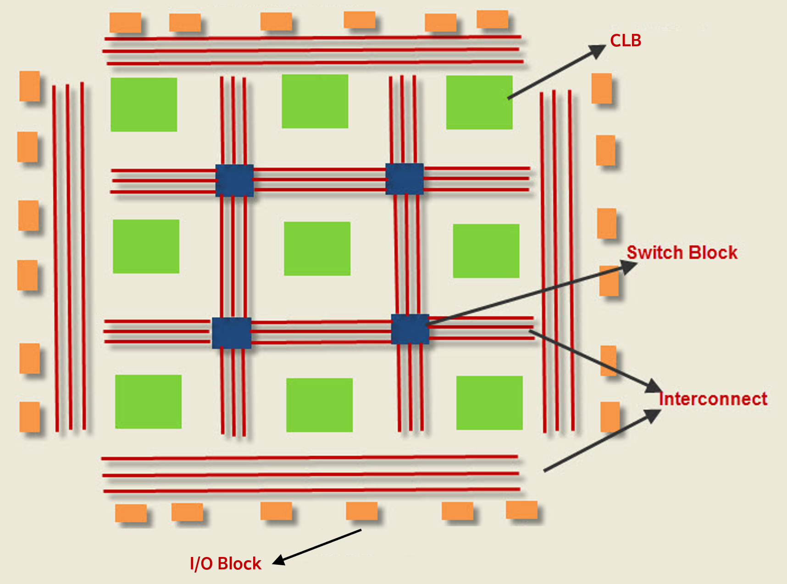
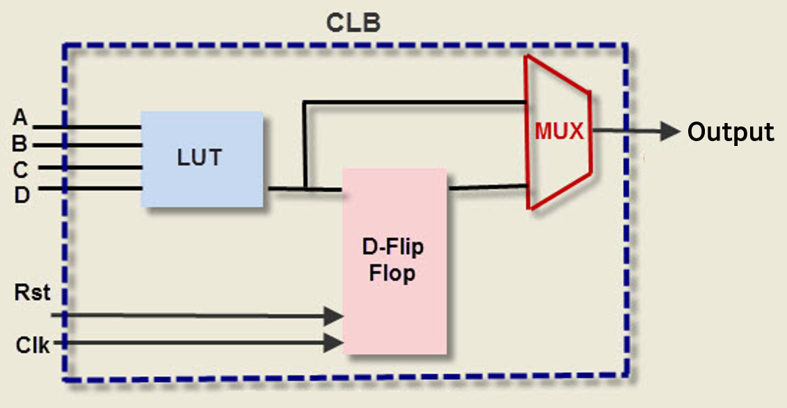
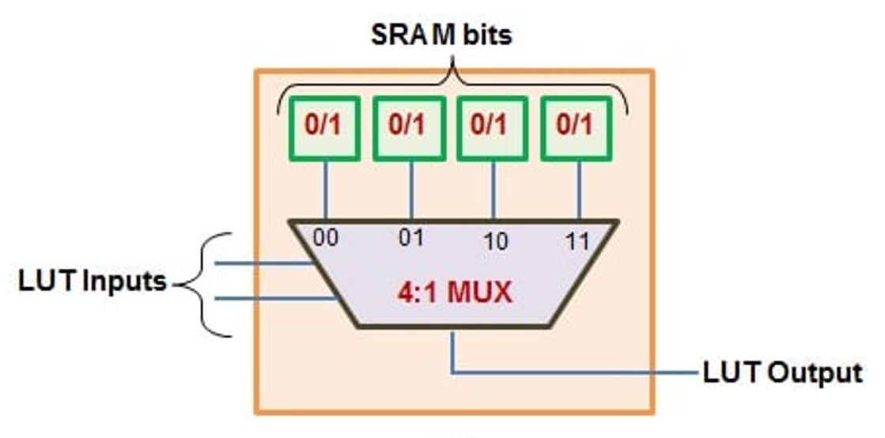

# Field-Programmable Gate Array (FPGA)

# FPGA Architecture

- ### [Configurable Logic Block (CLB)](#configurable-logic-block-clb-1)
- ### Switch Block
- ### Programmable Interconnect
- ### I/O Block

# Configurable Logic Block (CLB)

- ### Look-Up Table (LUT)
    - Signal
        ||Number of lines|Lines|
        |:---:|:---:|:---:|
        |**SRAM Bits**|$2^n$|$I_0,~I_1,~\cdots,~I_{2^n-1}$|
        |**LUT Inputs (Selects)**|$n$|$S_0,~S_1,~\cdots,~S_{n-1}$|
        |**LUT Outputs**|$1$|$Y$|
    - [Logic Diagram](/stem/physics-and-chemistry/electricity/electronic-circuit/digital-electronics-and-logic-design/digital-electronics-and-logic-design.md#logic-diagram) (4-bit)
        
        
    - Uses [Multiplexer (MUX)](/stem/physics-and-chemistry/electricity/electronic-circuit/digital-electronics-and-logic-design/digital-electronics/combinational-logic/mux-and-demux/multiplexer.md)
- ### [D Flip-Flop](/stem/physics-and-chemistry/electricity/electronic-circuit/digital-electronics-and-logic-design/digital-electronics/sequential-logic/memory-element/flip-flop.md#d-flip-flop-data)
- ### [Multiplexer (MUX)](/stem/physics-and-chemistry/electricity/electronic-circuit/digital-electronics-and-logic-design/digital-electronics/combinational-logic/mux-and-demux/multiplexer.md)
